# Session 01 — Introduction to Backend Development (Study Notes)

> **Course:** Backend Development with .NET — Andalusia Academy
> **Session:** 01 · Week 1 · 2 hours
> **Source deck:** <https://seifmansour.com/courses/dotnet-backend/1>
> This is an **introduction**. Each topic here is covered in depth in later sessions.

> Diagrams are written in **Mermaid**. They render on GitHub, Azure DevOps Wiki, Notion, and in VS Code with the *Markdown Preview Mermaid Support* extension.

---

## Table of Contents

1. [Session Goals & Agenda](#1-session-goals--agenda)
2. [What is a Backend?](#2-what-is-a-backend)
3. [The Client–Server Model & HTTP](#3-the-clientserver-model--http)
4. [Beyond HTTP — Other Protocols](#4-beyond-http--other-protocols)
5. [Stateless vs Stateful](#5-stateless-vs-stateful)
6. [What is REST?](#6-what-is-rest)
7. [Other API Styles](#7-other-api-styles)
8. [Where .NET Fits In](#8-where-net-fits-in)
9. [The Course Project](#9-the-course-project)
10. [Summary](#10-summary)
11. [Before Next Session](#11-before-next-session)

---

## 1. Session Goals & Agenda

By the end of the session you should be able to:

- Explain the difference between **frontend** and **backend**.
- Describe the **client–server model** and how **HTTP** connects them.
- Name the main **API styles** and explain why we start with **REST**.
- Know where **.NET** and **ASP.NET Core** fit.
- Picture the **Task Management API** you will build in this course.

| Time | Segment | Duration |
|---|---|---|
| 0:00 | What is a backend? | 20 min |
| 0:20 | Client–server model & HTTP | 20 min |
| 0:40 | REST vs other API styles | 20 min |
| 1:00 | Where .NET fits in | 15 min |
| 1:15 | Course project introduction | 20 min |
| 1:35 | Q&A and wrap-up | 25 min |

---

## 2. What is a Backend?

The **backend** is everything the user doesn't see: business logic, data storage, and security. The frontend **asks**, and the backend **answers**.

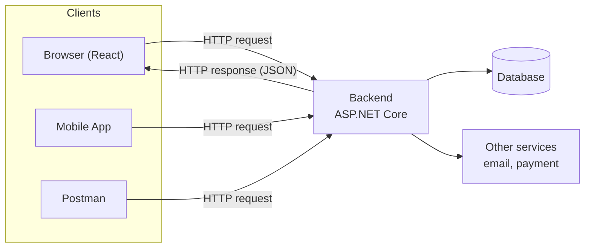

| Frontend | Backend |
|---|---|
| Shows the UI | Handles requests |
| Checks forms for a better user experience | **Really** validates the data |
| Hides buttons the user can't use | **Enforces** who can do what |
| — | Stores data in the database |
| — | Keeps secrets (passwords, API keys) |

**Why the backend can't trust the frontend:** anyone can skip your React app and call the API directly, for example with Postman or `curl`. So every rule must be checked on the backend.

> **Key concept:** *The frontend can be bypassed; the backend cannot.*

---

## 3. The Client–Server Model & HTTP

### 3.1 Request and response

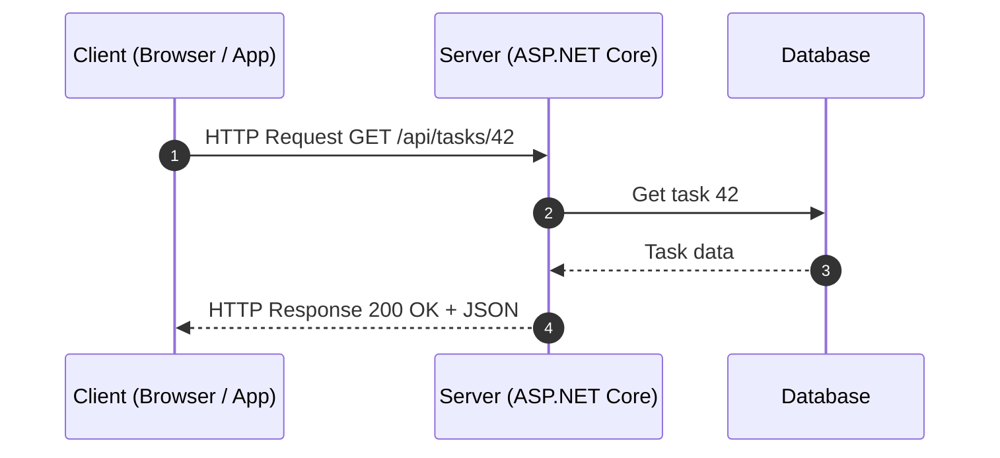

- The **client** always starts; the **server** responds.
- **HTTP is stateless:** the server doesn't remember earlier requests, so each request must carry what it needs (for example, a token). See §5.

### 3.2 What a request and a response look like

```http
POST /api/tasks HTTP/1.1
Content-Type: application/json

{ "title": "Prepare session 02 slides" }
```

```http
HTTP/1.1 201 Created
Content-Type: application/json

{ "id": 43, "title": "Prepare session 02 slides", "isCompleted": false }
```

A request has a **method + URL**, **headers**, and an optional **body**. A response has a **status code**, **headers**, and an optional **body**.

### 3.3 HTTP methods

| Method | Purpose | Example |
|---|---|---|
| `GET` | Read | `GET /api/tasks/42` |
| `POST` | Create | `POST /api/tasks` |
| `PUT` | Replace all fields | `PUT /api/tasks/42` |
| `PATCH` | Change some fields | `PATCH /api/tasks/42` (mark complete) |
| `DELETE` | Delete | `DELETE /api/tasks/42` |

### 3.4 Status codes

| Group | Meaning | Common codes |
|---|---|---|
| **2xx** | Success | `200 OK`, `201 Created`, `204 No Content` |
| **3xx** | Redirection | `301 Moved Permanently` |
| **4xx** | Client error (caller's fault) | `400 Bad Request`, `401 Unauthorized`, `403 Forbidden`, `404 Not Found` |
| **5xx** | Server error (our fault) | `500 Internal Server Error` |

> ⚠️ **Common mistake:** never return `200 OK` with an error message in the body. Use the correct status code.

*Sessions on HTTP methods and status codes go into full detail.*

---

## 4. Beyond HTTP — Other Protocols

HTTP is not the only protocol in a backend. One API call already uses several, and other parts of the system use others.

### 4.1 What happens when you call `https://api.example.com/api/tasks`

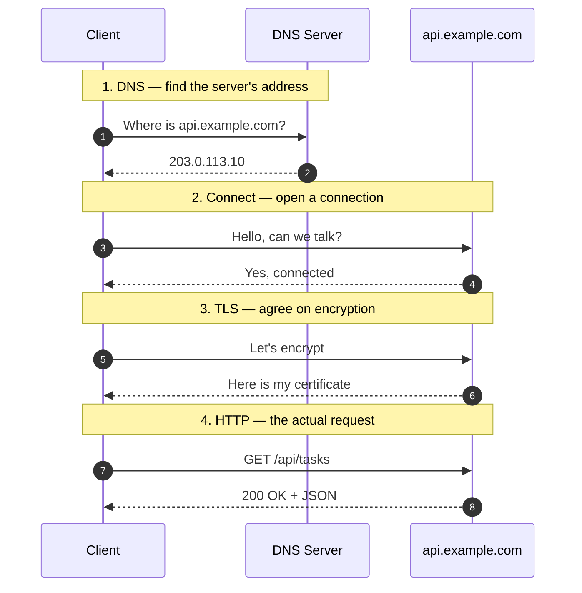

### 4.2 HTTPS = HTTP + TLS

- **TLS** encrypts the traffic and proves the server's identity.
- `https://` uses port **443**; `http://` uses port **80**.
- Always use HTTPS in production.

### 4.3 Protocols in one system

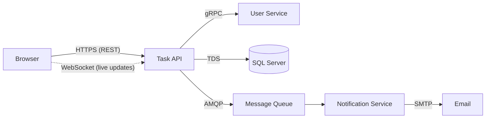

| Protocol | Used for |
|---|---|
| **HTTPS** | Calls from browser/mobile to the API |
| **WebSocket** | Live updates pushed to the browser |
| **gRPC** | Fast calls between internal services |
| **TDS** | Talking to SQL Server |
| **AMQP** | Sending messages through a queue |
| **SMTP** | Sending emails |

---

## 5. Stateless vs Stateful

- **Stateless:** the server **doesn't remember** you. Every request carries what's needed (e.g., a token).
- **Stateful:** the server **remembers** you (a session).

| Stateless ✉️ | Stateful 📞 |
|---|---|
| Like **letters**: each one must say who you are. | Like a **phone call**: the other side remembers the conversation. |

### 5.1 Login: session vs token

**Stateful: the server keeps a session**

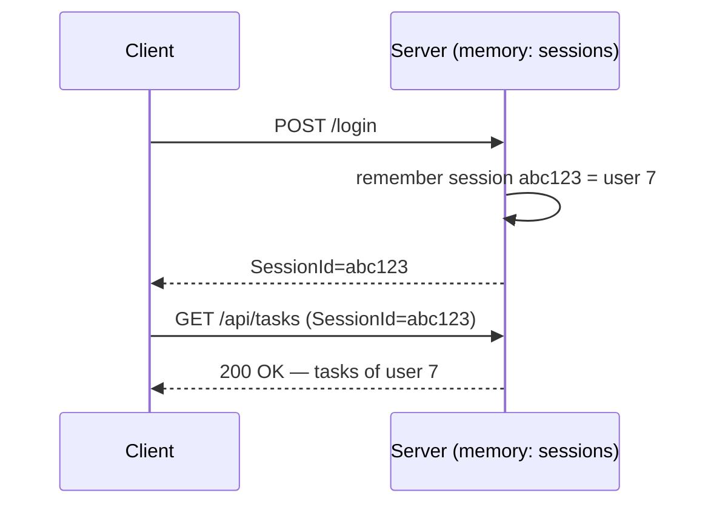

**Stateless: the client carries a token**

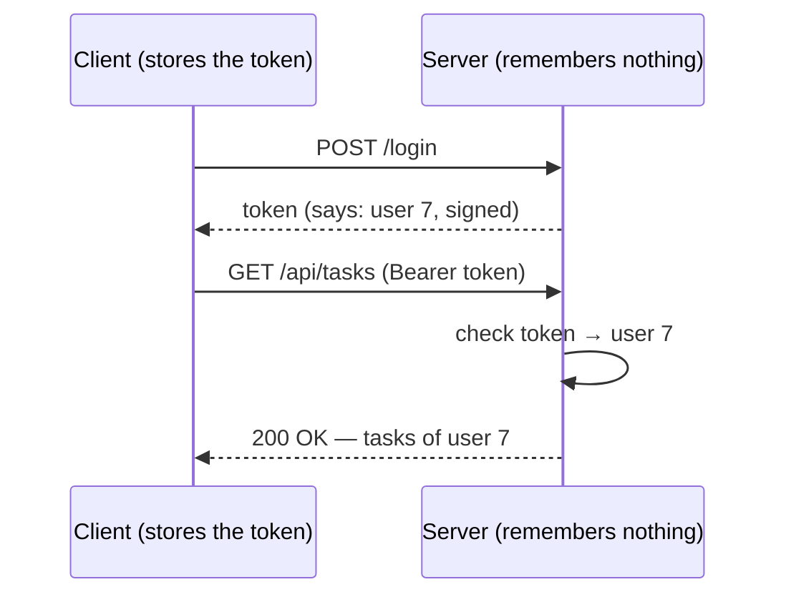

### 5.2 Why stateless is easier to scale

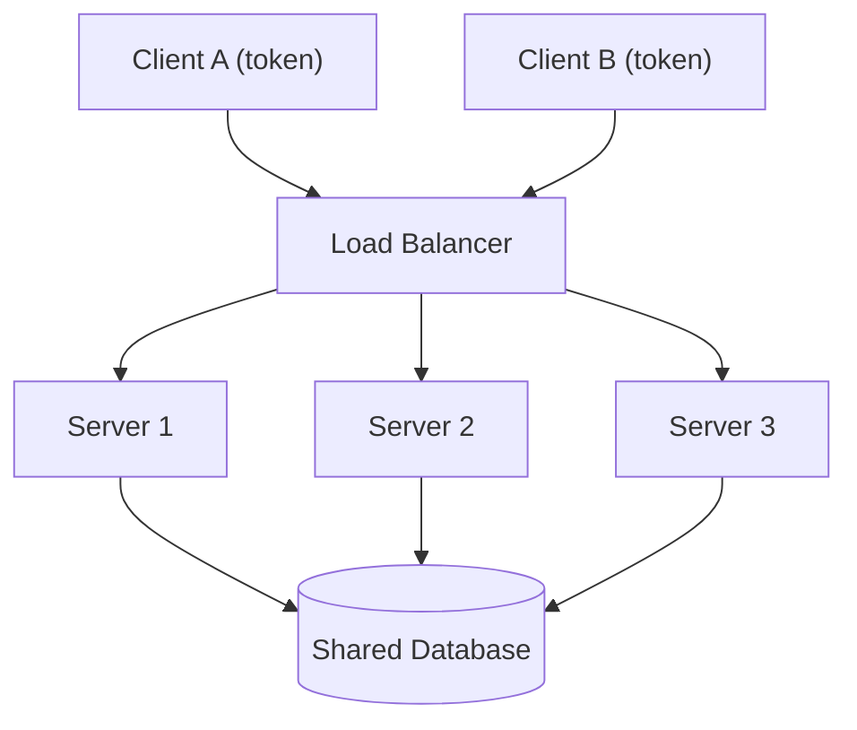

Any server can handle any request, so you can add servers or restart them and users won't notice. With **stateful** sessions, if a server crashes, its users lose their session.

| | Stateless | Stateful |
|---|---|---|
| Add more servers | ✅ Easy | ❌ Hard |
| A server crashes | ✅ No one notices | ❌ Users lose their session |
| Real-time (chat, live updates) | ❌ Not a good fit | ✅ Good fit |

---

## 6. What is REST?

**REST** is a style for designing APIs on top of HTTP. It's a set of rules, not a library.

**Main ideas:**

- **Resources:** everything is a resource with a URL, like `/api/tasks/42`.
- **HTTP methods are the verbs:** `GET` reads, `POST` creates, `DELETE` deletes.
- **Stateless:** each request carries everything needed.
- **Status codes** tell the result.
- **JSON** is the usual format.

### 6.1 Good vs bad URLs

| ❌ Bad | ✅ Good |
|---|---|
| `GET /getAllTasks` | `GET /api/tasks` |
| `POST /createTask` | `POST /api/tasks` |
| `POST /api/tasks/42/delete` | `DELETE /api/tasks/42` |
| `GET /api/tasks/open` | `GET /api/tasks?status=open` |

**Rule:** use **nouns** in the URL and let the **method** be the verb.

### 6.2 The Task API endpoints

| Method | URL | What it does | Success code |
|---|---|---|---|
| `GET` | `/api/tasks` | List tasks | `200` |
| `GET` | `/api/tasks/42` | Get one task | `200` (or `404`) |
| `POST` | `/api/tasks` | Create a task | `201` |
| `PUT` | `/api/tasks/42` | Update a task | `200` |
| `PATCH` | `/api/tasks/42` | Update some fields | `200` |
| `DELETE` | `/api/tasks/42` | Delete a task | `204` |

**Why REST first?** It maps directly onto HTTP, it's the most used style in jobs and public APIs, and its ideas carry over to every other style.

---

## 7. Other API Styles

A quick tour. You only need to know **what each one is for**.

### 7.1 GraphQL — "ask for exactly what you need"

One endpoint (`/graphql`). The client chooses the fields.

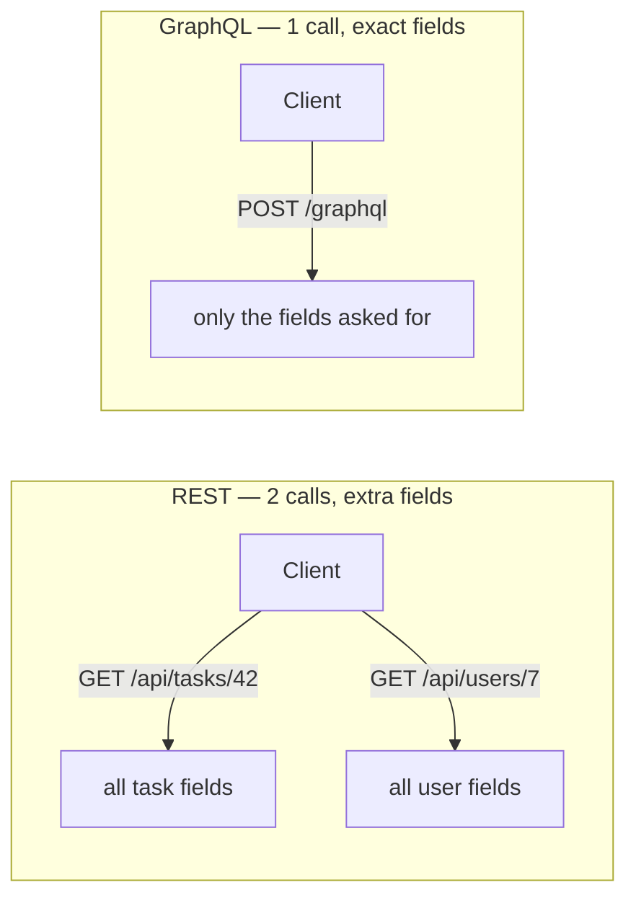

```graphql
query {
  task(id: 42) {
    title
    assignee { name }
  }
}
```

**Best for:** complex screens and mobile apps.

### 7.2 gRPC — "fast calls between services"

You define a contract in a `.proto` file. Messages are **binary**, so they're small and fast.

```protobuf
service TaskService {
  rpc GetTask (GetTaskRequest) returns (TaskReply);
}
```

**Best for:** communication between internal microservices.

### 7.3 WebSockets — "a connection that stays open"

Both sides can send messages at any time, and the server can **push** updates.

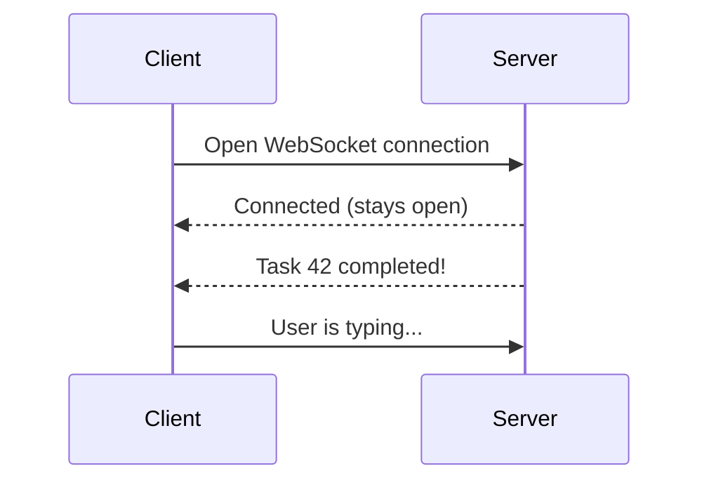

**Best for:** chat, live dashboards, notifications. In .NET we use **SignalR**.

### 7.4 Webhooks — "the other service calls you"

Instead of asking again and again, you give a service your URL, and it calls you when something happens.

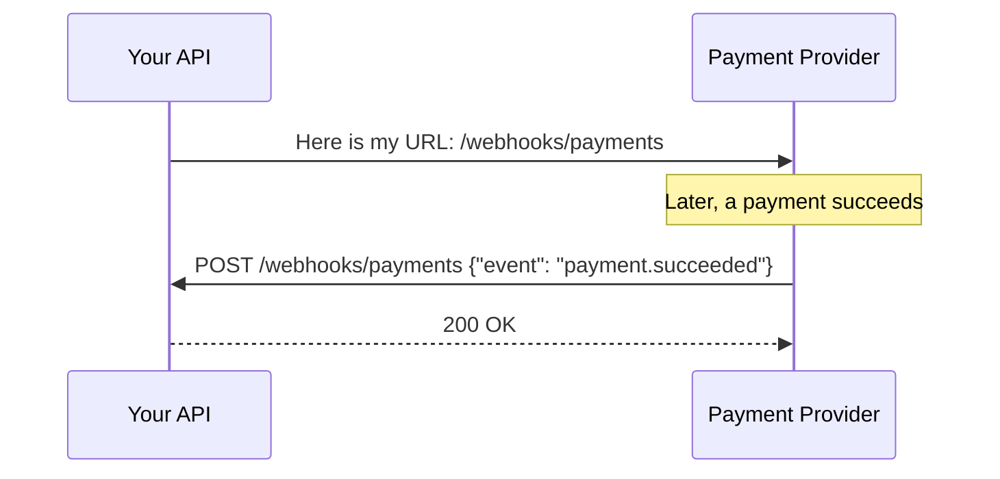

**Best for:** payment confirmations and events from GitHub or Azure DevOps.

### 7.5 Others you may hear about

| Style | In one line |
|---|---|
| **SOAP** | Older XML-based style, still used in banks, insurance and government systems |
| **SSE** (Server-Sent Events) | Server streams updates to the client in one direction (e.g., progress bars) |
| **Message queues** | Services send messages that others process later (RabbitMQ, Azure Service Bus) |

### 7.6 Comparison

| Style | Format | Direction | Best for |
|---|---|---|---|
| **REST** | JSON | Client → Server | Most web and mobile APIs |
| **GraphQL** | JSON | Client → Server | Complex UIs with flexible data needs |
| **gRPC** | Binary | Both | Service-to-service calls |
| **WebSockets** | Any | Both, always open | Real-time apps |
| **Webhooks** | JSON | Service → Your API | Event notifications |

### 7.7 Which one to choose?

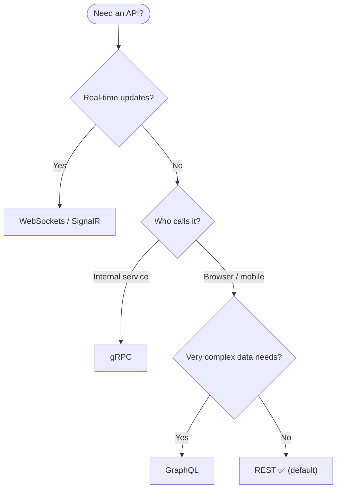

---

## 8. Where .NET Fits In

| Term | What it is |
|---|---|
| **.NET** | Free, cross-platform **runtime** (Windows, Linux, macOS) |
| **ASP.NET Core** | The **web framework** on top of .NET: routing, middleware, dependency injection |
| **C#** | The **language** |
| **.NET 8** | The **LTS** version used in this course |

> The old **.NET Framework** was Windows-only. Since **.NET Core** (2016), .NET runs everywhere.

**How a request flows through ASP.NET Core:**

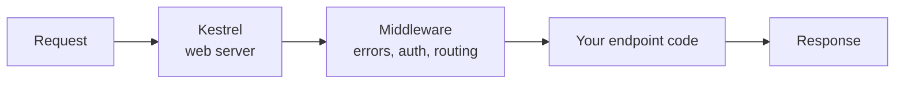

**Other backend frameworks:**

| Framework | Language | In short |
|---|---|---|
| Node.js / Express | JavaScript | Lightweight and fast to start, weak typing at scale |
| Django | Python | Rapid development, less control |
| Spring | Java | Enterprise-grade but verbose |
| **ASP.NET Core** | **C#** | **Strong typing, very fast, great tools. Our choice.** |

**Why .NET:** strong typing (errors caught at compile time), great tools (Visual Studio, Rider, VS Code), top performance, built-in dependency injection, and wide use in banks, healthcare and government.

---

## 9. The Course Project

You will build a **Task Management API**, adding one real feature each session.

| Sessions | Feature |
|---|---|
| 3–4 | Basic CRUD: create, read, update, delete tasks |
| 9–10 | Database with Entity Framework Core |
| 10 | Error handling |
| 11 | API versioning |
| 12 | Pagination, filtering, sorting |
| 13–15 | JWT authentication and roles |
| Later | Integration tests and deployment |

**By the end** you'll have a portfolio-ready API with authentication, full CRUD, filtering, versioning, clean errors, tests, and a production setup.

> ℹ️ The deck isn't consistent about the course length (20 sessions vs. 25) or the order of some sessions. Confirm with the instructor.

---

## 10. Summary

- The **backend** handles everything after the request leaves the browser, and it enforces the rules.
- **HTTP** is a stateless request/response protocol; **HTTPS** adds encryption.
- Other protocols (WebSocket, gRPC, SMTP, database protocols) work alongside HTTP.
- **Stateless** servers are easy to scale; **stateful** fits real-time.
- **REST** uses resources, HTTP methods and status codes. It's our starting point.
- **GraphQL**, **gRPC**, **WebSockets** and **webhooks** solve specific problems.
- **.NET 8 + ASP.NET Core + C#** is our platform.

---

## 11. Before Next Session

**Session 02: Environment Setup & Git**

- [ ] Install the **.NET 8 SDK** and check it with `dotnet --version`.
- [ ] Read the first two sections of "What is REST?" at <https://restfulapi.net>.
- [ ] Optional: try <https://httpbin.org>, a live API that echoes your requests back:

```bash
curl -i https://httpbin.org/get
```

```bash
curl -i https://httpbin.org/status/404
```

**Think about:**

1. Why can't the backend trust validation done in React?
2. Rewrite as REST: `GET /deleteTask?id=42` → ?
3. Which style fits a live chat app? Which fits a public weather API?

<details>
<summary>Answers</summary>

1. Anyone can call the API directly and skip the frontend.
2. `DELETE /api/tasks/42`
3. Chat → **WebSockets / SignalR**. Weather API → **REST**.

</details>
