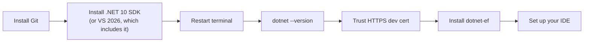
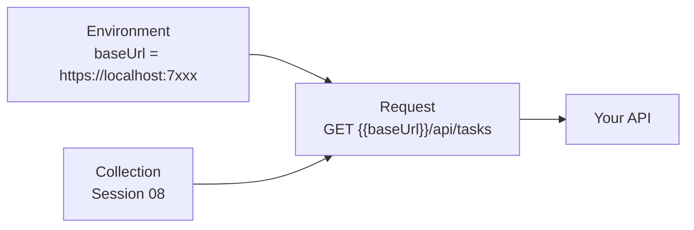
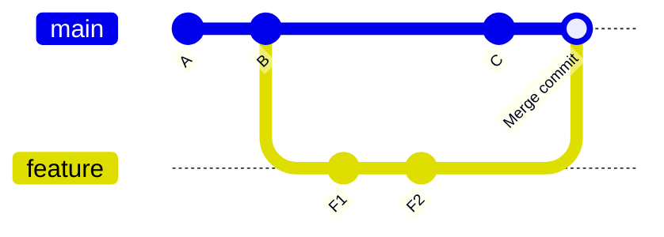
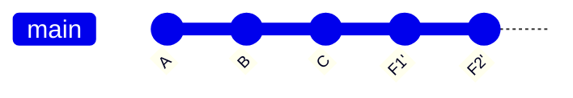
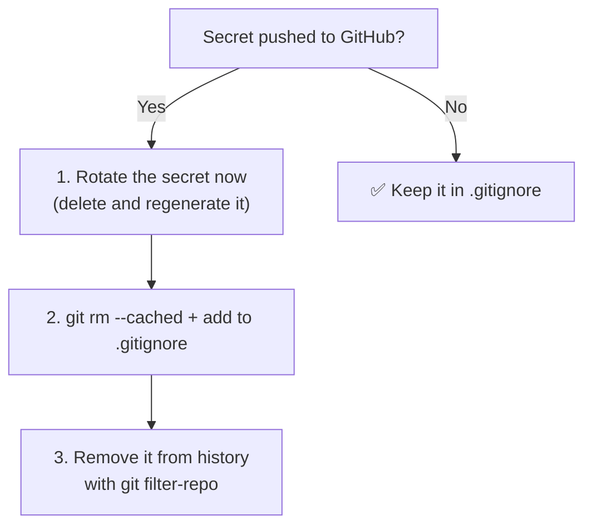
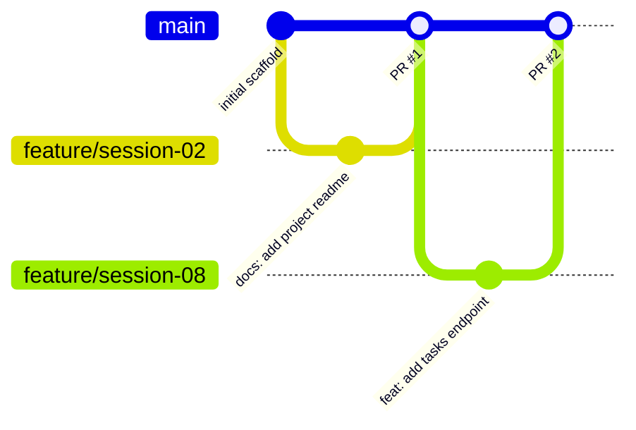

# Session 02 — Environment Setup & Git/GitHub (Study Notes)

> **Course:** Backend Development with .NET — Andalusia Academy
> **Session:** 02 · Week 1 · 2 hours
> **Source deck:** <https://seifmansour.com/courses/dotnet-backend/2>
> This is a **hands-on setup** session. By the end, your course repository is live on GitHub.

> ℹ️ **These notes use .NET 10, not .NET 8.** The deck was written for .NET 8, but .NET 8 support ends on **10 Nov 2026**. **.NET 10** is the current LTS release and is supported until **November 2028**. Everything in the course works the same way; the differences are flagged with 🆕.

> Diagrams are written in **Mermaid**. They render on GitHub, Azure DevOps Wiki, Notion, and in VS Code with the *Markdown Preview Mermaid Support* extension.

---

## Table of Contents

1. [Session Goals & Agenda](#1-session-goals--agenda)
2. [Dev Environment Setup](#2-dev-environment-setup)
3. [Option A — Visual Studio 2026](#3-option-a--visual-studio-2026)
4. [Option B — VS Code](#4-option-b--vs-code)
5. [Postman & API Testing](#5-postman--api-testing)
6. [Git Setup & Essentials](#6-git-setup--essentials)
7. [.NET-Specific Git Practices](#7-net-specific-git-practices)
8. [Creating Your First Repository](#8-creating-your-first-repository)
9. [Common Issues](#9-common-issues)
10. [Summary](#10-summary)
11. [Assignment](#11-assignment)
12. [Before Next Session](#12-before-next-session)
13. [Links](#13-links)

---

## 1. Session Goals & Agenda

By the end of the session you should have:

- A working **.NET 10** development environment, installed and checked.
- **Git** configured and your **GitHub** account connected to your machine.
- An understanding of **Git practices for .NET** and how to lay out the project.
- Your **first repository** created, committed, and pushed to GitHub.

| Time | Segment | Type | Duration |
|---|---|---|---|
| 0:00 | Install & verify .NET SDK | Lab | 20 min |
| 0:20 | IDE setup (Visual Studio, VS Code or Rider) | Lab | 15 min |
| 0:35 | Postman setup & first request | Demo | 15 min |
| 0:50 | Git essentials recap | Theory | 15 min |
| 1:05 | .NET-specific Git practices | Theory + Demo | 20 min |
| 1:25 | Create repo, first commit, push | Lab | 25 min |
| 1:50 | Wrap-up | Discussion | 10 min |

---

## 2. Dev Environment Setup

Set everything up and check it works **before** writing any code.



### 2.1 What to install

| Tool | Needed? | Download |
|---|---|---|
| **Git** | ✅ Required | <https://git-scm.com/downloads> |
| **.NET 10 SDK** | ✅ Required (VS 2026 installs it for you) | <https://dotnet.microsoft.com/download/dotnet/10.0> |
| **An IDE** — pick one | ✅ Required | See the table below |
| **Postman** | ✅ Required | <https://www.postman.com/downloads/> |
| **GitHub account** | ✅ Required | <https://github.com/signup> |

| IDE | Best for | Download |
|---|---|---|
| **Visual Studio 2026** (Community) | Windows users who want everything in one place | <https://visualstudio.microsoft.com/downloads/> |
| **VS Code** | Any OS; lightweight; shows the CLI clearly | <https://code.visualstudio.com/download> |
| **JetBrains Rider** | Any OS; strong refactoring | <https://www.jetbrains.com/rider/download/> |

> ⚠️ **Don't use Visual Studio 2022 for this course.** It doesn't support .NET 10. Use **Visual Studio 2026** (version 18.x) or later.

### 2.2 Install the .NET 10 SDK

> If you're using **Visual Studio 2026**, skip this step: the *ASP.NET and web development* workload installs the .NET 10 SDK. See [§3](#3-option-a--visual-studio-2026).

1. Go to <https://dotnet.microsoft.com/download/dotnet/10.0>.
2. Under **SDK 10.0.x**, download the installer for your OS (Windows x64, macOS Arm64/x64, or Linux).
   - Install the **SDK**, not just the Runtime. The SDK includes the runtime and the `dotnet` CLI tools.
3. Run the installer.
4. **Restart your terminal** so it picks up the new PATH.
5. Check the install:

```bash
dotnet --version
```

```bash
dotnet --list-sdks
```

You should see `10.0.xxx`. Having older SDKs (like 8.0) installed alongside it is fine; `dotnet` uses the newest one by default.

> **On Linux**, follow the distro-specific steps at <https://learn.microsoft.com/dotnet/core/install/linux>.

### 2.3 Trust the HTTPS development certificate

ASP.NET Core runs your API on `https://localhost` during development. Trust the local certificate once so browsers and Postman don't complain:

```bash
dotnet dev-certs https --trust
```

Click **Yes** on the Windows security prompt. (Visual Studio does this for you the first time you run a web project.)

### 2.4 Install the `dotnet-ef` global tool

```bash
dotnet tool install --global dotnet-ef
```

You'll need it for **Entity Framework Core migrations** in Session 14. To update it later, use `dotnet tool update --global dotnet-ef`.

> If you get "command not found", add the tools folder to your PATH:
> - Windows: `%USERPROFILE%\.dotnet\tools`
> - macOS / Linux: `~/.dotnet/tools`

### 2.5 Choose an IDE

| | **Visual Studio 2026** | **VS Code** | **JetBrains Rider** |
|---|---|---|---|
| OS | Windows only | Windows, macOS, Linux | Windows, macOS, Linux |
| Cost | Community edition is free for students and individuals | Free | Free for non-commercial use |
| Weight | Heavy (several GB) | Lightweight | Medium |
| Strengths | Best debugger, built-in Git and GitHub, visual tools | You learn the `dotnet` CLI directly; nothing is hidden | Strong refactoring and code analysis |
| Setup | Pick one workload | Install a few extensions | Works out of the box |

> **Course convention:** the demos use **VS Code**. All three produce the same project, so use whichever you prefer. The **terminal commands in these notes work no matter which IDE you pick.**

---

## 3. Option A — Visual Studio 2026

### 3.1 Install

1. Download **Visual Studio 2026 Community** from <https://visualstudio.microsoft.com/downloads/>.
2. Run the **Visual Studio Installer**.
3. On the **Workloads** tab, tick **ASP.NET and web development**. This installs the **.NET 10 SDK** too.
4. Click **Install** and wait (it's a few GB).
5. Sign in with your Microsoft account when asked (keeps Community activated). You can also sign in with GitHub to make pushing easier later.

Check that the SDK is there by opening a terminal and running `dotnet --version`.

### 3.2 Useful places in Visual Studio

| What | Where |
|---|---|
| Built-in terminal | **View → Terminal** (`Ctrl+`` ` ``) |
| Solution Explorer | **View → Solution Explorer** (`Ctrl+Alt+L`) |
| Git changes (stage, commit, push) | **View → Git Changes** (`Ctrl+0, Ctrl+G`) |
| Branches and history | **Git → Manage Branches** |
| Create a repo and publish to GitHub | **Git → Create Git Repository…** |
| Add NuGet packages | Right-click the project → **Manage NuGet Packages…** |
| Run with debugger / without | `F5` / `Ctrl+F5` |
| Send test requests | Open the project's **`.http` file** and click **Send request** |
| Add your GitHub account | **File → Account Settings → Add → GitHub** |

### 3.3 Creating the course project in Visual Studio (GUI way)

You can do the [§8 scaffold](#8-creating-your-first-repository) entirely from the terminal (recommended, so you learn the commands). If you prefer the GUI:

1. **File → New → Project** → choose **ASP.NET Core Web API** → **Next**.
2. Project name: `TaskManagerApi.Api`. Solution name: `TaskManagerApi`. Untick *Place solution and project in the same directory*.
3. Framework: **.NET 10.0 (Long Term Support)**. Leave *Configure for HTTPS* ticked. Tick **Enable OpenAPI support**. **Next / Create**.
4. **Git → Create Git Repository…** → choose **GitHub**, repository name `task-manager-api`, untick *Private* (or share it with the instructor) → **Create and Push**.
   - Visual Studio adds its own `.gitignore` here. That's fine, but **check that `appsettings.Development.json` is in it** (see [§7.3](#73-secrets-never-commit-them)).
5. Rename the first commit if needed so it reads exactly `feat: initial project scaffold` (required by the assignment). The easiest way is to make the commit yourself: create the repo with the terminal steps in §8 instead.

> **Tip:** for this course, the terminal route in §8 gives you exact control over the commit message and `.gitignore`. Then open the `.slnx` file in Visual Studio to keep working.

---

## 4. Option B — VS Code

### 4.1 Install

1. Download VS Code from <https://code.visualstudio.com/download> and install it.
   - **Windows:** tick **Add "Open with Code" action** and **Add to PATH** during setup, so `code .` works in a terminal.
2. Install the **.NET 10 SDK** separately ([§2.2](#22-install-the-net-10-sdk)). VS Code doesn't include it.
3. Install the extensions below.

### 4.2 Extensions

Open the Extensions panel with **Ctrl+Shift+X**, search for each name, and click **Install**. Or click the links.

| Extension | What it gives you | Link |
|---|---|---|
| **C# Dev Kit** (Microsoft) | IntelliSense, Solution Explorer, run & debug. It also installs the base **C#** extension and **.NET Install Tool**. | [marketplace](https://marketplace.visualstudio.com/items?itemName=ms-dotnettools.csdevkit) |
| **NuGet Gallery** | Browse and add NuGet packages from inside the editor | [marketplace](https://marketplace.visualstudio.com/items?itemName=patcx.vscode-nuget-gallery) |
| **REST Client** | Send HTTP requests from `.http` files, a lightweight alternative to Postman | [marketplace](https://marketplace.visualstudio.com/items?itemName=humao.rest-client) |
| *Optional:* **Markdown Preview Mermaid Support** | Renders the diagrams in these notes | [marketplace](https://marketplace.visualstudio.com/items?itemName=bierner.markdown-mermaid) |
| *Optional:* **GitHub Pull Requests** | Create and review PRs without leaving VS Code | [marketplace](https://marketplace.visualstudio.com/items?itemName=GitHub.vscode-pull-request-github) |

> C# Dev Kit asks you to sign in with a Microsoft account. It's free for individuals, students, and open-source work.

### 4.3 Useful places in VS Code

| What | Where |
|---|---|
| Built-in terminal | **Terminal → New Terminal** (`Ctrl+`` ` ``) |
| Command Palette | `Ctrl+Shift+P` |
| Solution Explorer (from C# Dev Kit) | Explorer sidebar → **Solution Explorer** section |
| Source Control (stage, commit, push) | `Ctrl+Shift+G` |
| Run with debugger / without | `F5` / `Ctrl+F5` |
| Create a new project from the GUI | `Ctrl+Shift+P` → **.NET: New Project…** |
| Open the course folder | In a terminal: `code TaskManagerApi` |

Getting-started guide: <https://code.visualstudio.com/docs/csharp/get-started>.

---

## 5. Postman & API Testing

Postman is the tool you'll use to call and inspect your API from **Session 08** onward.

1. Download it from <https://www.postman.com/downloads/>, or use the web version at <https://web.postman.co>.
2. Create a workspace named **Backend with .NET**, with **one collection per session**.
3. Send your first request, `GET https://httpbin.org/get`, and look at the **status code**, **headers**, and **JSON body**.

| Postman concept | What it's for |
|---|---|
| **Environment** | Stores variables such as `baseUrl`, so you can switch between local and deployed without editing every request |
| **Collection** | Groups related requests. You'll use collections a lot from Session 09 onward. |

> **httpbin.org** is a public API that sends your exact request back in the response, which makes it handy for learning HTTP.



> 🆕 **Your local port:** the `webapi` template picks random ports. Find yours in `Properties/launchSettings.json` (`applicationUrl`) or in the console when you run the app, e.g. `Now listening on: https://localhost:7123`.

> **Without Postman:** both Visual Studio 2026 and VS Code (REST Client) can send the requests in the project's `.http` file. The template creates `TaskManagerApi.Api.http` for you.

---

## 6. Git Setup & Essentials

### 6.1 One-time Git setup

Run these once after installing Git (use the **same email as your GitHub account**):

```bash
git config --global user.name "Your Name"
```

```bash
git config --global user.email "you@example.com"
```

```bash
git config --global init.defaultBranch main
```

```bash
git config --list --global
```

The third command makes every new repo start on `main` instead of `master`.

**Connecting to GitHub:** on Windows, **Git Credential Manager** comes with Git. The first time you `git push`, a browser window opens; sign in to GitHub and you're done. On macOS/Linux, or if you prefer, use the GitHub CLI (<https://cli.github.com>) and run `gh auth login`.

### 6.2 Core commands (recap from your frontend course)

| Command | Purpose |
|---|---|
| `git init` / `git clone` | Start a repo or copy an existing one |
| `git add` / `git commit` | Stage and save changes |
| `git push` / `git pull` | Sync with GitHub |
| `git checkout -b feature/name` | Create and switch to a new branch |
| Pull Request on GitHub | Review and merge a branch |

**A typical session workflow:**

```bash
git checkout -b feature/session-03
# ... make changes ...
git add .
git commit -m "feat: add task list endpoint"
git push origin feature/session-03
# open PR on GitHub → merge
```

### 6.3 Merge vs Rebase



*Merge:* the history of both branches is kept, and a merge commit joins them.



*Rebase:* your commits are replayed on top of the new base and get **new SHAs** (`F1'`, `F2'`), so the history is a straight line.

| | `git merge` | `git rebase` |
|---|---|---|
| What it does | Adds a merge commit | Replays your commits onto the new base |
| History | Full history of both branches | Clean, linear |
| Commit SHAs | Unchanged | **Rewritten** |
| Safe on shared branches? | ✅ Yes | ❌ No, if already pushed |
| Use for | Bringing a feature branch into `main` | Tidying a **local** branch before a PR |

> **Rule of thumb:** never rebase a branch someone else has already pulled. On a solo project, rebasing your local feature branch before merging is fine.

---

## 7. .NET-Specific Git Practices

Set these up **before your first commit** in a .NET project.

### 7.1 Why `.gitignore` matters

- Every `dotnet build` creates `bin/` and `obj/` folders.
- They hold thousands of compiled files that change on every build. Committing them **bloats the repo** and causes **merge conflicts**.
- Without a `.gitignore`, `git add .` stages all of them.

> **First commit rule:** always run `dotnet new gitignore` **before** your first `git add .`, never after.

### 7.2 Generate it

Run this from the **solution root**:

```bash
dotnet new gitignore
```

| Entry | Why it's ignored |
|---|---|
| `bin/` | Compiled output; changes on every build |
| `obj/` | Intermediate build files; never needed in Git |
| `*.user` | Each developer's IDE preferences |
| `.vs/` | Visual Studio 2026 workspace state (Rider uses `.idea/`) |
| `.vscode/*` | VS Code workspace state. Shared files such as `settings.json`, `tasks.json`, `launch.json` and `extensions.json` are kept. |

### 7.3 Secrets: never commit them

- In .NET, connection strings and API keys usually live in **`appsettings.Development.json`**.
- The generated `.gitignore` does **not** include this file, so **add it yourself**:

```gitignore
# append to your .gitignore
appsettings.Development.json
```

- If you already committed it, stop tracking it (the file stays on disk):

```bash
git rm --cached appsettings.Development.json
```



- The proper way to store local secrets is **`dotnet user-secrets`**, covered in **Session 24**. Docs: <https://learn.microsoft.com/aspnet/core/security/app-secrets>.
- History cleanup tool: <https://github.com/newren/git-filter-repo>.

> **Key concept:** *Set up the `.gitignore` before the first commit. A secret that reaches GitHub, even for a moment, must be treated as compromised, even if the repo is private.*

### 7.4 Branch strategy for the course



- **`main`** must always work and be deployable. Never commit to it directly.
- **`feature/session-XX`**: one branch for each session's work, merged with a PR when done.
- Open a **Pull Request even when working alone**. It builds the habit and leaves a clear record.
- Use **conventional commit** prefixes (spec: <https://www.conventionalcommits.org>):

| Prefix | Use for |
|---|---|
| `feat:` | A new feature |
| `fix:` | A bug fix |
| `docs:` | Documentation only |
| `chore:` | Maintenance (config, dependencies, tooling) |

> **Course convention:** after each session's lab, merge `feature/session-XX` into `main` through a PR. This is how professional teams work.

---

## 8. Creating Your First Repository

You'll create a **TaskManagerApi** solution with a Web API project, a `.gitignore`, a first commit, and a GitHub remote. You'll build on it from Session 08.

### 8.1 Create the empty repo on GitHub first

1. Go to <https://github.com/new>.
2. Repository name: `task-manager-api`. Visibility: **Public** (or Private and share it with the instructor).
3. **Don't** add a README, .gitignore, or license. The repo must be empty, or your first push will conflict.
4. Click **Create repository** and copy the HTTPS URL.

### 8.2 Scaffold and push (works with any IDE)

Run in a terminal (VS 2026: **View → Terminal**; VS Code: **Terminal → New Terminal**):

```bash
mkdir TaskManagerApi
cd TaskManagerApi
dotnet new sln
dotnet new webapi -n TaskManagerApi.Api
dotnet sln add TaskManagerApi.Api
git init -b main
dotnet new gitignore
git add .
git commit -m "feat: initial project scaffold"
git remote add origin https://github.com/<username>/task-manager-api.git
git push -u origin main
```

| Lines | What they do |
|---|---|
| 1–2 | Create the folder and go into it |
| 3–5 | Create the solution and Web API project, then add the project to the solution |
| 6–8 | Start Git on `main` and generate the `.gitignore` (**before** `git add`) |
| 9–11 | First commit, connect to GitHub, push |

> ℹ️ The deck uses plain `git init`. `git init -b main` makes sure the branch is called `main` even if you skipped the `init.defaultBranch` setting.

> 🆕 **.NET 10 creates a `.slnx` file**, not `.sln`. `dotnet new sln` now uses the newer XML solution format. Visual Studio 2026, VS Code (C# Dev Kit) and Rider all open it, and `dotnet sln add` works the same.

> 🆕 **No Swagger UI by default.** Since .NET 9, the `webapi` template generates an **OpenAPI document** (at `/openapi/v1.json` in Development) but no Swagger UI page. Test with Postman or the `.http` file. Want controllers instead of minimal APIs? Add `--use-controllers` to the `dotnet new webapi` line (follow what the instructor uses in Session 08).

### 8.3 Run it once to check

```bash
dotnet run --project TaskManagerApi.Api
```

Open the URL shown in the console plus `/weatherforecast` (the sample endpoint), e.g. `https://localhost:7123/weatherforecast`. Press `Ctrl+C` to stop.

- **Visual Studio 2026:** open `TaskManagerApi.slnx` and press `F5`.
- **VS Code:** run `code .` in the `TaskManagerApi` folder, then press `F5` and choose **C#**.

### 8.4 The resulting layout

```text
TaskManagerApi/
├── .git/
├── .gitignore
├── TaskManagerApi.slnx
└── TaskManagerApi.Api/
    ├── Program.cs
    ├── TaskManagerApi.Api.csproj        ← <TargetFramework>net10.0</TargetFramework>
    ├── TaskManagerApi.Api.http          ← send test requests from the editor
    ├── appsettings.json
    ├── appsettings.Development.json     ← add to .gitignore
    ├── Properties/launchSettings.json   ← your local ports
    ├── bin/   ← ignored
    └── obj/   ← ignored
```

---

## 9. Common Issues

| Problem | Fix |
|---|---|
| `dotnet` not found after install | Restart the terminal (or VS Code / Visual Studio). The PATH only updates for new processes. |
| `dotnet --version` shows 8.x or 9.x | The .NET 10 SDK isn't installed, or a `global.json` file is pinning an older SDK. Install from the .NET 10 download page and check for `global.json` in parent folders. |
| Visual Studio doesn't offer **.NET 10.0** | You're on VS 2022. Install **Visual Studio 2026**, or in the VS Installer click **Update**. |
| VS Code: "The .NET SDK cannot be located" | Install the .NET 10 SDK, then fully close and reopen VS Code. |
| `dotnet-ef` not found | Add `%USERPROFILE%\.dotnet\tools` (Windows) or `~/.dotnet/tools` (macOS/Linux) to PATH, then restart the terminal |
| Browser warns about the HTTPS certificate | Run `dotnet dev-certs https --trust` |
| `git push` asks for a password | GitHub doesn't accept account passwords. Let Git Credential Manager open the browser sign-in, or run `gh auth login`. |
| `git push -u origin main` fails with "src refspec main does not match any" | Your branch is called `master`. Run `git branch -M main`, then push again. |
| Push rejected: "fetch first" | The GitHub repo isn't empty (you added a README there). Run `git pull origin main --allow-unrelated-histories`, then push. |
| `appsettings.Development.json` committed by mistake | `git rm --cached appsettings.Development.json`, add it to `.gitignore`, commit, and **rotate any exposed secrets** |

---

## 10. Summary

- The **.NET 10 SDK** is installed, and `dotnet --version` shows `10.0.x`.
- **Visual Studio 2026**, **VS Code + C# Dev Kit**, or **Rider** gives you full .NET 10 support. VS 2022 does not.
- Run **`dotnet new gitignore` before the first commit** to keep out `bin/` and `obj/`. Add secrets files to it yourself.
- **Merge** is for combining branches. **Rebase** is for tidying local history. Never rebase pushed branches.
- **One feature branch per session, merged with a PR**, is the professional workflow, even when working alone.
- Your **TaskManagerApi** repo is on GitHub, ready for Session 08.

---

## 11. Assignment

**Set up your course repository.** You're done when all five are true:

- [ ] A `task-manager-api` GitHub repository exists and is **public** (or shared with the instructor).
- [ ] A `.gitignore` generated by `dotnet new gitignore` is committed.
- [ ] `bin/` and `obj/` are **not tracked**. To check, run `dotnet build` then `git status`; they shouldn't appear.
- [ ] The first commit message is exactly `feat: initial project scaffold`.
- [ ] `main` is pushed and visible on GitHub.

**Bonus:**

```bash
git checkout -b feature/session-02
# create README.md: project name + one-sentence description
git add README.md
git commit -m "docs: add project readme"
git push -u origin feature/session-02
# open a Pull Request to main on GitHub
```

---

## 12. Before Next Session

**Next: Session 08, First .NET Web API & Project Architecture**

- Build your first `/tasks` endpoint and return data from it.
- See how ASP.NET Core handles a request from start to finish.
- Organize the project into layers.

**To do:**

- [ ] Push the starter project to GitHub. It **must be live** before Session 08.
- [ ] Read the generated `.gitignore` and understand each entry.

> ℹ️ The deck calls the next session **Session 08** and mentions **20 sessions**. The course index lists **25** presentations, and the Session 01 notes put CRUD in sessions 3–4. Check the order with the instructor.

**Think about:**

1. Why must `dotnet new gitignore` run *before* the first `git add .`?
2. You pushed an API key to a **private** repo and deleted it in the next commit. Is it safe now?
3. You've pushed `feature/session-08` and a classmate pulled it. Should you rebase it onto `main`?

<details>
<summary>Answers</summary>

1. Otherwise `git add .` stages `bin/` and `obj/`, and they stay tracked even after you add the `.gitignore`. You'd have to `git rm --cached` them.
2. No. It's still in the Git history and may already have been copied. Rotate the key, then clean the history.
3. No. Rebasing rewrites commit SHAs, so your classmate's copy would no longer match. Merge instead.

</details>

---

## 13. Links

**Downloads**

| What | Link |
|---|---|
| .NET 10 SDK | <https://dotnet.microsoft.com/download/dotnet/10.0> |
| Visual Studio 2026 | <https://visualstudio.microsoft.com/downloads/> |
| VS Code | <https://code.visualstudio.com/download> |
| JetBrains Rider | <https://www.jetbrains.com/rider/download/> |
| Git | <https://git-scm.com/downloads> |
| GitHub CLI (optional) | <https://cli.github.com> |
| Postman | <https://www.postman.com/downloads/> |

**Docs**

| What | Link |
|---|---|
| What's new in .NET 10 | <https://learn.microsoft.com/dotnet/core/whats-new/dotnet-10/overview> |
| .NET support policy (LTS/STS dates) | <https://dotnet.microsoft.com/platform/support/policy/dotnet-core> |
| Install .NET on Windows / macOS / Linux | <https://learn.microsoft.com/dotnet/core/install/> |
| `dotnet` CLI reference | <https://learn.microsoft.com/dotnet/core/tools/> |
| Visual Studio 2026 release notes | <https://learn.microsoft.com/visualstudio/releases/2026/release-notes> |
| Git in Visual Studio | <https://learn.microsoft.com/visualstudio/version-control/> |
| C# in VS Code — getting started | <https://code.visualstudio.com/docs/csharp/get-started> |
| Tutorial: create a Web API with ASP.NET Core | <https://learn.microsoft.com/aspnet/core/tutorials/first-web-api> |
| Safe storage of app secrets (`user-secrets`) | <https://learn.microsoft.com/aspnet/core/security/app-secrets> |
| `.http` files | <https://learn.microsoft.com/aspnet/core/test/http-files> |
| Pro Git book (free) | <https://git-scm.com/book/en/v2> |
| GitHub: creating a repository | <https://docs.github.com/repositories/creating-and-managing-repositories/creating-a-new-repository> |
| Conventional Commits | <https://www.conventionalcommits.org> |
| git filter-repo | <https://github.com/newren/git-filter-repo> |
| httpbin (test API) | <https://httpbin.org> |
