# Session 03 — C# Fundamentals: Types, Control Flow & Arrays (Study Notes)

> **Course:** Backend Development with .NET — Andalusia Academy
> **Session:** 03 · Week 2 · 2 hours
> **Source deck:** <https://seifmansour.com/courses/dotnet-backend/3>
> This session is **pure C#**: no web API yet. You write small **console programs** to learn the language.

> ℹ️ **These notes use .NET 10 and C# 14.** Everything in the deck works on .NET 10. Newer syntax you can also use is marked 🆕, and places where the deck is wrong are marked ⚠️ **Correction**. Every code sample here was run on the .NET 10 SDK (10.0.403).

> Diagrams are written in **Mermaid**. They render on GitHub, Azure DevOps Wiki, Notion, and in VS Code with the *Markdown Preview Mermaid Support* extension.

---

## Table of Contents

1. [Session Goals & Agenda](#1-session-goals--agenda)
2. [Running C# Code: VS 2026, VS Code, or One File](#2-running-c-code-vs-2026-vs-code-or-one-file) · [Practice projects](#25-practice-projects-for-this-session)
3. [Variables & Data Types](#3-variables--data-types)
4. [Type Conversion](#4-type-conversion)
5. [Conditions](#5-conditions)
6. [Loops](#6-loops)
7. [Arrays](#7-arrays)
8. [Debugging Your Code](#8-debugging-your-code)
9. [Common Mistakes](#9-common-mistakes)
10. [Summary](#10-summary)
11. [Assignment](#11-assignment)
12. [Before Next Session](#12-before-next-session)
13. [Links](#13-links)

---

## 1. Session Goals & Agenda

By the end of the session you should be able to:

- Declare variables with the **right data type** for the job.
- **Convert between types** safely using built-in methods.
- Control program flow with **conditions** and **loops**.
- Declare, fill, and loop through **arrays**.

| Time | Topic | Type | Duration |
|---|---|---|---|
| 0:00 | Variables & data types | Theory + Demo | 25 min |
| 0:25 | Type conversion | Theory + Demo | 15 min |
| 0:40 | Conditions: if/else & switch | Theory + Demo | 20 min |
| 1:00 | Break | — | 5 min |
| 1:05 | Loops: for, while, foreach | Theory + Demo | 20 min |
| 1:25 | Arrays | Theory + Demo | 20 min |
| 1:45 | Exercises | Exercise | 15 min |

---

## 2. Running C# Code: VS 2026, VS Code, or One File

You need somewhere to run the examples and the assignment. Pick **one** of the three ways below. All of them use the .NET 10 SDK you installed in Session 02.

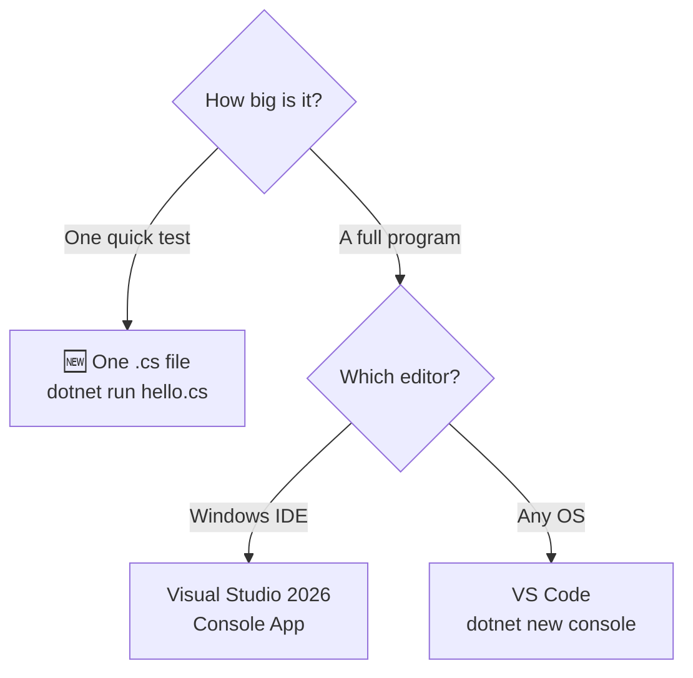

### 2.1 🆕 Quickest: run a single `.cs` file (.NET 10)

.NET 10 can run a **single C# file without a project** ("file-based apps"). This is perfect for trying out the examples in this session.

1. Create a file called `hello.cs`:

   ```csharp
   Console.WriteLine("Hello, C#!");
   ```

2. Run it:

   ```bash
   dotnet run hello.cs
   ```

That's it: no `.csproj`, no `Program.cs`. The first run takes a few seconds because it builds; after that it's fast. When a program grows, turn it into a normal project with `dotnet project convert hello.cs`.

Docs: <https://learn.microsoft.com/dotnet/core/sdk/file-based-apps>

### 2.2 Visual Studio 2026

1. **File → New → Project** → search for **Console App** (C#) → **Next**.
2. Project name: `Session03`. Choose a folder → **Next**.
3. Framework: **.NET 10.0 (Long Term Support)**. Leave **Do not use top-level statements** *unticked* (so `Program.cs` starts directly with your code, like the examples here). → **Create**.
4. Write your code in `Program.cs`.
5. Run:
   - `Ctrl+F5` — run **without** the debugger (the console window stays open).
   - `F5` — run **with** the debugger (stops at breakpoints; see [§8](#8-debugging-your-code)).

> **Tip:** to test several small programs without making a project each time, add more projects to the same solution: right-click the solution → **Add → New Project…**. Pick which one runs with right-click → **Set as Startup Project**.

Tutorial: <https://learn.microsoft.com/visualstudio/get-started/csharp/tutorial-console>

### 2.3 VS Code

1. Open a terminal (`Ctrl+`` ` ``) and create the project:

   ```bash
   dotnet new console -n Session03
   ```

   ```bash
   code Session03
   ```

2. Write your code in `Program.cs`.
3. Run it from the terminal inside the `Session03` folder:

   ```bash
   dotnet run
   ```

   Or press **F5** and choose **C#** to run with the debugger.

> **`Console.ReadLine()` in VS Code:** if your program reads input, run it with `dotnet run` in the **terminal** so you can type. The Debug Console can't take keyboard input.

Guide: <https://code.visualstudio.com/docs/csharp/get-started>

### 2.4 What a .NET 10 console program looks like

The template gives you just one line in `Program.cs`:

```csharp
Console.WriteLine("Hello, World!");
```

There's no `class Program` and no `static void Main`. These **top-level statements** are turned into a `Main` method for you. Two settings in the `.csproj` matter for this session:

| Setting | What it means for you |
|---|---|
| `<ImplicitUsings>enable</ImplicitUsings>` | `using System;` and other common namespaces are added automatically, so `Console`, `Math`, `Array` just work |
| `<Nullable>enable</Nullable>` | The compiler warns when something might be `null`. You'll see this with `Console.ReadLine()`; see [§4.4](#44-parse--tryparse) |

> **Where to keep this code?** These are practice programs, not part of the Task Manager API. They live in this course repository under `Session03/`, not inside `task-manager-api`.

### 2.5 Practice projects for this session

Ready-made code for every topic is in this `Session03` folder, next to these notes (see [README.md](README.md)). There are **two separate solutions**:

```text
Session03/
├── Demo/Session03.Demo.slnx      ← one console project per topic, with short comments
│   ├── Session03.Variables       §3
│   ├── Session03.Conversion      §4
│   ├── Session03.Conditions      §5
│   ├── Session03.Loops           §6
│   ├── Session03.Arrays          §7
│   └── Session03.CommonMistakes  §9
└── Lab/Session03.Lab.slnx        ← the assignment as a starter with TODOs and hints (§11)
```

| | Visual Studio 2026 | VS Code |
|---|---|---|
| Open | **File → Open → Project/Solution** → `Session03.Demo.slnx` | `code Session03` |
| Pick a demo | Right-click the project → **Set as Startup Project** | In the `Demo` folder: `dotnet run --project Session03.Loops` |
| Run | `Ctrl+F5` | the command above, or `F5` → **C#** to debug |
| Lab | Open `Session03.Lab.slnx` (its own solution) → `Ctrl+F5` | In the `Lab` folder: `dotnet run --project Session03.Lab` |

The demo programs need **no keyboard input** (input is simulated), so they run with F5 in VS Code too. The Lab reads real input, so run it from a terminal.

---

## 3. Variables & Data Types

> ▶ **Run it:** `Session03.Variables` in [`Demo`](Demo/Session03.Variables/Program.cs) — `dotnet run --project Session03.Variables`

C# is **statically typed**: every variable has a fixed type, decided when the code is compiled. Assigning the wrong type is a **compile error**, not a runtime surprise.

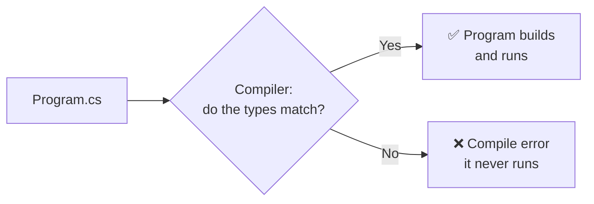

### 3.1 Value types

A value-type variable **holds the data itself**. Copying it copies the value.

| Type | Description | Example |
|---|---|---|
| `int` | 32-bit whole number (about ±2.1 billion) | `int age = 25;` |
| `long` | 64-bit whole number | `long pop = 8_000_000_000L;` |
| `double` | 64-bit floating point | `double price = 9.99;` |
| `decimal` | 128-bit high precision | `decimal tax = 0.15m;` |
| `bool` | `true` or `false` | `bool isActive = true;` |
| `char` | One Unicode character | `char grade = 'A';` |

- `_` in numbers is just for readability: `8_000_000_000` = 8000000000.
- Suffixes: `L` = long, `m` = decimal, `f` = float. Without a suffix, `9.99` is a `double`.

> 💰 **Use `decimal` for money.** `double` can't store values like 0.1 exactly:
>
> ```csharp
> Console.WriteLine(0.1 + 0.2 == 0.3);    // False  (double)
> Console.WriteLine(0.1m + 0.2m == 0.3m); // True   (decimal)
> ```

### 3.2 Reference types

A reference-type variable **holds a reference (address)** to an object stored on the **heap**. Copying the variable copies the reference, so both variables point to the same object.

| Type | Description |
|---|---|
| `string` | A sequence of characters |
| `object` | The base type of every .NET type |
| Arrays, classes, records | You'll meet these in later sessions |

**What copying does:** changing the copy of a value type leaves the original alone. Two reference variables share **one** object, so a change through either one is seen by both:

```csharp
int a = 25;
int b = a;      // b gets its own copy
b = 30;         // a is still 25

int[] x = { 1, 2, 3 };
int[] y = x;    // y points to the SAME array
y[0] = 99;      // x[0] is now 99 too
```

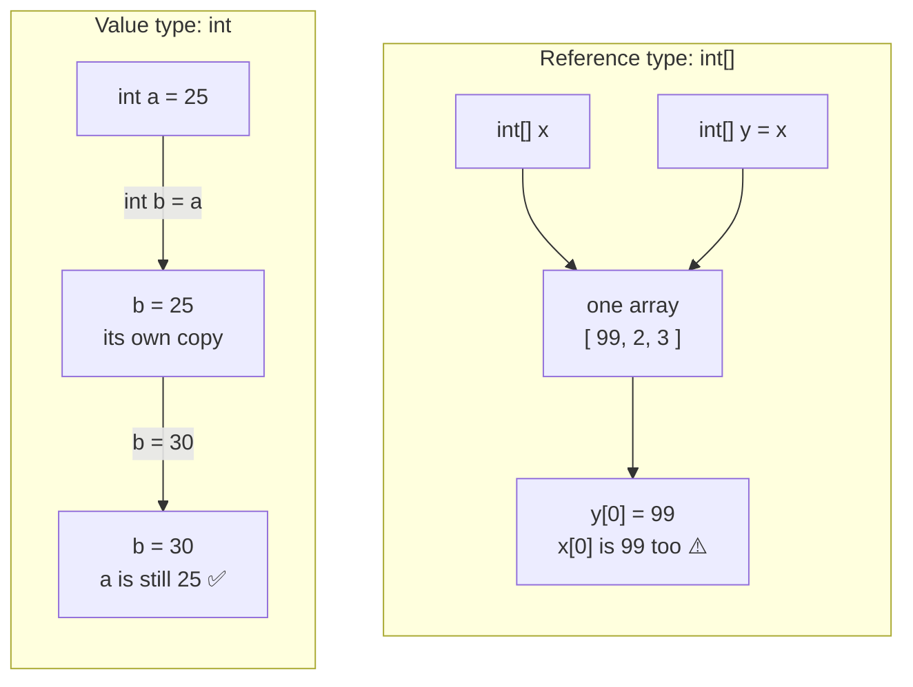

> `string` is a reference type but behaves like a value: strings are **immutable**, so "changing" one always creates a new string.

### 3.3 Stack vs heap

A running .NET program keeps its data in two areas of memory.

- **Stack:** a small, fast area for **method calls**. Each call gets a **frame** for its parameters and local variables. The frame is removed as soon as the method returns.
- **Heap:** a large area for **objects** such as arrays, strings and (later) class instances. An object stays there while something still refers to it. After that, the **Garbage Collector (GC)** frees it for you.

```csharp
int age = 25;              // stack: the value 25 itself
int[] nums = { 1, 2, 3 };  // stack: a reference  →  heap: the array
string name = "Alice";     // stack: a reference  →  heap: the string

int total = Add(2, 3);     // calling Add pushes a new frame on the stack

static int Add(int x, int y)
{
    int sum = x + y;       // x, y and sum live in Add's frame
    return sum;            // Add returns → its frame is removed
}
```

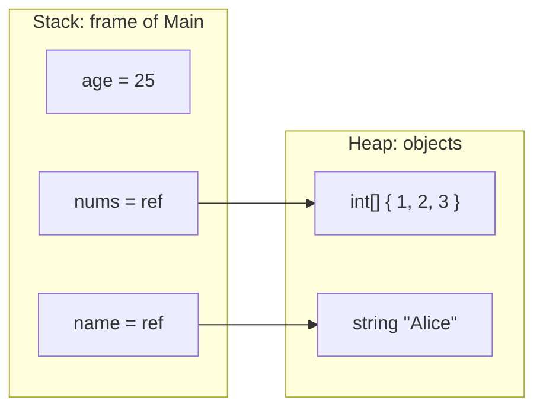

The stack grows when a method is called and shrinks when it returns ("last in, first out"):

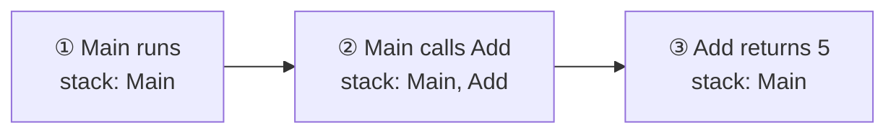

| | Stack | Heap |
|---|---|---|
| Holds | Parameters and local variables of the running methods | Objects: arrays, strings, class instances |
| Freed | Automatically, when the method returns | By the Garbage Collector, when nothing refers to the object |
| Speed | Very fast | Fast, but the GC has a cost |
| Size | Small (about 1 MB per thread) | Large (limited by the machine's memory) |
| When it runs out | `StackOverflowException`, usually from endless recursion. It ends the program. | `OutOfMemoryException` |

**Why this explains §3.2:** passing an `int` to a method copies the value into the new frame, so the method can't change the caller's variable. Passing an array copies only the **reference**, so the method changes the **same** array on the heap:

```csharp
int n = 1;
int[] arr = { 1 };
Change(n, arr);
Console.WriteLine($"{n}, {arr[0]}");   // 1, 99

static void Change(int value, int[] items)
{
    value = 99;      // changes the copy in Change's frame only
    items[0] = 99;   // changes the shared array on the heap
}
```

> ⚠️ **Correction / simplification:** the deck says value types "live on the stack". That's true for **local variables and parameters**. A value type stored *inside* an object or an array (e.g. the numbers in an `int[]`) lives on the heap with that object. Where data lives is mostly the runtime's business. The rule that changes how your code behaves is: **value types copy the value; reference types copy the reference.**

### 3.4 Type inference with `var`

```csharp
var count = 10;      // int
var price = 9.99m;   // decimal
var label = "Hello"; // string

// var x = 1;
// x = "hello";      // ❌ compile error: x is an int
```

> **`var` is not dynamic.** The compiler works out the type from the right-hand side, and it's fixed from then on. `var` needs a value: `var x;` doesn't compile.

### 3.5 Strings: interpolation, verbatim, and raw

```csharp
// Interpolation: embed expressions with $"..."
string firstName = "Alice";
int year = 2025;
string message = $"Hello, {firstName}! Born in {year - 25}.";
// → Hello, Alice! Born in 2000.

// Verbatim: @"..." treats backslashes literally
string path = @"C:\Users\Alice\Documents\notes.txt";

// Both together
string userName = "Alice";
string folder = $@"C:\Users\{userName}\files";
// → C:\Users\Alice\files
```

🆕 **Raw string literals (C# 11+)** use three or more quotes. No escaping at all, which is handy for JSON in an API course:

```csharp
string json = $$"""
    { "name": "{{firstName}}", "year": {{year}} }
    """;
// → { "name": "Alice", "year": 2025 }
```

With `$$`, you use `{{ }}` for values, so single `{ }` stays as normal JSON braces.

---

## 4. Type Conversion

> ▶ **Run it:** `Session03.Conversion` in [`Demo`](Demo/Session03.Conversion/Program.cs) — `dotnet run --project Session03.Conversion`

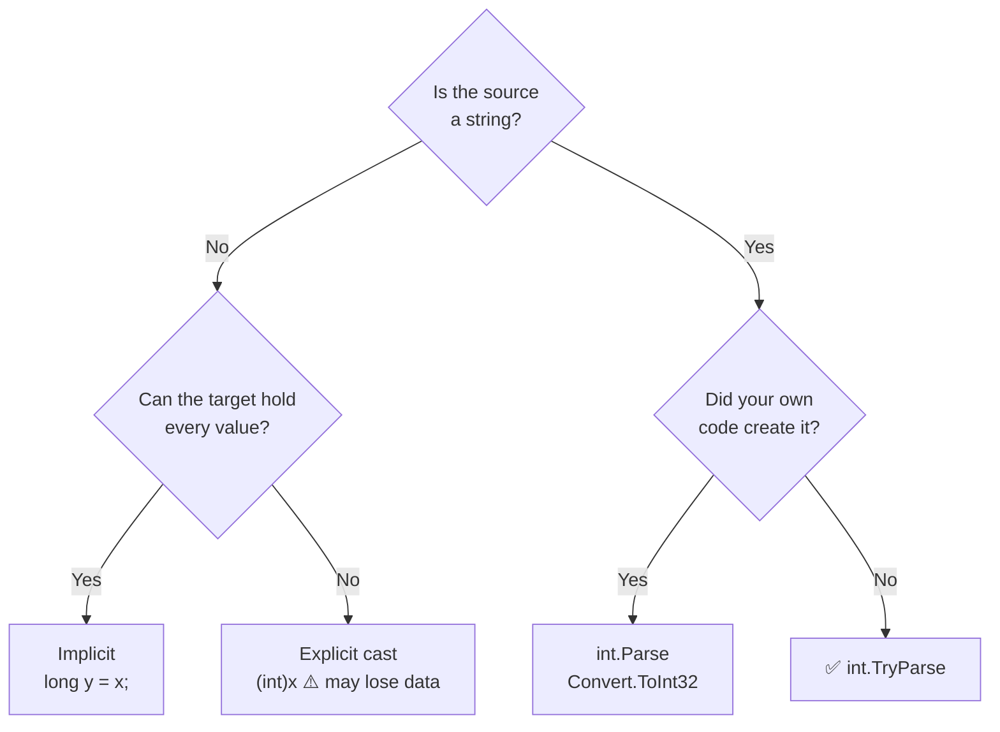

### 4.1 Implicit conversion: safe, automatic

```csharp
int x = 100;
long y = x;    // int → long
double d = x;  // int → double
```

The compiler does it for you when the target type can hold **every** value of the source type. Each arrow below is an automatic (implicit) conversion, and you can skip steps (`int` → `double` works directly):

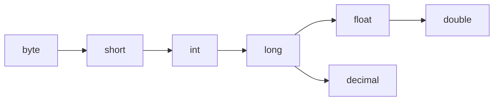

Going **against** the arrows (e.g. `double` → `int`), or between `double` and `decimal`, needs an explicit cast.

### 4.2 Explicit cast: you accept the risk

```csharp
double pi = 3.14159;
int truncated = (int)pi;   // 3 — the decimal part is cut off (not rounded)
```

> ⚠️ **Silent overflow:** casting a `long` that's too big for `int` gives a wrong number, with no error:
>
> ```csharp
> long big = 3_000_000_000L;
> int wrong = (int)big;            // -1294967296 😱
> int safe = checked((int)big);    // throws OverflowException ✅
> ```
>
> Wrap risky casts in `checked(...)` when a wrong number would be worse than an error.

Need rounding instead of cutting off? Use `(int)Math.Round(pi)`.

### 4.3 The `Convert` class

```csharp
int n = Convert.ToInt32("42");
bool b = Convert.ToBoolean("true");
double d = Convert.ToDouble("3.14");
```

Converts between unrelated types and **throws** if it can't.

> 🌍 **Watch the culture with decimals.** `Convert.ToDouble("3.14")` and `double.Parse("3.14")` use your PC's regional settings. Tested on .NET 10:
>
> | Culture | `double.Parse("3.14")` |
> |---|---|
> | English (en-US) | `3.14` ✅ |
> | German (de-DE) | `314` ❌ (`.` is a thousands separator there) |
> | Arabic – Egypt (ar-EG) | **throws `FormatException`** ❌ |
>
> For data (files, APIs, config), always pass the invariant culture:
>
> ```csharp
> using System.Globalization;
> double d = double.Parse("3.14", CultureInfo.InvariantCulture);
> ```

### 4.4 Parse & TryParse

```csharp
int a = int.Parse("100");   // fine
int b = int.Parse("abc");   // ❌ throws FormatException
```

**`TryParse` returns `true`/`false` instead of throwing.** Always use it for input you didn't create yourself (user input, files, API responses):

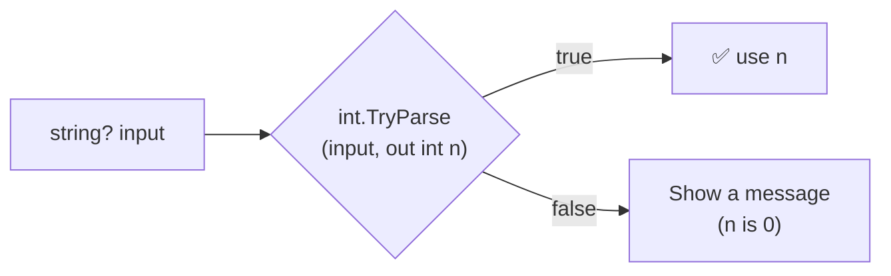

```csharp
string? userInput = Console.ReadLine();

if (int.TryParse(userInput, out int result))
{
    Console.WriteLine($"You entered: {result}");
}
else
{
    Console.WriteLine("That is not a valid integer.");
}
```

> 🆕 **Note the `?` in `string?`.** In .NET 10 projects, nullable warnings are on, and `Console.ReadLine()` can return `null` (for example when input ends). Writing `string userInput = Console.ReadLine();` like the deck gives **warning CS8600**. `string?` says "this might be null", and `TryParse` handles `null` safely (it just returns `false`).

---

## 5. Conditions

> ▶ **Run it:** `Session03.Conditions` in [`Demo`](Demo/Session03.Conditions/Program.cs) — `dotnet run --project Session03.Conditions`

### 5.1 if / else if / else

```csharp
int score = 75;

if (score >= 90)
{
    Console.WriteLine("A");
}
else if (score >= 75)
{
    Console.WriteLine("B");
}
else
{
    Console.WriteLine("C or below");
}
```

Conditions are checked **top to bottom**; the first one that's `true` wins, and the rest are skipped:

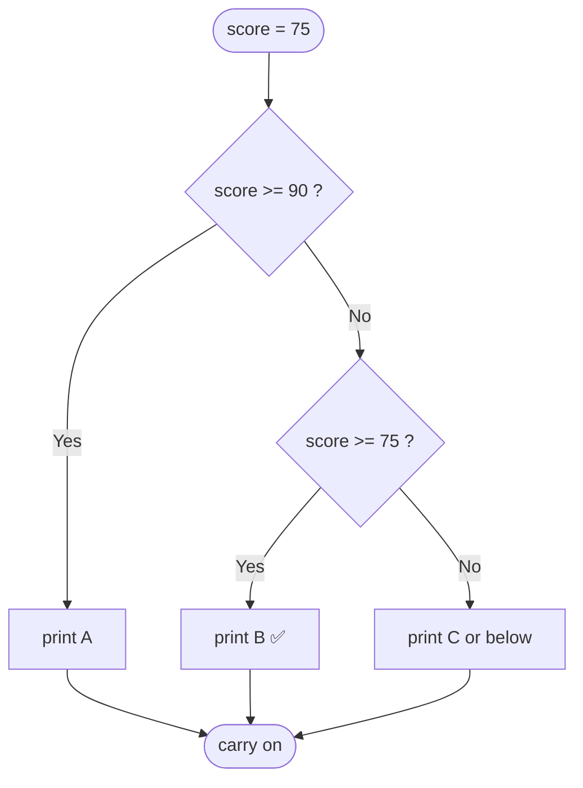

### 5.2 Ternary operator `? :`

```csharp
// condition ? valueIfTrue : valueIfFalse
string label = score >= 50 ? "Pass" : "Fail";

bool isAdult = age >= 18;
string message = isAdult
    ? "Access granted"
    : "Access denied";
```

Use it for **simple** two-way choices. If either branch needs more than a value, use a full `if`.

### 5.3 switch statement

A `switch` looks at **one value** and jumps to the matching case. If nothing matches, `default` (or `_` in a switch expression) runs:

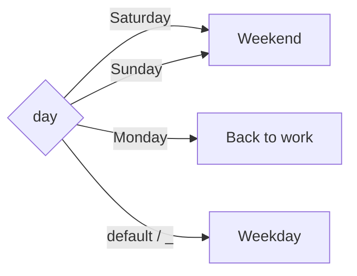

```csharp
string day = "Saturday";

switch (day)
{
    case "Saturday":
    case "Sunday":
        Console.WriteLine("Weekend");
        break;
    case "Monday":
        Console.WriteLine("Back to work");
        break;
    default:
        Console.WriteLine("Weekday");
        break;
}
```

> ⚠️ **Correction:** the deck says that forgetting `break` "causes fall-through to the next case". That's true in C, C++, Java and JavaScript, but **not in C#**. In C#, a missing `break` is a **compile error**:
>
> ```text
> error CS0163: Control cannot fall through from one case label ('case "Monday":') to another
> ```
>
> Stacking **empty** labels (like `"Saturday"` and `"Sunday"` above) is allowed, because there's no code between them. Each section that has code must end with `break`, `return`, `throw`, or `goto case`.

### 5.4 switch expression (C# 8+): returns a value

```csharp
string type = day switch
{
    "Saturday" or "Sunday" => "Weekend",
    "Monday"               => "Back to work",
    _                      => "Weekday"   // _ = anything else
};
```

Great for mapping enums:

```csharp
enum TaskStatus { Pending, InProgress, Completed }

string label = status switch
{
    TaskStatus.Pending   => "Not started",
    TaskStatus.Completed => "Done",
    _                    => "In progress"
};
```

🆕 **Relational patterns (C# 9+)** let you compare ranges, which you'll need in the assignment:

```csharp
string letter = score switch
{
    >= 90 => "A",
    >= 75 => "B",
    _     => "C or below"
};
```

| | `switch` statement | `switch` expression |
|---|---|---|
| Produces a value? | No, runs statements | **Yes** |
| Needs `break`? | Yes (compile error without it) | No |
| Default case | `default:` | `_ =>` |
| Best for | Running different blocks of code | Mapping a value to another value |

> In a `switch` expression, if no arm matches at runtime, it throws `SwitchExpressionException`. Always add `_ =>` unless you've covered every case.

---

## 6. Loops

> ▶ **Run it:** `Session03.Loops` in [`Demo`](Demo/Session03.Loops/Program.cs) — `dotnet run --project Session03.Loops`

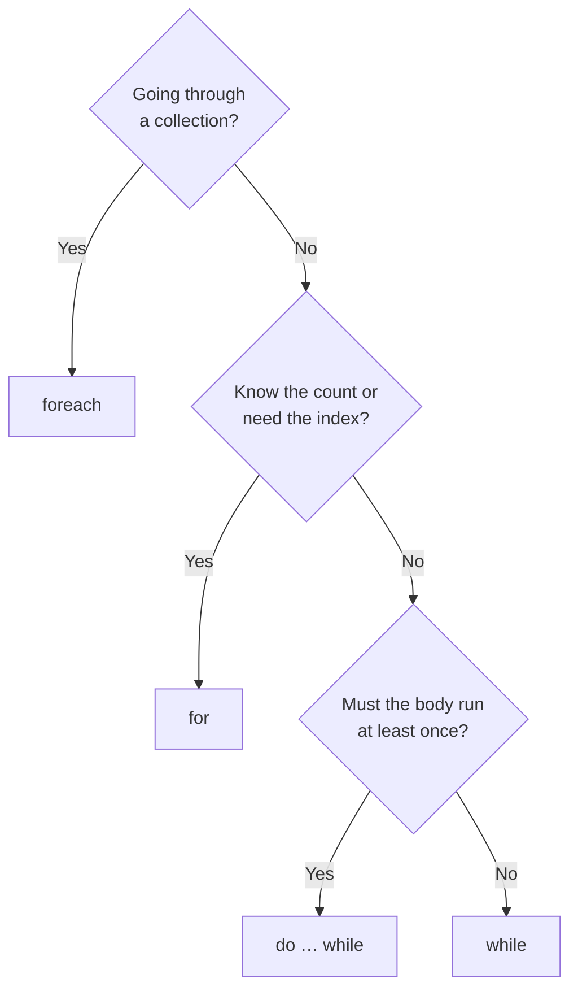

### 6.1 for

```csharp
// init ; condition ; update
for (int i = 0; i < 5; i++)
{
    Console.WriteLine(i);
}
// 0 1 2 3 4
```

The three parts in the brackets run in this order. Steps ②→③→④ repeat until the condition is `false`:

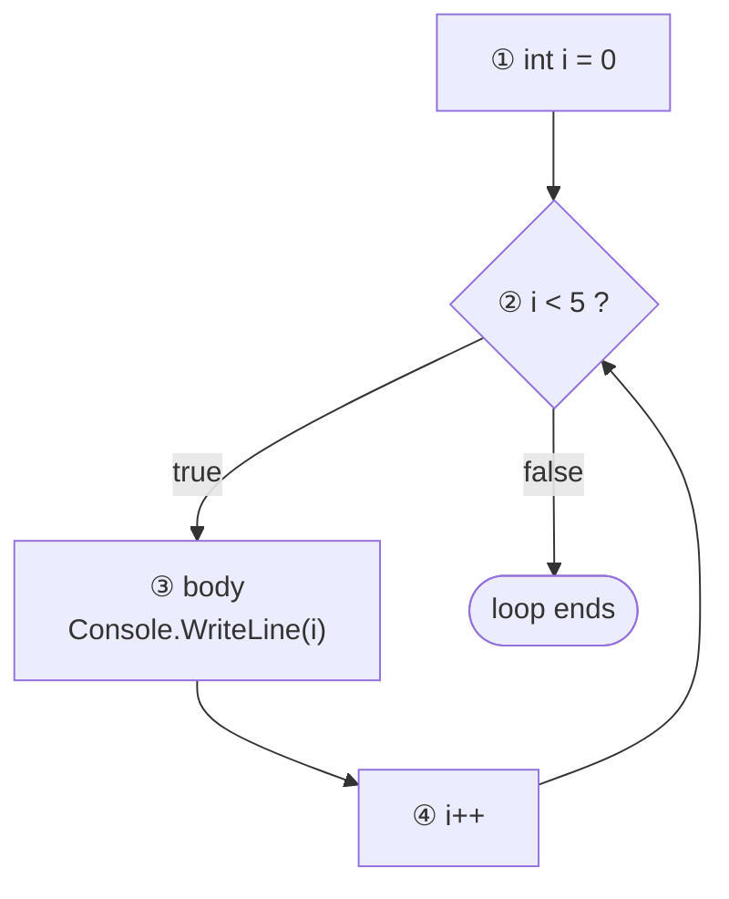

A loop inside a loop: the inner loop runs **completely** for each step of the outer loop (3 × 3 = 9 lines):

```csharp
// Nested: multiplication table
for (int i = 1; i <= 3; i++)
    for (int j = 1; j <= 3; j++)
        Console.WriteLine($"{i}x{j}={i * j}");
```

### 6.2 while and do-while

The only difference is **when the condition is checked**:

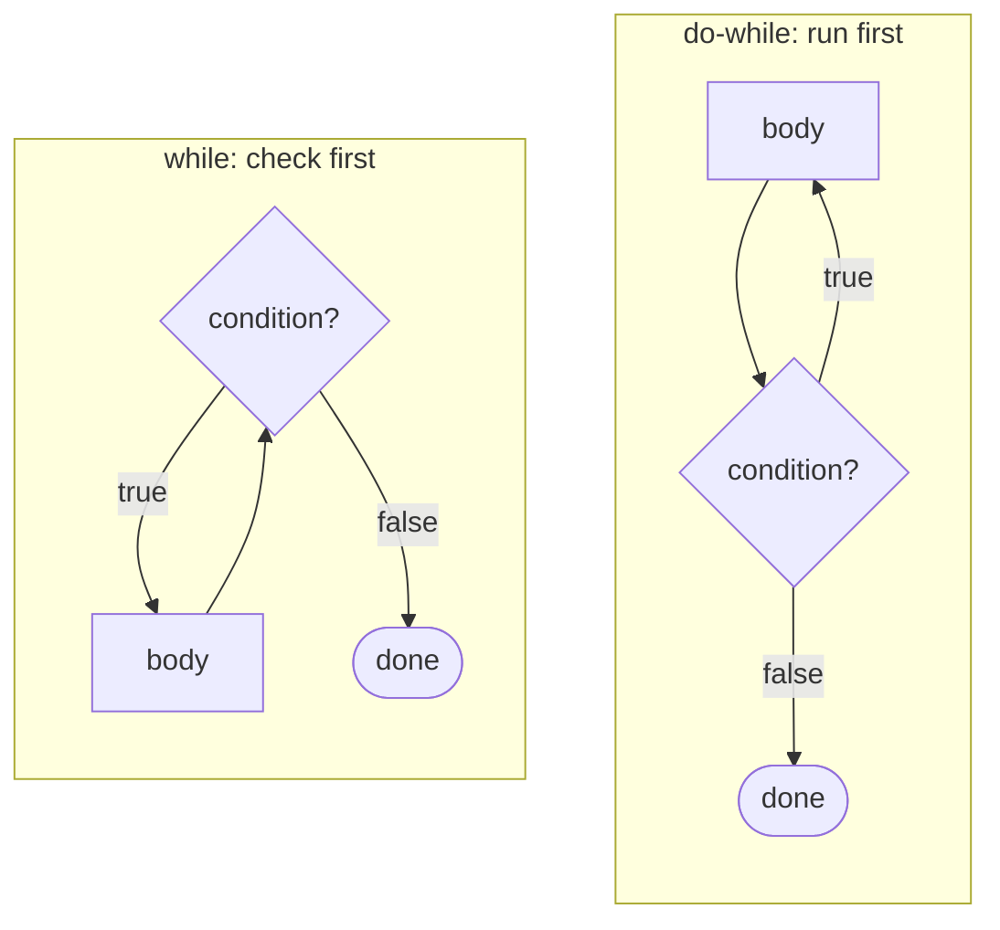

A `while` body can run **zero** times; a `do-while` body always runs **at least once**.

```csharp
int count = 0;
while (count < 5)      // checked BEFORE each run
{
    Console.WriteLine(count);
    count++;
}
```

`do … while` runs the body **at least once**, which is ideal for "ask until the input is valid". The deck uses `int.Parse` here, which **crashes** if the user types letters. A safer version:

```csharp
int input;
do
{
    Console.Write("Enter a positive number: ");
} while (!int.TryParse(Console.ReadLine(), out input) || input <= 0);

Console.WriteLine($"Thanks, you entered {input}");
```

### 6.3 foreach

```csharp
string[] names = { "Alice", "Bob", "Carol" };

foreach (string name in names)
{
    Console.WriteLine(name);
}
```

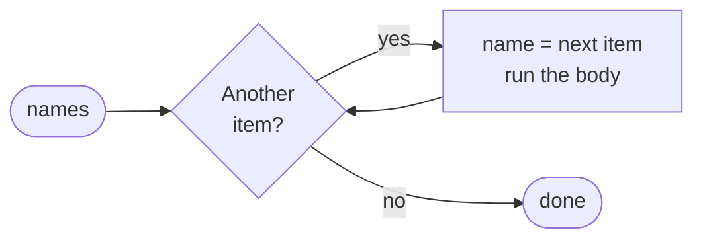

Works on any collection: arrays, lists, query results. **Prefer `foreach` when you don't need the index.** You can't change the loop variable (`name = "x"` is a compile error).

### 6.4 break and continue

```csharp
for (int i = 0; i < 10; i++)
{
    if (i == 3) continue;  // skip this one, go to the next
    if (i == 7) break;     // leave the loop completely
    Console.WriteLine(i);
}
// 0 1 2 4 5 6
```

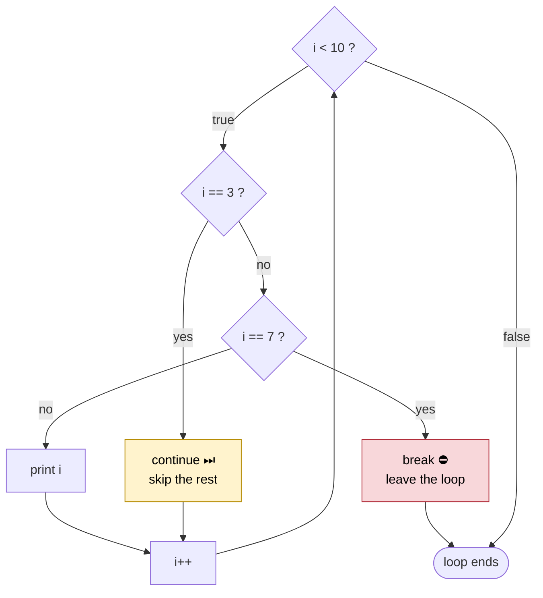

`continue` still goes to `i++` (the loop carries on); `break` jumps straight out, so 8 and 9 never run.

---

## 7. Arrays

> ▶ **Run it:** `Session03.Arrays` in [`Demo`](Demo/Session03.Arrays/Program.cs) — `dotnet run --project Session03.Arrays`

An array is a **fixed-size**, ordered list of values of **one type**. Indexes start at **0**.

`int[] primes = { 2, 3, 5, 7, 11 };` has `Length` 5, so the valid indexes are 0 to 4:

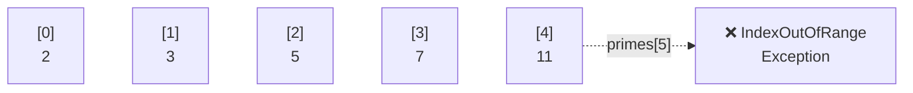

### 7.1 Declaring and using

```csharp
int[] scores = new int[5];                    // [0, 0, 0, 0, 0]
int[] primes = { 2, 3, 5, 7, 11 };
string[] names = new string[] { "Alice", "Bob" };

Console.WriteLine(primes[0]);      // 2
primes[2] = 99;                    // replace 5 with 99
Console.WriteLine(primes.Length);  // 5
```

New arrays are filled with **default values**: `0` for numbers, `false` for `bool`, `null` for `string`.

🆕 **Modern syntax you'll see in .NET 10 code:**

```csharp
int[] primes = [2, 3, 5, 7, 11];   // collection expression (C# 12+)

Console.WriteLine(primes[^1]);     // 11 — ^1 means "last item"
int[] middle = primes[1..3];       // [3, 5] — from index 1 up to (not including) 3
```

### 7.2 Common operations

```csharp
int[] numbers = { 5, 2, 8, 1, 9 };

Array.Sort(numbers);                  // [1, 2, 5, 8, 9]
Array.Reverse(numbers);               // [9, 8, 5, 2, 1]
int pos = Array.IndexOf(numbers, 5);  // 2  (-1 if not found)

foreach (int n in numbers)
    Console.Write(n + " ");
```

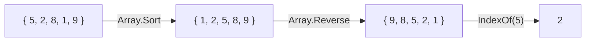

> `Array.Sort` and `Array.Reverse` **change the original array**; they don't return a new one.

### 7.3 Multi-dimensional arrays

```csharp
int[,] grid = new int[3, 3];
grid[0, 0] = 1;
grid[1, 2] = 7;

int[,] matrix =
{
    { 1, 2, 3 },
    { 4, 5, 6 },
    { 7, 8, 9 }
};
Console.WriteLine(matrix[1, 1]);  // 5 (row 1, column 1)

for (int row = 0; row < matrix.GetLength(0); row++)
    for (int col = 0; col < matrix.GetLength(1); col++)
        Console.Write(matrix[row, col] + " ");
```

Each item has a `[row, column]` address. `matrix[1, 1]` is the middle one:

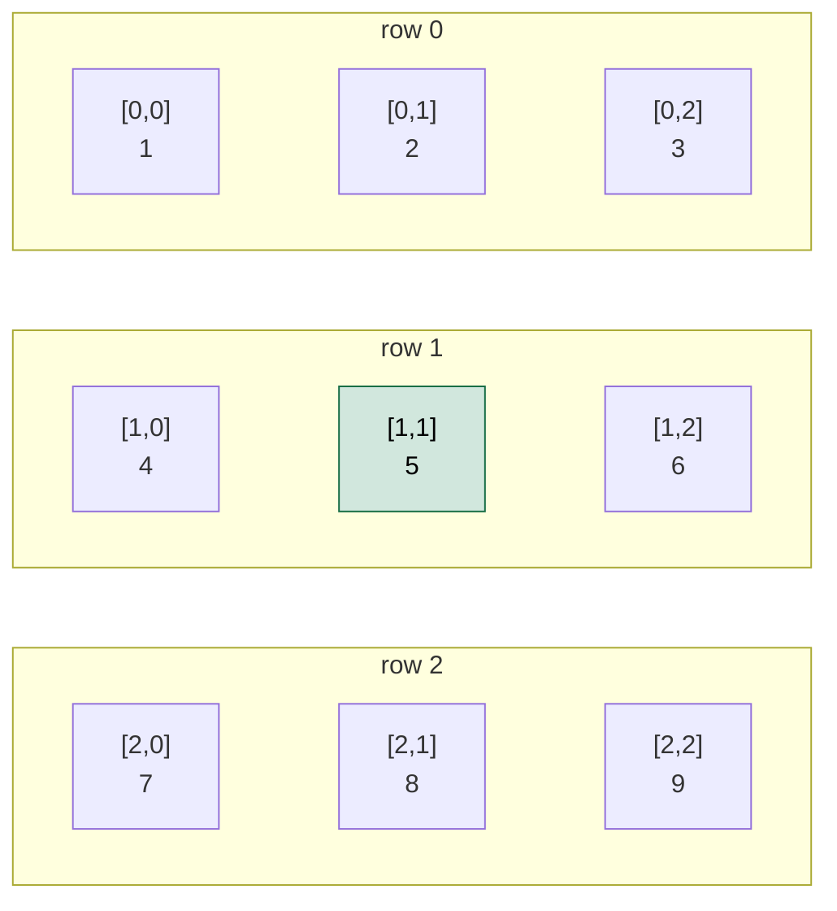

| | Meaning | For `matrix` |
|---|---|---|
| `GetLength(0)` | Number of rows | `3` |
| `GetLength(1)` | Number of columns | `3` |
| `Length` | **Total** number of items | `9` |

---

## 8. Debugging Your Code

Loops and conditions are much easier to understand when you **watch them run step by step**. Both editors work the same way.

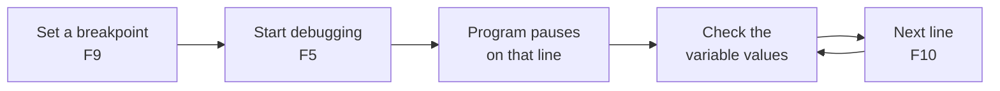

| Action | Visual Studio 2026 | VS Code |
|---|---|---|
| Toggle a breakpoint | `F9` or click the left margin | `F9` or click the left margin |
| Start with debugger | `F5` | `F5` (choose **C#** the first time) |
| Run without debugger | `Ctrl+F5` | `Ctrl+F5`, or `dotnet run` in the terminal |
| Step over (next line) | `F10` | `F10` |
| Step into a method | `F11` | `F11` |
| Continue to next breakpoint | `F5` | `F5` |
| Stop | `Shift+F5` | `Shift+F5` |
| See variable values | **Locals** / **Autos** windows, or hover over a variable | **Variables** panel, or hover |
| Watch one expression | **Watch** window (e.g. `numbers[i]`) | **Watch** panel |
| Only stop when… | Right-click breakpoint → **Conditions** (e.g. `i == 7`) | Right-click breakpoint → **Edit Condition** |

> **Try it:** put a breakpoint inside the `break`/`continue` loop in [§6.4](#64-break-and-continue), press F5, then F10 repeatedly and watch `i` change.

Docs: [Visual Studio debugger tour](https://learn.microsoft.com/visualstudio/debugger/debugger-feature-tour) · [Debugging C# in VS Code](https://code.visualstudio.com/docs/csharp/debugging)

---

## 9. Common Mistakes

> ▶ **Run it:** `Session03.CommonMistakes` in [`Demo`](Demo/Session03.CommonMistakes/Program.cs) — `dotnet run --project Session03.CommonMistakes`

| Mistake | What goes wrong | Do this instead |
|---|---|---|
| Comparing `double` with `==` | `0.1 + 0.2 == 0.3` is `false` | `Math.Abs(a - b) < 0.0001`, or use `decimal` |
| Using `double` for money | Rounding errors | Use `decimal` |
| `int.Parse` on user input | Crashes on bad input | `int.TryParse` |
| Parsing decimals without a culture | `"3.14"` fails or becomes `314` on some PCs | `CultureInfo.InvariantCulture` |
| Casting a big `long` to `int` | Silent wrong number | `checked((int)x)` |
| Code in a `case` with no `break` | **Compile error** CS0163 in C# (not fall-through) | End each section with `break` / `return` |
| Off-by-one in `for` | Skipped items or out-of-range | Use `i < arr.Length` consistently, or `foreach` |
| `arr[arr.Length]` | `IndexOutOfRangeException` | Valid indexes are `0` to `Length - 1`; last item is `arr[^1]` |
| `string s = Console.ReadLine();` | Nullable warning CS8600 | `string? s = Console.ReadLine();` |

---

## 10. Summary

- C# is **statically typed**; `var` still has a fixed type.
- **Value types** copy the value; **reference types** copy a reference to an object on the heap.
- The **stack** holds each method's local variables and is freed when the method returns. The **heap** holds objects and is cleaned up by the **Garbage Collector**.
- Use **`decimal`** for money and **`TryParse`** for any input from outside your code.
- Parse decimals with **`CultureInfo.InvariantCulture`** so the code works on every PC.
- **`switch` expressions** are shorter than `switch` statements and return a value. In C#, a missing `break` is a compile error, not fall-through.
- Prefer **`foreach`** when you don't need the index.
- Arrays have a **fixed size**; valid indexes are **0 to Length − 1**.
- 🆕 .NET 10 can run a single file with **`dotnet run file.cs`**.

---

## 11. Assignment

> ▶ **Starter code:** [`Lab/Session03.Lab/Program.cs`](Lab/Session03.Lab/Program.cs) — a separate solution (`Session03.Lab.slnx`) with a TODO and hints for each criterion. Run it with `dotnet run --project Session03.Lab` from the `Lab` folder.

Build a small **console program** that shows you understand types, control flow and arrays.

**Acceptance criteria:**

- [ ] Ask the user for an integer and print whether it's **even or odd**. Use `TryParse` so invalid input is handled without crashing.
- [ ] Print the **multiplication table (1 to 10)** for that number using a `for` loop.
- [ ] Declare an array of **5 integers**, fill it from user input, then print the **minimum and maximum** **without** using `Array.Sort`.
- [ ] Use a **switch expression** to label the maximum: less than 10 → `"Low"`, 10–99 → `"Medium"`, 100 or more → `"High"`.
- [ ] **Label all output** clearly, so the user knows what each line means.

**Bonus:** read a **second array** of integers and print only the values that appear in **both** arrays, using arrays only (no `List`, `HashSet`, or LINQ).

### Hints

| Requirement | Hint |
|---|---|
| Even or odd | `number % 2 == 0` means even. Watch out: `-3 % 2` is `-1`, so check `!= 0` for odd rather than `== 1`. |
| Invalid input | Reuse the `do … while` + `TryParse` loop from [§6.2](#62-while-and-do-while), so the user is asked again. |
| Min and max | Start both at `array[0]`, then loop and update them. Don't start `min` at `0`: it breaks when every number is positive. |
| Label | Relational patterns: `< 10 => …`, `< 100 => …`, `_ => …` ([§5.4](#54-switch-expression-c-8-returns-a-value)). |
| Bonus | A loop inside a loop. Think about what happens when a value appears twice in the first array. |

### Starter skeleton

```csharp
// Session 03 assignment — fill in the TODOs

// 1. Read an integer safely
int number;
do
{
    Console.Write("Enter an integer: ");
} while (!int.TryParse(Console.ReadLine(), out number));

// TODO: print "even" or "odd"

// 2. TODO: multiplication table 1..10 with a for loop

// 3. TODO: read 5 integers into an array (re-ask on invalid input)
int[] values = new int[5];

// TODO: find min and max with a loop (no Array.Sort)

// 4. TODO: label the max with a switch expression

// Bonus: TODO: read a second array and print common values
```

**How to run it:**

- **Single file:** save it as `assignment.cs`, then `dotnet run assignment.cs`.
- **Visual Studio 2026:** paste into `Program.cs` of a Console App, then `Ctrl+F5`.
- **VS Code:** paste into `Program.cs`, then `dotnet run` in the terminal (so you can type input).

---

## 12. Before Next Session

**Next: [Session 04, C# Methods, Strings & Exception Handling](../Session04/dotnet-backend-session-04-notes.md)**

- Defining and calling methods with different kinds of parameters.
- Method overloading, optional and named parameters.
- String manipulation and `StringBuilder`.
- Handling `null` safely: nullable types, `??`, `?.`.
- Exception handling with `try` / `catch` / `finally`.

**To do:**

- [ ] Finish the assignment above.
- [ ] Try each example in this file once with `dotnet run file.cs`.
- [ ] Debug one loop with breakpoints and **F10** ([§8](#8-debugging-your-code)).

> ℹ️ Session 02's deck said the next session was **Session 08**, but this deck is Session 03 and leads to Session 04. Ask the instructor for the confirmed order.

**Think about:**

1. What does this print, and why?
   ```csharp
   double total = 0.1 + 0.2;
   Console.WriteLine(total == 0.3);
   ```
2. Why does this code **not compile** in C#?
   ```csharp
   switch (x)
   {
       case 1:
           Console.WriteLine("one");
       case 2:
           Console.WriteLine("two");
           break;
   }
   ```
3. An array has `Length == 5`. What's the index of the last item? What's a shorter way to write it?
4. A user types `12abc`. What do `int.Parse` and `int.TryParse` each do?

<details>
<summary>Answers</summary>

1. `False`. `double` can't store 0.1 and 0.2 exactly, so the sum is `0.30000000000000004`. Use `decimal` or compare with a tolerance.
2. `case 1` has code but no `break`, and C# doesn't allow falling through to the next case (error CS0163).
3. Index `4` (`Length - 1`). Shorter: `arr[^1]`.
4. `int.Parse` throws `FormatException`. `int.TryParse` returns `false` and sets the `out` value to `0`.

</details>

---

## 13. Links

**C# language**

| Topic | Link |
|---|---|
| C# documentation (home) | <https://learn.microsoft.com/dotnet/csharp/> |
| What's new in C# 14 | <https://learn.microsoft.com/dotnet/csharp/whats-new/csharp-14> |
| Built-in types | <https://learn.microsoft.com/dotnet/csharp/language-reference/builtin-types/built-in-types> |
| Value types | <https://learn.microsoft.com/dotnet/csharp/language-reference/builtin-types/value-types> |
| String interpolation `$""` | <https://learn.microsoft.com/dotnet/csharp/language-reference/tokens/interpolated> |
| Raw string literals `"""` | <https://learn.microsoft.com/dotnet/csharp/language-reference/tokens/raw-string> |
| Casting and type conversions | <https://learn.microsoft.com/dotnet/csharp/programming-guide/types/casting-and-type-conversions> |
| `checked` and `unchecked` | <https://learn.microsoft.com/dotnet/csharp/language-reference/statements/checked-and-unchecked> |
| `int.TryParse` | <https://learn.microsoft.com/dotnet/api/system.int32.tryparse> |
| Parsing numbers (cultures) | <https://learn.microsoft.com/dotnet/standard/base-types/parsing-numeric> |
| `if` and `switch` statements | <https://learn.microsoft.com/dotnet/csharp/language-reference/statements/selection-statements> |
| `switch` expression | <https://learn.microsoft.com/dotnet/csharp/language-reference/operators/switch-expression> |
| Patterns (`>=`, `or`, `_`) | <https://learn.microsoft.com/dotnet/csharp/language-reference/operators/patterns> |
| Loops (`for`, `foreach`, `while`, `do`) | <https://learn.microsoft.com/dotnet/csharp/language-reference/statements/iteration-statements> |
| `break`, `continue`, `return` | <https://learn.microsoft.com/dotnet/csharp/language-reference/statements/jump-statements> |
| Arrays | <https://learn.microsoft.com/dotnet/csharp/language-reference/builtin-types/arrays> |
| Collection expressions `[1, 2, 3]` | <https://learn.microsoft.com/dotnet/csharp/language-reference/operators/collection-expressions> |
| Index `^1` and range `1..3` | <https://learn.microsoft.com/dotnet/csharp/language-reference/operators/member-access-operators> |
| Nullable reference types (`string?`) | <https://learn.microsoft.com/dotnet/csharp/nullable-references> |
| Top-level statements | <https://learn.microsoft.com/dotnet/csharp/fundamentals/program-structure/top-level-statements> |

**Tools**

| Topic | Link |
|---|---|
| File-based apps (`dotnet run file.cs`) | <https://learn.microsoft.com/dotnet/core/sdk/file-based-apps> |
| Console template (top-level statements) | <https://learn.microsoft.com/dotnet/core/tutorials/top-level-templates> |
| Visual Studio 2026: console app tutorial | <https://learn.microsoft.com/visualstudio/get-started/csharp/tutorial-console> |
| Visual Studio 2026: debugger tour | <https://learn.microsoft.com/visualstudio/debugger/debugger-feature-tour> |
| VS Code: C# getting started | <https://code.visualstudio.com/docs/csharp/get-started> |
| VS Code: debugging C# | <https://code.visualstudio.com/docs/csharp/debugging> |
| .NET Fiddle (run C# in the browser) | <https://dotnetfiddle.net> |

**Practice**

| Topic | Link |
|---|---|
| Microsoft Learn: Get started with C# (free path) | <https://learn.microsoft.com/training/paths/get-started-c-sharp-part-1/> |
