# Session 04 — C# Methods, Strings & Exception Handling (Study Notes)

> **Course:** Backend Development with .NET — Andalusia Academy
> **Session:** 04 · Week 2 · 2 hours
> **Source deck:** <https://seifmansour.com/courses/dotnet-backend/4>
> Still **pure C#** console programs. Everything here is used later in the API: methods hold your logic, strings are your data, and exceptions become your API errors.

> ℹ️ **These notes use .NET 10 and C# 14.** Everything in the deck works on .NET 10, except where marked ⚠️ **Correction**. Newer syntax you can also use is marked 🆕. Every code sample here was run on the .NET 10 SDK (10.0.403).

> Diagrams are written in **Mermaid**. They render on GitHub, Azure DevOps Wiki, Notion, and in VS Code with the *Markdown Preview Mermaid Support* extension.

---

## Table of Contents

1. [Session Goals & Agenda](#1-session-goals--agenda)
2. [Before You Start](#2-before-you-start) · [Practice projects](#23-practice-projects-for-this-session)
3. [Methods](#3-methods)
4. [Strings & StringBuilder](#4-strings--stringbuilder)
5. [Null & Nullable Types](#5-null--nullable-types)
6. [Exception Handling](#6-exception-handling)
7. [Debugging Exceptions](#7-debugging-exceptions)
8. [Common Mistakes](#8-common-mistakes)
9. [Summary](#9-summary)
10. [Assignment](#10-assignment)
11. [Before Next Session](#11-before-next-session)
12. [Links](#12-links)

---

## 1. Session Goals & Agenda

By the end of the session you should be able to:

- **Define and call methods** with different parameter and return types.
- **Work with strings** using built-in methods and `StringBuilder`.
- **Handle `null` safely** with nullable types and the null operators.
- **Catch and throw exceptions**, and create your own exception types.

| Time | Topic | Type | Duration |
|---|---|---|---|
| 0:00 | Methods: definition & overloading | Theory + Demo | 25 min |
| 0:25 | Strings & StringBuilder | Theory + Demo | 20 min |
| 0:45 | Null & nullable types | Theory + Demo | 15 min |
| 1:00 | Break | — | 5 min |
| 1:05 | Exception handling | Theory + Demo | 25 min |
| 1:30 | Exercises | Exercise | 30 min |

---

## 2. Before You Start

### 2.1 Running the code

Use the same setup as Session 03 ([Session 03 §2](../Session03/dotnet-backend-session-03-notes.md#2-running-c-code-vs-2026-vs-code-or-one-file)):

| Way | How |
|---|---|
| 🆕 One file | Save as `test.cs`, then `dotnet run test.cs` |
| Visual Studio 2026 | Console App (.NET 10), write in `Program.cs`, `Ctrl+F5` |
| VS Code | `dotnet new console -n Session04`, then `dotnet run` in the terminal |

### 2.2 Adding a second file to a project

This session is the first time a program has **more than one file**: the custom exception in [§6.6](#66-custom-exception-types) lives in `Exceptions/InsufficientFundsException.cs`. All `.cs` files in a project folder are compiled together, so you don't need to "include" anything.

| | Visual Studio 2026 | VS Code |
|---|---|---|
| New folder | Right-click the project → **Add → New Folder** → `Exceptions` | Explorer: right-click → **New Folder…** |
| New class file | Right-click the folder → **Add → Class…** (`Shift+Alt+C`) | C# Dev Kit Solution Explorer: right-click → **New File… → Class**, or `dotnet new class -n InsufficientFundsException -o Exceptions` |

Each file starts with a **namespace** that matches its folder, and `Program.cs` imports it with `using`:

```csharp
// Exceptions/InsufficientFundsException.cs
namespace Session04.ExceptionHandling.Exceptions;

public class InsufficientFundsException : Exception { /* ... */ }
```

```csharp
// Program.cs
using Session04.ExceptionHandling.Exceptions;
```

> `dotnet new class -o Exceptions` writes the project's root namespace (e.g. `Session04.ExceptionHandling`). Add `.Exceptions` yourself so it matches the folder.

### 2.3 Practice projects for this session

Ready-made code for every topic is in this `Session04` folder, next to these notes (see [README.md](README.md)). There are **two separate solutions**:

```text
Session04/
├── Demo/Session04.Demo.slnx            ← one console project per topic, with short comments
│   ├── Session04.Methods               §3
│   ├── Session04.Strings               §4
│   ├── Session04.Nulls                 §5
│   ├── Session04.ExceptionHandling     §6
│   └── Session04.CommonMistakes        §8
└── Lab/Session04.Lab.slnx              ← the assignment as a starter with TODOs and hints (§10)
```

| | Visual Studio 2026 | VS Code |
|---|---|---|
| Open | **File → Open → Project/Solution** → `Session04.Demo.slnx` | `code Session04` |
| Pick a demo | Right-click the project → **Set as Startup Project** | In the `Demo` folder: `dotnet run --project Session04.Methods` |
| Run | `Ctrl+F5` | the command above, or `F5` → **C#** to debug |
| Lab | Open `Session04.Lab.slnx` (its own solution) → `Ctrl+F5` | In the `Lab` folder: `dotnet run --project Session04.Lab` |

The demo programs need **no keyboard input**, so they run with F5 in VS Code too. The Lab reads real input, so run it from a terminal.

---

## 3. Methods

> ▶ **Run it:** `Session04.Methods` in [`Demo`](Demo/Session04.Methods/Program.cs) — `dotnet run --project Session04.Methods`

A **method** is a named block of code that does one job. You write it once and call it as many times as you need.

### 3.1 Method structure

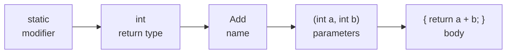

```csharp
static int Add(int a, int b)
{
    return a + b;
}

int result = Add(3, 4);   // 7

// void: does something, returns nothing
static void PrintLine(string message)
{
    Console.WriteLine(message);
}
```

When you call a method, the **arguments** are copied into its **parameters**, the body runs, and `return` sends a value back to the caller:

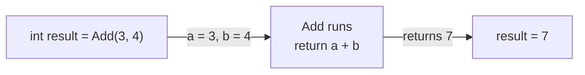

- A method with a return type **must** return a value on every path (`return` ends the method right away).
- Each call gets its own **stack frame** for its parameters and locals ([Session 03 §3.3](../Session03/dotnet-backend-session-03-notes.md#33-stack-vs-heap)).

> **In top-level programs** (`Program.cs` without `class Program`), methods written next to your code are **local functions**. Put them **after** the code that uses them, as the demos do. Classes (like `Calculator` below) must come after all top-level code.

### 3.2 Expression-bodied methods

When the body is **one expression**, `=>` replaces `{ return ...; }`:

```csharp
static int Square(int n) => n * n;
static void Greet(string name) => Console.WriteLine($"Hello, {name}!");
```

### 3.3 Overloading

**Same name, different parameter lists.** The compiler picks the version that matches the arguments:

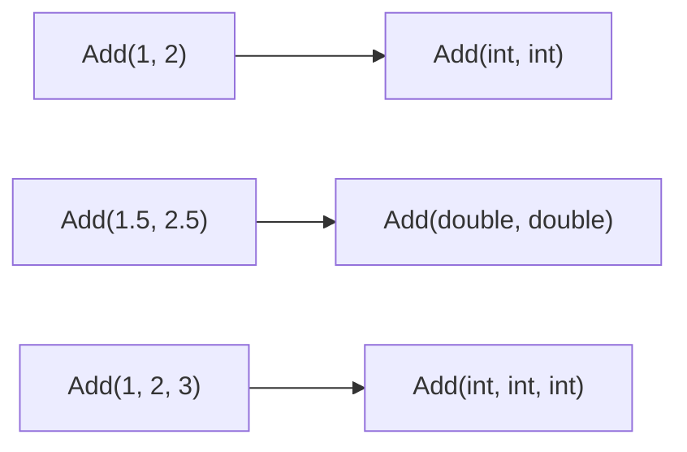

- Overloads must differ in the **number or types** of parameters. A different **return type alone is not enough**.
- You already use overloads: `Console.WriteLine` has versions for `string`, `int`, `object` and more.

> ⚠️ **Correction:** the deck writes the three `Add` overloads as plain `static` methods. In a top-level `Program.cs` they become **local functions**, and local functions **can't be overloaded**:
>
> ```text
> error CS0128: A local variable or function named 'Add' is already defined in this scope
> ```
>
> Put overloads inside a **class** (classes are covered properly in Session 05):
>
> ```csharp
> Console.WriteLine(Calculator.Add(1, 2));       // 3    → Add(int, int)
> Console.WriteLine(Calculator.Add(1.5, 2.5));   // 4    → Add(double, double)
> Console.WriteLine(Calculator.Add(1, 2, 3));    // 6    → Add(int, int, int)
> Console.WriteLine(Calculator.Add(1, 2.5));     // 3.5  → Add(double, double): 1 becomes 1.0
>
> static class Calculator
> {
>     public static int Add(int a, int b) => a + b;
>     public static double Add(double a, double b) => a + b;
>     public static int Add(int a, int b, int c) => a + b + c;
> }
> ```

### 3.4 Optional and named parameters

```csharp
static void CreateUser(string name, bool isAdmin = false, int age = 18)
{
    Console.WriteLine($"{name}, admin: {isAdmin}, age: {age}");
}

CreateUser("Alice");                 // Alice, admin: False, age: 18
CreateUser("Bob", isAdmin: true);    // Bob, admin: True, age: 18
CreateUser("Carol", age: 25);        // skip isAdmin, set age by name
CreateUser(age: 30, name: "Dave");   // named arguments can be in any order
```

- **Optional** parameters have a default value and must come **after** the required ones.
- **Named** arguments let you skip an optional parameter and make calls easier to read: `CreateUser("Bob", isAdmin: true)` says more than `CreateUser("Bob", true)`.
- Optional parameters often replace a pile of overloads.

### 3.5 Passing by value, `ref` and `out`

By default C# passes a **copy** of the argument. `ref` and `out` pass the **variable itself**:

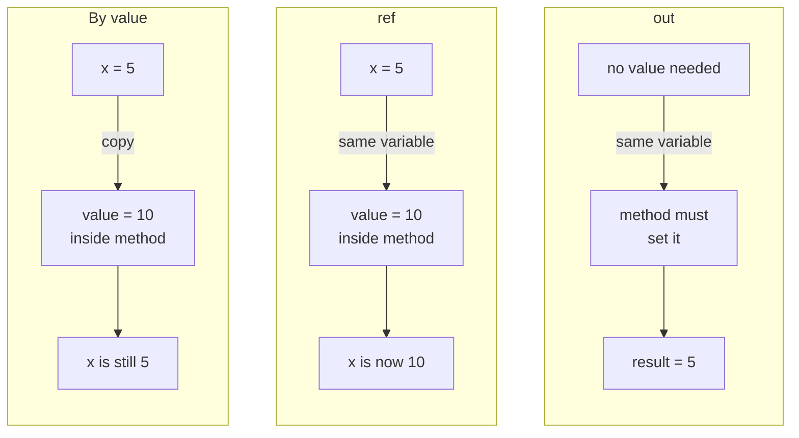

```csharp
// ref: the variable must have a value before the call
static void DoubleIt(ref int value) => value *= 2;

int x = 5;
DoubleIt(ref x);   // x is now 10

// out: the method must assign it before returning
static bool TryDivide(int a, int b, out double result)
{
    if (b == 0) { result = 0; return false; }
    result = (double)a / b;
    return true;
}

if (TryDivide(10, 2, out double quotient))
    Console.WriteLine(quotient);   // 5
```

| | Must have a value **before** the call? | Must be set **inside** the method? |
|---|---|---|
| `ref` | Yes | No |
| `out` | No | Yes, on every path |

> **Why this matters:** `out` is exactly how `int.TryParse(text, out int value)` works: it returns `true`/`false` and hands back the number through `out`. Use `out _` when you don't need the value.

> 🆕 **Tuples are often clearer than `out`** when a method needs to return two values:
>
> ```csharp
> var (min, max) = MinMax([4, 9, 1, 7]);   // min = 1, max = 9
>
> static (int Min, int Max) MinMax(int[] values)
> {
>     int min = values[0], max = values[0];
>     foreach (int v in values)
>     {
>         if (v < min) min = v;
>         if (v > max) max = v;
>     }
>     return (min, max);
> }
> ```

---

## 4. Strings & StringBuilder

> ▶ **Run it:** `Session04.Strings` in [`Demo`](Demo/Session04.Strings/Program.cs) — `dotnet run --project Session04.Strings`

### 4.1 Strings are immutable

A string **never changes** after it's created. Methods like `Trim()`, `ToUpper()` and `Replace()` return a **new** string. If you don't store it, it's lost:

```csharp
string name = "  Alice  ";
name.Trim();          // ❌ the trimmed copy is thrown away; name is still "  Alice  "
name = name.Trim();   // ✅ name is now "Alice"
```

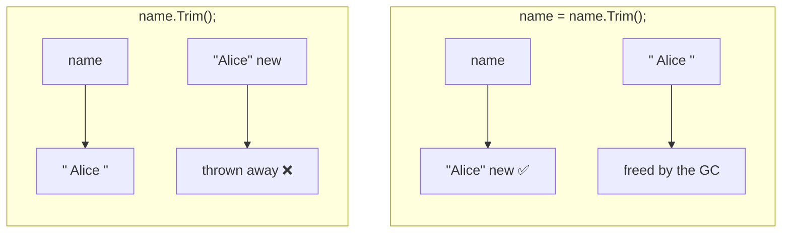

### 4.2 Common string methods

```csharp
string s = "  Hello, World!  ";

s.Length                    // 17
s.Trim()                    // "Hello, World!"
s.ToUpper()                 // "  HELLO, WORLD!  "
s.Contains("World")         // true
s.StartsWith("  Hello")     // true
s.Replace("World", "C#")    // "  Hello, C#!  "
s.IndexOf("World")          // 9
s.Substring(9, 5)           // "World"   (start index, length)
s.Split(',')                // ["  Hello", " World!  "]

string.Join(", ", new[] { "a", "b", "c" })   // "a, b, c"
```

> ⚠️ **Correction:** the deck shows `s.Substring(7, 5)` → `"World"`. With the two leading spaces, `"World"` starts at index **9**, so `Substring(7, 5)` returns `", Wor"`. Safer: find the position instead of counting by hand: `s.Substring(s.IndexOf("World"), 5)`.

Also useful:

| Code | Result |
|---|---|
| `string.IsNullOrWhiteSpace("   ")` | `true`: the best check for "the user typed nothing" |
| `s.Split(',', StringSplitOptions.TrimEntries)` | `["Hello", "World!"]`: splits and trims each part |
| `"World"[0]`, `"World"[^1]` | `'W'`, `'d'` (a string is indexed like an array) |
| `"World"[1..3]` | `"or"` (ranges work on strings too) |

### 4.3 Comparing strings

`==` is **case-sensitive**. To ignore case, say so with a `StringComparison`:

```csharp
string a = "hello";
string b = "HELLO";

bool eq = a == b;                                                         // false
bool eqIgnore = string.Equals(a, b, StringComparison.OrdinalIgnoreCase);  // true

"Hello World".Contains("world", StringComparison.OrdinalIgnoreCase);       // true
```

| Use | When |
|---|---|
| `StringComparison.OrdinalIgnoreCase` | Identifiers, commands, API parameters, file names, e.g. `"exit"` in the assignment |
| `StringComparison.CurrentCultureIgnoreCase` | Text shown to users and sorted for them |

> Don't compare with `a.ToLower() == b.ToLower()`: it creates two extra strings, and lower-casing rules differ between languages.

### 4.4 StringBuilder

Because strings are immutable, `+=` in a loop creates a **new string on every round**. `StringBuilder` keeps **one buffer** that grows, and makes the final string once:

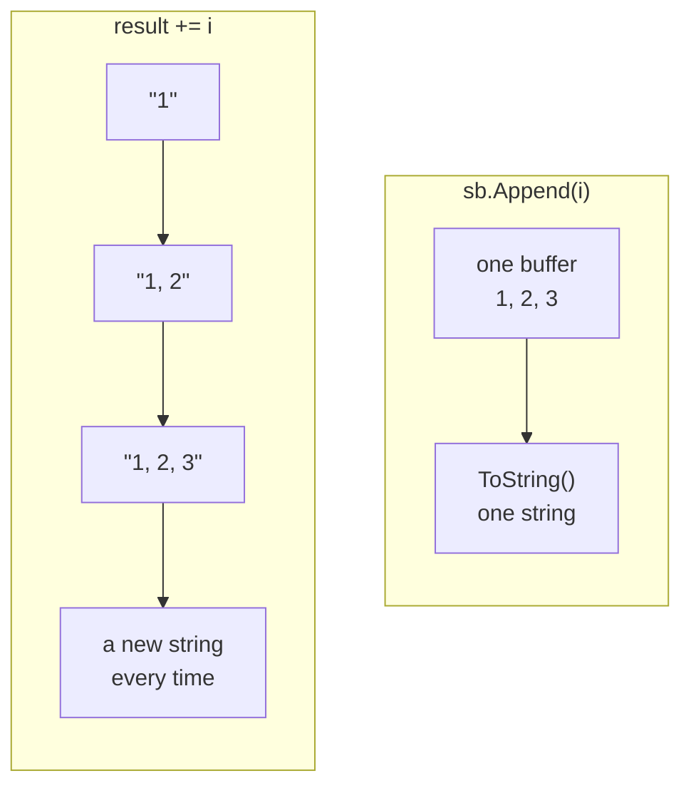

```csharp
using System.Text;   // ← needed for StringBuilder

var sb = new StringBuilder();
for (int i = 1; i <= 100; i++)
{
    sb.Append(i);
    if (i < 100) sb.Append(", ");
}
string result = sb.ToString();   // "1, 2, 3, ..., 100"
```

> ⚠️ **Correction:** `StringBuilder` lives in `System.Text`, which is **not** one of the implicit usings. Without `using System.Text;` you get `error CS0246: The type or namespace name 'StringBuilder' could not be found`.

- `AppendLine(...)` adds the text plus a new line. Calls can be chained: `sb.Append("Total: ").Append(45.5m).AppendLine();`
- In the demo, 20,000 `+=` take tens of milliseconds while `StringBuilder` takes under 1 ms. The gap grows fast with size.
- For a few joins, `+` or `$"..."` is fine. Use `StringBuilder` when building text **in a loop**.

---

## 5. Null & Nullable Types

> ▶ **Run it:** `Session04.Nulls` in [`Demo`](Demo/Session04.Nulls/Program.cs) — `dotnet run --project Session04.Nulls`

`null` means **"no value"**. Using a member of something that is `null` throws `NullReferenceException`, one of the most common bugs in .NET. C# gives you types and operators to handle it safely.

### 5.1 Nullable value types: `int?`

Value types (`int`, `bool`, `decimal`...) can't be `null`. Add `?` to allow it:

```csharp
int? age = null;
bool? isVerified = null;

age.HasValue               // false
age.GetValueOrDefault()    // 0
age = 30;
age.Value                  // 30

// int plain = null;       // error CS0037: Cannot convert null to 'int'
```

> Reading `.Value` when there is no value throws `InvalidOperationException`. The compiler warns you (CS8629). Check `HasValue` first, or use `??`.

Typical use: data that may be **missing**, like an optional age in a form or a `dueDate` that isn't set yet.

### 5.2 Nullable reference types: `string?`

Reference types (`string`, arrays, objects) can always hold `null`. With **nullable reference types** turned on, you mark the ones that **may** be `null` with `?`, and the compiler warns you when you use them without checking:

```csharp
string? maybeName = null;   // OK: might be null
string name = null;         // warning CS8600
```

> ⚠️ **Correction / update:** the deck says to enable `<Nullable>enable</Nullable>` in your project file. Since .NET 6, **every new project already has it** (look in your `.csproj`). Treat these warnings as bugs waiting to happen.

### 5.3 Fallbacks: `??` and `??=`

```csharp
int? userAge = null;
int display = userAge ?? 0;              // 0: use the right side when the left is null

string? nickname = null;
string shown = nickname ?? "Unknown";    // "Unknown"

string? title = null;
title ??= "Untitled";                    // assign only if title is null
```

### 5.4 Safe access: `?.`

`?.` uses a member **only if the value isn't null**. Otherwise the whole expression is `null` instead of throwing:

```csharp
string? name = null;
int? length = name?.Length;        // null (note: int?, because it might be null)
string? upper = name?.ToUpper();   // null
```

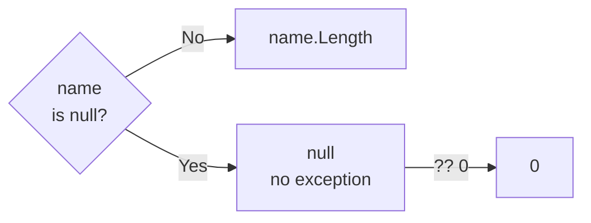

**Chaining:** if anything along the way is `null`, the result is `null`, and `??` gives the fallback:

```csharp
int len = user?.Address?.PostalCode?.Length ?? 0;
```

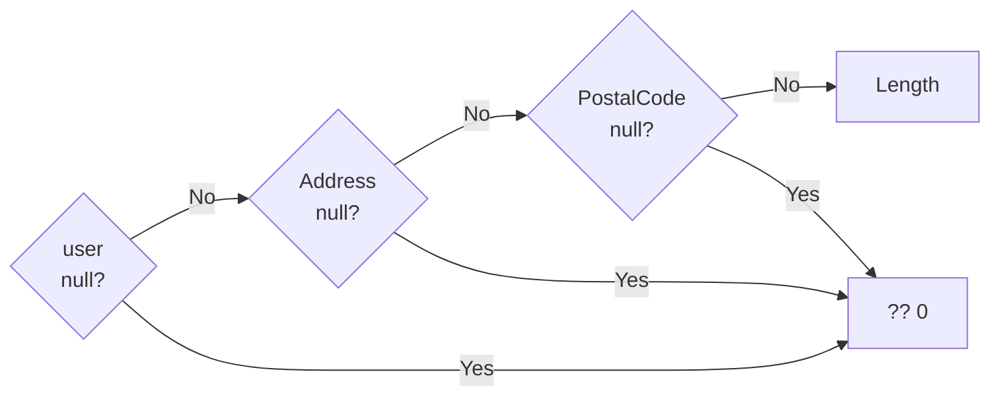

> 🆕 **C# 14:** `?.` also works on the **left** of `=`. `user?.Address = newAddress;` assigns only when `user` isn't null, and does nothing otherwise.

> **The `!` operator** (`name!.Length`) tells the compiler "trust me, it's not null". It removes the **warning**, not the **problem**: if it is null, you still get `NullReferenceException`. Use it only when you're sure.

### 5.5 Null checks

```csharp
string? name = GetName();

if (name is not null)            // C# 9+, preferred: reads like English
{
    Console.WriteLine(name.Length);
}

if (name != null)                // classic, works too
{
    Console.WriteLine(name.Length);
}

string display = name ?? "Unknown";
```

Inside the `if`, the compiler **knows** `name` isn't null (flow analysis), so there's no warning on `name.Length`.

---

## 6. Exception Handling

> ▶ **Run it:** `Session04.ExceptionHandling` in [`Demo`](Demo/Session04.ExceptionHandling/Program.cs) — `dotnet run --project Session04.ExceptionHandling`

An **exception** is an error that happens while the program runs: bad input, a missing file, dividing an `int` by zero. If nobody **catches** it, the program **crashes**.

### 6.1 `try` / `catch` / `finally`

```csharp
try
{
    string? input = Console.ReadLine();
    int result = 10 / int.Parse(input!);
    Console.WriteLine(result);
}
catch (DivideByZeroException)
{
    Console.WriteLine("Cannot divide by zero.");
}
catch (FormatException ex)
{
    Console.WriteLine($"Invalid input: {ex.Message}");
}
finally
{
    // Always runs: use it to release resources
    Console.WriteLine("Done.");
}
```

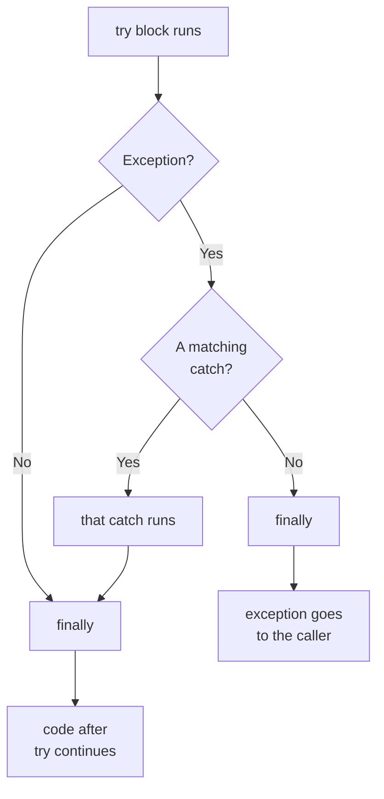

- `finally` runs **whether or not** an exception was thrown, and even when the `try` block **returns**. Use it for cleanup (closing files, releasing locks).
- `ex.Message` is the human-readable error; `ex.GetType().Name` says which exception it was.

> ⚠️ **Correction / update:** the deck's `int.Parse(Console.ReadLine())` gives **warning CS8604** in a .NET 10 project, because `ReadLine()` returns `string?`. Read into a `string?` first. If input ends, `ReadLine()` returns `null` and `int.Parse(null)` throws `ArgumentNullException`, which none of the deck's catches handle. And `"99999999999"` throws `OverflowException`, which isn't caught either. The demo adds a final `catch (Exception)` for those.

### 6.2 How an exception travels

When a method throws and **doesn't catch**, the exception leaves that method and goes to its **caller**, then the caller's caller, until a `catch` handles it:

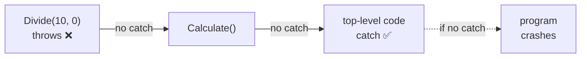

So you don't need `try/catch` in **every** method. Catch where you can actually **do something** about the error: show a message, retry, or return an error response (in the API, Session 10).

### 6.3 Catch order: specific first

The **first matching** `catch` wins, and a `catch` also matches every exception **derived** from its type. So put **specific** types first and `Exception` **last**:

```csharp
catch (FormatException ex)      // specific
catch (OverflowException ex)    // specific
catch (Exception ex)            // general: last!
```

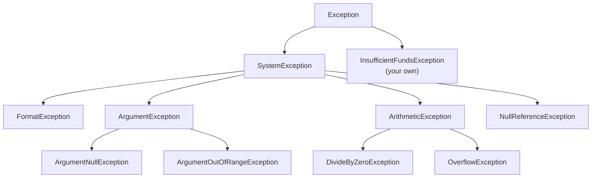

> ⚠️ **Correction:** the deck says a `catch (Exception)` at the top "swallows everything". In C# it's stronger than that: a general catch **before** a specific one **doesn't compile**:
>
> ```text
> error CS0160: A previous catch clause already catches all exceptions of this or of a super type ('Exception')
> ```

### 6.4 Throwing exceptions

Use `throw` when a method **can't do its job**, for example when it gets an invalid argument:

```csharp
static int Divide(int a, int b)
{
    if (b == 0)
        throw new ArgumentException("Divisor cannot be zero.", nameof(b));
    return a / b;
}
// ex.Message   → "Divisor cannot be zero. (Parameter 'b')"
// ex.ParamName → "b"
```

- `nameof(b)` gives `"b"`, and it stays correct if you rename the parameter.
- Pick the most fitting type: `ArgumentNullException` for a `null` argument, `ArgumentOutOfRangeException` for a value outside the allowed range, `InvalidOperationException` when the object is in the wrong state.

> 🆕 **.NET 8+ guard helpers** do the `if` + `throw` in one line:
>
> ```csharp
> ArgumentOutOfRangeException.ThrowIfZero(b);
> ArgumentOutOfRangeException.ThrowIfNegative(amount);
> ArgumentNullException.ThrowIfNull(name);
> ArgumentException.ThrowIfNullOrWhiteSpace(title);
> ```

### 6.5 Re-throwing: `throw;` not `throw ex;`

Sometimes you want to **log** an error and then let it keep going up. Use a bare `throw;`:

```csharp
try
{
    // ... something that may throw
}
catch (Exception ex)
{
    Console.WriteLine($"Logging: {ex.Message}");
    throw;      // ✅ keeps the original stack trace
    // NOT: throw ex;
}
```

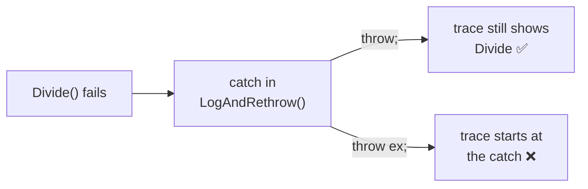

The demo prints both stack traces:

```text
throw;     trace: Divide → LogAndRethrow → <Main>$   ✅ Divide is still there
throw ex;  trace: LogAndThrowEx → <Main>$            ❌ Divide is gone
```

> *"Use bare `throw;` to re-throw — never `throw ex;`. The stack trace is your only map to the crime scene."* — Session 04 deck. The .NET analyzers agree: `throw ex;` gives warning **CA2200**.

> **Exception filters** catch only when a condition is true, without catching and re-throwing:
>
> ```csharp
> catch (HttpRequestException ex) when (ex.StatusCode == HttpStatusCode.ServiceUnavailable)
> ```

### 6.6 Custom exception types

Make your own exception when a failure belongs to **your domain** and needs extra data:

```csharp
// Exceptions/InsufficientFundsException.cs
namespace Session04.ExceptionHandling.Exceptions;

public class InsufficientFundsException : Exception
{
    public decimal Amount { get; }

    public InsufficientFundsException(decimal amount)
        : base($"Insufficient funds. Attempted to withdraw {amount:N2} EGP.")
    {
        Amount = amount;
    }
}
```

```csharp
// Throwing
throw new InsufficientFundsException(500m);

// Catching
catch (InsufficientFundsException ex)
{
    Console.WriteLine($"Failed: {ex.Message}");   // Insufficient funds. Attempted to withdraw 500.00 EGP.
    Console.WriteLine($"Amount: {ex.Amount}");    // 500
}
```

- Inherit from `Exception`, and end the name with **`Exception`**.
- `: base(message)` passes the message to `Exception`, so `ex.Message` works.
- Add properties for the extra data (`Amount`).

> ⚠️ **Correction:** the deck formats the amount with `{amount:C}` (currency). `C` uses the **PC's regional settings**: the same code prints `$500.00` on a US PC, `500,00 €` on a German one, and `500٫00 ج.م.‏` on an Egyptian Arabic one. For messages that go into logs or APIs, use a fixed format such as `{amount:N2} EGP` (or pass `CultureInfo.InvariantCulture`), the same lesson as parsing in [Session 03 §4.3](../Session03/dotnet-backend-session-03-notes.md#43-the-convert-class).

> **Why this matters later:** custom exceptions become essential in **Session 10**: every API error will map to a specific exception type, and each type to an HTTP status code (e.g. `NotFoundException` → 404).

### 6.7 Exceptions or `TryX`?

Exceptions are for **unexpected** failures. When failure is **normal** (a user typing a wrong number), don't use `try/catch` for it: use a method that reports success, like `TryParse`.

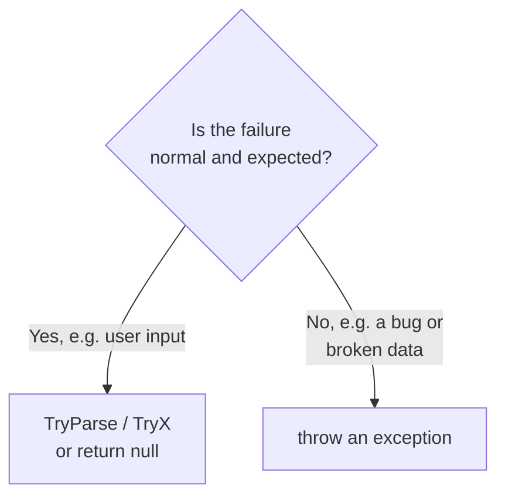

This is also the design of the assignment: `SafeCalculate` returns `null` for an invalid operation, and throws only when the input isn't an expression at all.

---

## 7. Debugging Exceptions

When an exception isn't caught and you run with **F5**, the debugger **stops on the line that threw** and shows the exception. Use that moment to look around.

| Action | Visual Studio 2026 | VS Code |
|---|---|---|
| See the exception | The **Exception Helper** pop-up on the failing line; `$exception` in **Locals** | The exception panel on the failing line; **Variables** panel |
| See how you got there | **Call Stack** window (`Ctrl+Alt+C`); double-click a frame to jump to it | **Call Stack** panel in Run and Debug |
| Stop even when it's caught | **Debug → Windows → Exception Settings** (`Ctrl+Alt+E`) → tick **Common Language Runtime Exceptions** (or one type) | Run and Debug → **Breakpoints** → tick **All Exceptions** |
| Stop only when it's not caught | Default behaviour | Tick **User-Unhandled Exceptions** |
| Step into a method | `F11` | `F11` |
| Step out of a method | `Shift+F11` | `Shift+F11` |

**Reading a stack trace:** the **top** line is where the exception was thrown; each line below is the method that called the one above it.

> **Try it:** in `Session04.ExceptionHandling`, set a breakpoint on `Calculator.Calculate(10, 0);`, press **F5**, then **F11** into `Calculate` and `Divide` and watch the Call Stack grow, then shrink when the exception travels back up.

Docs: [Manage exceptions with the VS debugger](https://learn.microsoft.com/visualstudio/debugger/managing-exceptions-with-the-debugger) · [Debugging C# in VS Code](https://code.visualstudio.com/docs/csharp/debugging)

---

## 8. Common Mistakes

> ▶ **Run it:** `Session04.CommonMistakes` in [`Demo`](Demo/Session04.CommonMistakes/Program.cs) — `dotnet run --project Session04.CommonMistakes`

| Mistake | What goes wrong | Do this instead |
|---|---|---|
| Overloading methods in top-level code | Compile error CS0128 | Put overloads in a `class` |
| `s.Trim();` without assigning | Nothing changes (strings are immutable) | `s = s.Trim();` |
| Counting `Substring` positions by hand | Wrong part of the string | `s.Substring(s.IndexOf("World"), 5)` |
| `==` for case-insensitive compare | `"admin" == "ADMIN"` is `false` | `string.Equals(a, b, StringComparison.OrdinalIgnoreCase)` |
| `+=` on a string in a loop | Slow, lots of garbage | `StringBuilder` (with `using System.Text;`) |
| `name!.Length` to silence a warning | `NullReferenceException` at runtime | `name?.Length ?? 0` or an `is not null` check |
| Empty `catch { }` | The error disappears silently | Catch a specific type and handle or log it |
| `catch (Exception)` before specific catches | Compile error CS0160 | Specific first, `Exception` last |
| `throw ex;` | Stack trace lost (warning CA2200) | `throw;` |
| Expecting `10.0 / 0` to throw | It's `∞` (`double.PositiveInfinity`), no exception | Check the divisor; only `int / 0` throws |
| `try/catch` around `int.Parse` for user input | Exceptions for normal input | `int.TryParse` |

---

## 9. Summary

- **Methods** hold reusable logic. Use `=>` for one-expression methods.
- **Overloads** share a name with different parameters. In top-level code, put them in a **class**.
- **Optional** and **named** parameters cut down on overloads and make calls readable.
- Arguments are **copied** by default; `ref` and `out` pass the variable itself. `out` is how `TryParse` works.
- **Strings are immutable**: always use the result of `Trim()`, `Replace()`... Use **`StringBuilder`** in loops.
- Compare with **`StringComparison.OrdinalIgnoreCase`** to ignore case.
- `int?` allows `null` for value types; `string?` marks references that may be `null`.
- **`??`** gives a fallback, **`??=`** assigns if null, **`?.`** skips the member if null.
- **Catch specific exceptions first**; `finally` always runs; re-throw with bare **`throw;`**.
- **Custom exceptions** carry domain data and will drive API errors in Session 10.

---

## 10. Assignment

> ▶ **Starter code:** [`Lab/Session04.Lab/Program.cs`](Lab/Session04.Lab/Program.cs) — a separate solution (`Session04.Lab.slnx`) with a TODO and hints for each criterion, and an empty [`InvalidExpressionException`](Lab/Session04.Lab/Exceptions/InvalidExpressionException.cs) to finish. Run it with `dotnet run --project Session04.Lab` from the `Lab` folder.

Build a **safe calculator** console app that uses methods, strings, nullable types, and exception handling.

**Acceptance criteria:**

- [ ] A method `double? SafeCalculate(string expression)` parses a string like `"10 / 2"` and returns the result, or **`null`** if the operation is invalid.
- [ ] Supports the operators `+`, `-`, `*`, `/`.
- [ ] Throws a custom **`InvalidExpressionException`** (with the original input as a property) when the format is unrecognized.
- [ ] The program loops until the user types **`exit`**, printing each result or an error message. **No uncaught exception** may crash the app.
- [ ] Uses **`StringBuilder`** to print a summary of all calculations at the end.

**Bonus:** a **`history`** command that prints all previous calculations (the `StringBuilder` summary) at any time, not just on exit.

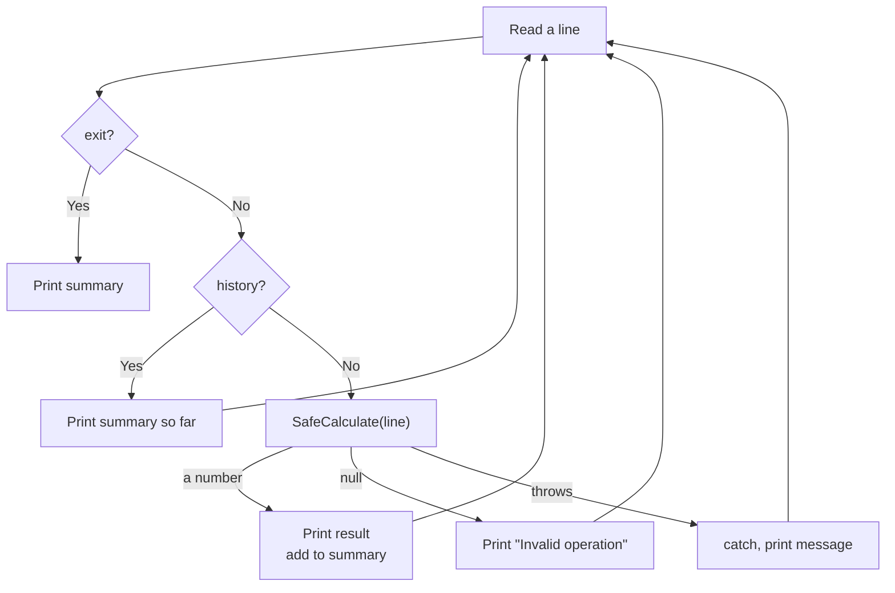

> "In Main" in the deck means the top-level code in `Program.cs`. A .NET 10 console app has no written `Main` method ([Session 03 §2.4](../Session03/dotnet-backend-session-03-notes.md#24-what-a-net-10-console-program-looks-like)).

### Hints

| Requirement | Hint |
|---|---|
| Split the input | `expression.Split(' ', StringSplitOptions.RemoveEmptyEntries)`. A valid expression gives exactly **3** parts. |
| Parse the numbers | `double.TryParse(text, CultureInfo.InvariantCulture, out double a)`, so `"2.5"` works on every PC ([Session 03 §4.3](../Session03/dotnet-backend-session-03-notes.md#43-the-convert-class)). |
| Pick the operator | A switch expression on the operator string: `"+" => a + b, ...` ([Session 03 §5.4](../Session03/dotnet-backend-session-03-notes.md#54-switch-expression-c-8-returns-a-value)). |
| `null` vs exception | Decide what's an **invalid operation** (e.g. `5 / 0`) → return `null`, and what's an **unrecognized format** (`"hello"`, `"5 ^ 2"`, `"1 + "`) → throw. |
| Divide by zero | `10.0 / 0` doesn't throw for `double`, it gives `∞`. Check the divisor yourself and return `null`. |
| `exit` | `line.Trim().Equals("exit", StringComparison.OrdinalIgnoreCase)` so `EXIT` and `" exit "` work too. |
| Never crash | Wrap the `SafeCalculate` call in `try/catch`: `InvalidExpressionException` first, then a general `catch (Exception)`. |
| Summary | `summary.AppendLine($"{line} = {result}");` after each calculation, then `Console.Write(summary.ToString())`. |

### Starter skeleton

```csharp
using System.Globalization;
using System.Text;

var summary = new StringBuilder();

while (true)
{
    Console.Write("> ");
    string? line = Console.ReadLine();
    if (line is null) break;

    // TODO: "exit" → break.   Bonus: "history" → print the summary
    // TODO: try { SafeCalculate(line) } catch ... → print result or error
}

// TODO: print the summary

static double? SafeCalculate(string expression)
{
    // TODO: split, parse, calculate; return null for an invalid operation;
    //       throw new InvalidExpressionException(expression) for a bad format
    return null;
}

// TODO: class InvalidExpressionException : Exception with an Input property
//       (in the Lab it's in Exceptions/InvalidExpressionException.cs)
```

**How to run it:**

- **Single file:** save it as `calculator.cs`, then `dotnet run calculator.cs` (put the exception class at the bottom of the file).
- **Visual Studio 2026:** open `Lab\Session04.Lab.slnx`, then `Ctrl+F5`.
- **VS Code:** `dotnet run --project Session04.Lab` in the terminal from the `Lab` folder (so you can type input).

---

## 11. Before Next Session

**Next: Session 05, OOP I: Classes, Encapsulation & Inheritance**

- Defining classes with fields, properties, and constructors.
- Access modifiers and encapsulation.
- Inheritance and the `base` keyword (you've already used `: base(...)` in [§6.6](#66-custom-exception-types)).
- Method overriding with `virtual` and `override`.

**To do:**

- [ ] Finish the Safe Calculator assignment above.
- [ ] Step through `Session04.ExceptionHandling` with **F11** and watch the Call Stack ([§7](#7-debugging-exceptions)).

> ℹ️ The deck asks you to "complete the four exercises at the end of today's session" and to pay attention to **exercise 4**, but the deck itself only contains the assignment above. Check with the instructor for the exercise list.

**Think about:**

1. What does this print, and why?
   ```csharp
   string s = "  hi  ";
   s.ToUpper();
   Console.WriteLine($"[{s}]");
   ```
2. Why doesn't this compile in a top-level `Program.cs`?
   ```csharp
   static int Max(int a, int b) => a > b ? a : b;
   static double Max(double a, double b) => a > b ? a : b;
   ```
3. `string? name = null;` What are `name?.Length` and `name?.Length ?? -1`?
4. What's the difference between `throw;` and `throw ex;`?
5. What does `Console.WriteLine(10.0 / 0);` print? And `Console.WriteLine(10 / 0);`?

<details>
<summary>Answers</summary>

1. `[  hi  ]`. `ToUpper()` returns a new string that's thrown away. Write `s = s.ToUpper();`.
2. Methods in top-level code are local functions, and local functions can't be overloaded (CS0128). Put them in a class.
3. `null` (an `int?`), and `-1`.
4. `throw;` keeps the original stack trace (where it really failed). `throw ex;` restarts it at the `catch`, so you lose where the error came from.
5. `∞`: `double` division by zero gives infinity. `10 / 0` with two `int` **constants** doesn't even compile (error CS0020: Division by constant zero); with an `int` variable that is 0 it throws `DivideByZeroException`.

</details>

---

## 12. Links

**Methods**

| Topic | Link |
|---|---|
| Methods | <https://learn.microsoft.com/dotnet/csharp/methods> |
| Local functions | <https://learn.microsoft.com/dotnet/csharp/programming-guide/classes-and-structs/local-functions> |
| Expression-bodied members `=>` | <https://learn.microsoft.com/dotnet/csharp/programming-guide/statements-expressions-operators/expression-bodied-members> |
| Named and optional arguments | <https://learn.microsoft.com/dotnet/csharp/programming-guide/classes-and-structs/named-and-optional-arguments> |
| Method parameters (`ref`, `out`, `in`) | <https://learn.microsoft.com/dotnet/csharp/language-reference/keywords/method-parameters> |
| Tuples | <https://learn.microsoft.com/dotnet/csharp/language-reference/builtin-types/value-tuples> |

**Strings**

| Topic | Link |
|---|---|
| Strings | <https://learn.microsoft.com/dotnet/csharp/programming-guide/strings/> |
| `StringBuilder` | <https://learn.microsoft.com/dotnet/standard/base-types/stringbuilder> |
| Comparing strings | <https://learn.microsoft.com/dotnet/csharp/how-to/compare-strings> |
| Best practices for strings | <https://learn.microsoft.com/dotnet/standard/base-types/best-practices-strings> |
| Splitting strings | <https://learn.microsoft.com/dotnet/csharp/how-to/parse-strings-using-split> |

**Null**

| Topic | Link |
|---|---|
| Nullable value types `int?` | <https://learn.microsoft.com/dotnet/csharp/language-reference/builtin-types/nullable-value-types> |
| Nullable reference types `string?` | <https://learn.microsoft.com/dotnet/csharp/nullable-references> |
| `??` and `??=` | <https://learn.microsoft.com/dotnet/csharp/language-reference/operators/null-coalescing-operator> |
| `?.` and `?[]` | <https://learn.microsoft.com/dotnet/csharp/language-reference/operators/member-access-operators#null-conditional-operators--and-> |
| What's new in C# 14 (null-conditional assignment) | <https://learn.microsoft.com/dotnet/csharp/whats-new/csharp-14> |

**Exceptions**

| Topic | Link |
|---|---|
| `try`, `catch`, `finally`, `throw` | <https://learn.microsoft.com/dotnet/csharp/language-reference/statements/exception-handling-statements> |
| Exceptions overview | <https://learn.microsoft.com/dotnet/csharp/fundamentals/exceptions/> |
| Best practices for exceptions | <https://learn.microsoft.com/dotnet/standard/exceptions/best-practices-for-exceptions> |
| Creating custom exceptions | <https://learn.microsoft.com/dotnet/standard/exceptions/how-to-create-user-defined-exceptions> |
| CA2200: re-throw to preserve stack details | <https://learn.microsoft.com/dotnet/fundamentals/code-analysis/quality-rules/ca2200> |
| Manage exceptions with the VS debugger | <https://learn.microsoft.com/visualstudio/debugger/managing-exceptions-with-the-debugger> |
| Debugging C# in VS Code | <https://code.visualstudio.com/docs/csharp/debugging> |
