# Session 05 — OOP I: Classes, Encapsulation & Inheritance (Study Notes)

> **Course:** Backend Development with .NET — Andalusia Academy
> **Session:** 05 · Week 3 · 2.5 hours
> **Source deck:** <https://seifmansour.com/courses/dotnet-backend/5>
> Your first **classes**. Every part of the Task Manager API (tasks, users, services, controllers) is a class, so this is the foundation for everything after it.

> ℹ️ **These notes use .NET 10 and C# 14.** Everything in the deck works on .NET 10, except where marked ⚠️ **Correction**. Newer syntax you can also use is marked 🆕. Every code sample here was run on the .NET 10 SDK (10.0.404).

> Diagrams are written in **Mermaid**. They render on GitHub, Azure DevOps Wiki, Notion, and in VS Code with the *Markdown Preview Mermaid Support* extension.

---

## Table of Contents

1. [Session Goals & Agenda](#1-session-goals--agenda)
2. [Before You Start](#2-before-you-start) · [Practice projects](#23-practice-projects-for-this-session)
3. [Classes & Objects](#3-classes--objects)
4. [Constructors & the `this` Keyword](#4-constructors--the-this-keyword)
5. [Properties & Access Modifiers](#5-properties--access-modifiers)
6. [Static Members](#6-static-members)
7. [Inheritance & the `base` Keyword](#7-inheritance--the-base-keyword)
8. [`virtual` & `override`](#8-virtual--override)
9. [Debugging Objects](#9-debugging-objects)
10. [Common Mistakes](#10-common-mistakes)
11. [Summary](#11-summary)
12. [Lab: WorkItem Hierarchy](#12-lab-workitem-hierarchy)
13. [Assignment: BankAccount Hierarchy](#13-assignment-bankaccount-hierarchy)
14. [Before Next Session](#14-before-next-session)
15. [Links](#15-links)

---

## 1. Session Goals & Agenda

By the end of the session you should be able to:

- **Define classes** with constructors, fields, and properties.
- Use **access modifiers** to enforce **encapsulation**.
- Use **static members** for state and behaviour shared by the whole class.
- Build class hierarchies with **inheritance**.
- **Override** methods in derived classes correctly.

**Where this fits:** object-oriented programming (OOP) rests on four ideas. This session covers the first three; Session 06 finishes polymorphism and adds abstraction.

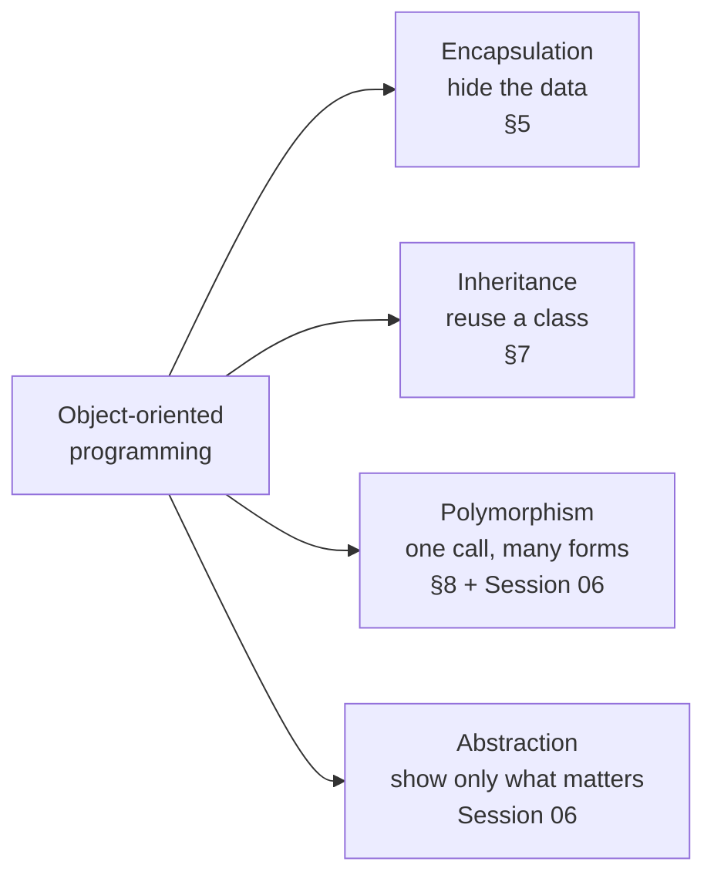

| Time | Topic | Type | Duration |
|---|---|---|---|
| 0:00 | Classes & objects | Theory + Demo | 25 min |
| 0:25 | Constructors & the `this` keyword | Theory + Demo | 20 min |
| 0:45 | Properties & access modifiers | Theory + Demo | 25 min |
| 1:10 | Break | — | 10 min |
| 1:20 | Static members | Theory + Demo | 15 min |
| 1:35 | Inheritance & the `base` keyword | Theory + Demo | 25 min |
| 2:00 | `virtual` & `override` | Theory + Demo | 20 min |
| 2:20 | Lab | Lab | 10 min |

---

## 2. Before You Start

### 2.1 Running the code

Same setup as before ([Session 03 §2](../Session03/dotnet-backend-session-03-notes.md#2-running-c-code-vs-2026-vs-code-or-one-file)):

| Way | How |
|---|---|
| 🆕 One file | Save as `test.cs`, then `dotnet run test.cs`. Put classes **after** the top-level code. |
| Visual Studio 2026 | Console App (.NET 10), `Ctrl+F5` |
| VS Code | `dotnet new console -n Session05`, then `dotnet run` in the terminal |

### 2.2 One class per file, in a `Models` folder

From now on, programs have **many classes**. The convention (used in the deck and in the API later) is **one public class per file**, with the file named after the class, inside a folder such as `Models`:

```text
Session05.Inheritance/
├── Program.cs           ← top-level code: uses the classes
└── Models/
    ├── Animal.cs        ← namespace Session05.Inheritance.Models;
    ├── Dog.cs
    └── Cat.cs
```

```csharp
// Models/Dog.cs
namespace Session05.Inheritance.Models;

public class Dog : Animal { /* ... */ }
```

```csharp
// Program.cs
using Session05.Inheritance.Models;

Dog d = new Dog("Rex", "Labrador");
```

How to add the folder and the class files in Visual Studio 2026 and VS Code: [Session 04 §2.2](../Session04/dotnet-backend-session-04-notes.md#22-adding-a-second-file-to-a-project).

### 2.3 Practice projects for this session

Ready-made code for every topic is in this `Session05` folder, next to these notes (see [README.md](README.md)). There are **two separate solutions**:

```text
Session05/
├── Demo/Session05.Demo.slnx            ← one console project per topic, with short comments
│   ├── Session05.ClassesObjects        §3
│   ├── Session05.Constructors          §4
│   ├── Session05.Properties            §5
│   ├── Session05.StaticMembers         §6
│   ├── Session05.Inheritance           §7
│   ├── Session05.Polymorphism          §8
│   └── Session05.CommonMistakes        §10
└── Lab/Session05.Lab.slnx              ← starters with TODOs and hints
    ├── Session05.Lab                   §12  WorkItem hierarchy (in-session lab)
    └── Session05.Assignment            §13  BankAccount hierarchy (assignment)
```

| | Visual Studio 2026 | VS Code |
|---|---|---|
| Open | **File → Open → Project/Solution** → `Session05.Demo.slnx` | `code Session05` |
| Pick a demo | Right-click the project → **Set as Startup Project** | In the `Demo` folder: `dotnet run --project Session05.Inheritance` |
| Run | `Ctrl+F5` | the command above, or `F5` → **C#** to debug |
| Lab | Open `Session05.Lab.slnx` → pick `Session05.Lab` or `Session05.Assignment` → `Ctrl+F5` | In the `Lab` folder: `dotnet run --project Session05.Lab` |

None of this session's programs read keyboard input, so they all run with F5 in VS Code too.

---

## 3. Classes & Objects

> ▶ **Run it:** `Session05.ClassesObjects` in [`Demo`](Demo/Session05.ClassesObjects/Program.cs) — `dotnet run --project Session05.ClassesObjects`

### 3.1 Blueprint vs instance

A **class** is a **blueprint**: it describes what data something has and what it can do. An **object** (also called an **instance**) is one thing built from that blueprint, with **its own copy of the data**.

Think of a house **blueprint**: it isn't a house, but you can build many houses from it, and each one gets its own furniture and door colour.

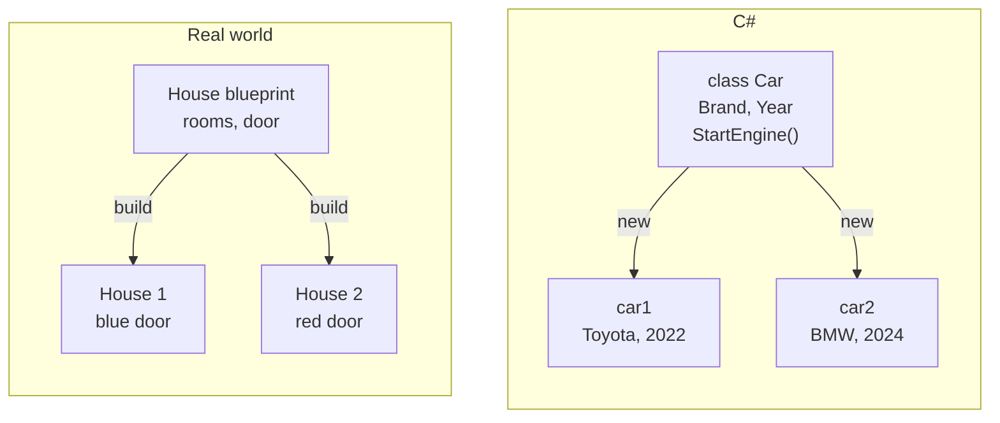

You've used classes since Session 03 without writing them: `string`, `StringBuilder` and `Random` are all classes.

### 3.2 Class anatomy

```csharp
public class Car
{
    public string Brand = "";   // field
    public int Year;            // field

    public void StartEngine()   // method
    {
        Console.WriteLine($"{Brand} engine started.");
    }
}
```

A class puts **data** and the **behaviour** that works on that data in one place:

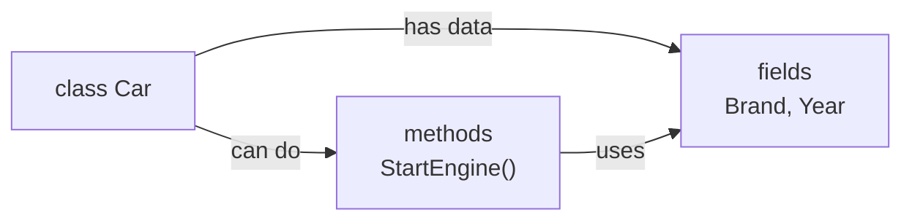

| Term | Meaning | In the example |
|---|---|---|
| **Class** | The blueprint: a new type you define | `Car` |
| **Object / instance** | One value created from the class with `new` | `car1`, `car2` |
| **Field** | A variable that belongs to the object (its data) | `Brand`, `Year` |
| **Method** | A function that belongs to the class (its behaviour) | `StartEngine()` |
| **Member** | Anything inside a class: fields, properties, methods, constructors | all of the above |
| **Instantiate** | Create an object from a class | `new Car()` |
| **Access modifier** | Who may use the member (`public`, `private`...), see [§5.2](#52-access-modifiers) | `public` |

- `public` on the **class** lets code in other files and projects use it.
- Public **fields** are fine for learning, but real code hides them behind **properties** ([§5](#5-properties--access-modifiers)).

> ⚠️ **Correction:** the deck declares `public string Brand;`. In a .NET 10 project (nullable reference types on) that gives:
>
> ```text
> warning CS8618: Non-nullable field 'Brand' must contain a non-null value when exiting constructor. Consider adding the 'required' modifier or declaring the field as nullable.
> ```
>
> A `string` field starts as `null`, but `string` (without `?`) promises it's never null. Fix it with a starting value (`= ""`), a constructor that sets it ([§4](#4-constructors--the-this-keyword)), `required` ([§3.4](#34-object-initializers)), or `string?` if it really may be missing.

### 3.3 Creating objects with `new`

```csharp
Car car1 = new Car();     // a new object on the heap
car1.Brand = "Toyota";
car1.Year = 2022;
car1.StartEngine();       // Toyota engine started.

Car empty = new Car();    // fields start with default values: Brand = "", Year = 0
```

`new` creates the object on the **heap** and gives you a **reference** to it ([Session 03 §3.3](../Session03/dotnet-backend-session-03-notes.md#33-stack-vs-heap)).

### 3.4 Object initializers

Set several fields or properties **in one expression**. It's the same as setting them one by one, just shorter:

```csharp
Car car2 = new Car
{
    Brand = "BMW",
    Year = 2024
};
car2.StartEngine();   // BMW engine started.

Car car3 = new() { Brand = "Kia", Year = 2023 };   // 🆕 target-typed new (C# 9): the type is on the left
```

> 🆕 **`required` (C# 11)** forces callers to set a member in the initializer:
>
> ```csharp
> public class Book
> {
>     public required string Title { get; set; }
>     public int Pages { get; set; }
> }
>
> Book ok = new() { Title = "Clean Code", Pages = 464 };
> Book bad = new Book();   // error CS9035: Required member 'Book.Title' must be set in the object initializer or attribute constructor.
> ```

### 3.5 Objects are references

A class is a **reference type** ([Session 03 §3.2](../Session03/dotnet-backend-session-03-notes.md#32-reference-types)). Each `new` makes a separate object, but copying a variable only copies the **reference**:

```csharp
car1.Year = 2000;          // car2.Year is still 2024: different objects

Car sameCar = car1;        // NOT a new car: the same object
sameCar.Brand = "Lexus";   // car1.Brand is now "Lexus" too
```

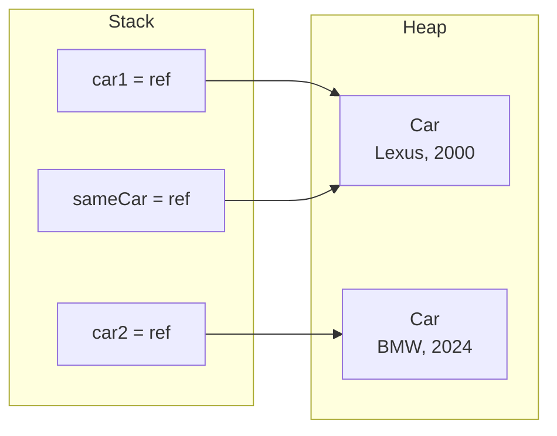

A variable that refers to **no object** is `null`, and calling a method on it throws `NullReferenceException` ([Session 04 §5](../Session04/dotnet-backend-session-04-notes.md#5-null--nullable-types)).

---

## 4. Constructors & the `this` Keyword

> ▶ **Run it:** `Session05.Constructors` in [`Demo`](Demo/Session05.Constructors/Program.cs) — `dotnet run --project Session05.Constructors`

### 4.1 Constructors

A **constructor** is a special method that runs **automatically when an object is created**. Its job: make sure the object **starts in a valid state**.

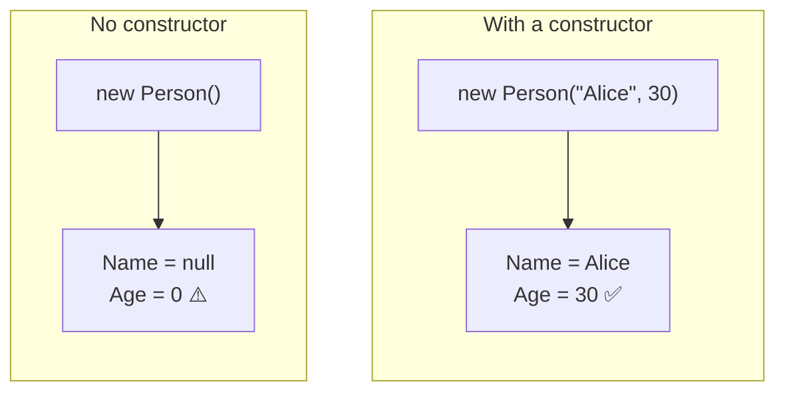

```csharp
public class Person
{
    public string Name;
    public int Age;

    public Person(string name, int age)   // same name as the class, no return type
    {
        Name = name;
        Age = age;
    }
}

Person p = new Person("Alice", 30);       // the constructor runs here
```

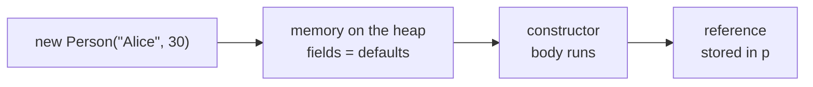

- Same name as the class, **no return type** (not even `void`).
- Because the constructor sets `Name`, there's **no CS8618 warning** here.
- If you write **no constructor**, C# gives you an empty parameterless one, so `new Car()` works.
- As soon as you write **any** constructor, that free one **disappears**:

```text
Person p = new Person();
error CS1729: 'Person' does not contain a constructor that takes 0 arguments          (Person has 2+ constructors)
error CS7036: There is no argument given that corresponds to the required parameter 'name' of 'Person.Person(string)'   (Person has 1)
```

### 4.2 Overloading and chaining with `this(...)`

Constructors can be **overloaded** like methods ([Session 04 §3.3](../Session04/dotnet-backend-session-04-notes.md#33-overloading)). To avoid repeating the setup code, one constructor can **call another** with `: this(...)`:

```csharp
public class Person
{
    public string Name;
    public int Age;
    public string Email;

    // Delegates to the three-parameter constructor
    public Person(string name, int age) : this(name, age, "")
    {
    }

    public Person(string name, int age, string email)
    {
        Name = name;
        Age = age;
        Email = email;
    }
}
```

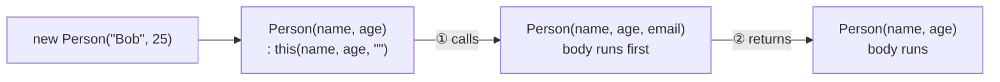

The demo prints the order: the **called** constructor's body runs **first**, then the caller's body.

> Optional parameters ([Session 04 §3.4](../Session04/dotnet-backend-session-04-notes.md#34-optional-and-named-parameters)) can do the same job: `public Person(string name, int age, string email = "")`.

### 4.3 The `this` keyword

`this` means **"the current object"**: the one the method or constructor is running on.

**1. Telling a field apart from a parameter with the same name:**

```csharp
public class Point
{
    private int x;
    private int y;

    public Point(int x, int y)
    {
        this.x = x;   // this.x = the field, x = the parameter
        this.y = y;
    }
}
```

The parameter `x` lives in the constructor's stack frame; the field `this.x` lives in the object on the heap ([Session 03 §3.3](../Session03/dotnet-backend-session-03-notes.md#33-stack-vs-heap)). `this.x = x` copies one into the other:

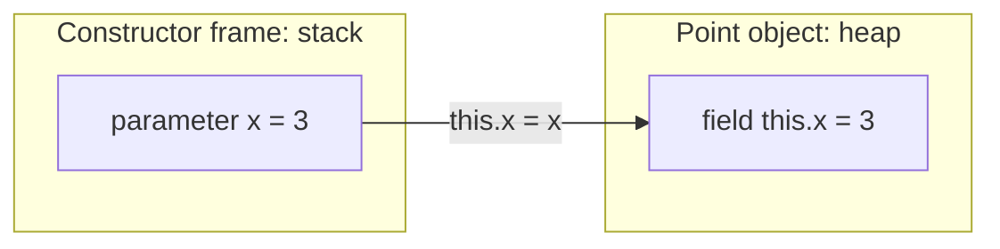

Without `this.`, `x = x;` would assign the parameter to **itself** and leave the field at `0` (the compiler warns: `warning CS1717: Assignment made to same variable; did you mean to assign something else?`).

> Many teams name private fields with an underscore (`_count`, `_price`) so there's never a clash and `this.` isn't needed.

**2. Returning the object itself to allow method chaining:**

```csharp
public class Counter
{
    private int _count;
    public int Count => _count;

    public void Increment() => _count++;

    public Counter Reset()
    {
        _count = 0;
        return this;   // same object — enables chaining
    }
}

var c = new Counter();
c.Increment();
c.Increment();           // Count = 2
c.Reset().Increment();   // Count = 1
```

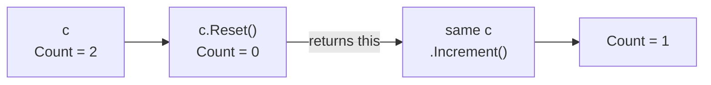

`StringBuilder.Append()` works the same way: it returns the builder, so you can write `sb.Append("a").Append("b")` ([Session 04 §4.4](../Session04/dotnet-backend-session-04-notes.md#44-stringbuilder)).

### 4.4 🆕 Primary constructors (C# 12)

Parameters written **after the class name** are available in the whole class. It's a shorter way to write a simple constructor:

```csharp
public class Employee(string name, decimal salary)
{
    public string Name { get; } = name;
    public decimal Salary { get; } = salary;
}

var e = new Employee("Sara", 15_000m);
```

You'll see this style a lot in ASP.NET Core code (services that receive their dependencies).

---

## 5. Properties & Access Modifiers

> ▶ **Run it:** `Session05.Properties` in [`Demo`](Demo/Session05.Properties/Program.cs) — `dotnet run --project Session05.Properties`

### 5.1 Encapsulation

**Encapsulation** means **hiding an object's data** and letting other code change it only through members you control. That way the object can **protect its own rules** (a price can't be negative, a balance can't be set directly).

Think of an **ATM**: you use the screen and buttons, and the machine checks the rules (PIN, balance). You can't reach into the cash box. A class works the same way:

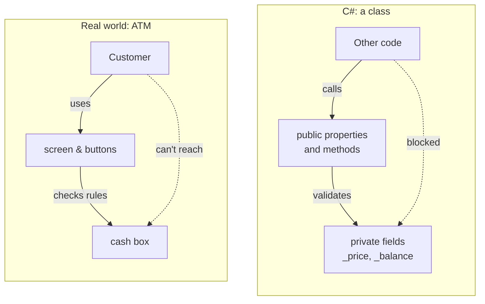

> *"Hide the data; expose the behaviour. The public surface of a class is a promise — once broken, everything that depends on it breaks too."* — Session 05 deck

### 5.2 Access modifiers

| Modifier | Accessible from |
|---|---|
| `public` | Anywhere |
| `private` | Only inside the same class |
| `protected` | The same class and **derived** classes ([§7](#7-inheritance--the-base-keyword)) |
| `internal` | Anywhere in the same **project** (assembly) |
| `protected internal` | The same project, **or** derived classes anywhere |
| 🆕 `private protected` | Derived classes **in the same project** only (C# 7.2) |

**Who can see a member?** Read across a row: ✅ means code in that place can use the member.

| Modifier | Same class | Derived class, same project | Other class, same project | Derived class, other project | Other class, other project |
|---|:---:|:---:|:---:|:---:|:---:|
| `public` | ✅ | ✅ | ✅ | ✅ | ✅ |
| `protected internal` | ✅ | ✅ | ✅ | ✅ | ❌ |
| `protected` | ✅ | ✅ | ❌ | ✅ | ❌ |
| `internal` | ✅ | ✅ | ✅ | ❌ | ❌ |
| `private protected` | ✅ | ✅ | ❌ | ❌ | ❌ |
| `private` | ✅ | ❌ | ❌ | ❌ | ❌ |

> `protected internal` = protected **OR** internal (wider). `private protected` = protected **AND** internal (narrower).

The same idea as a picture, for the `Vault` class in the demo:

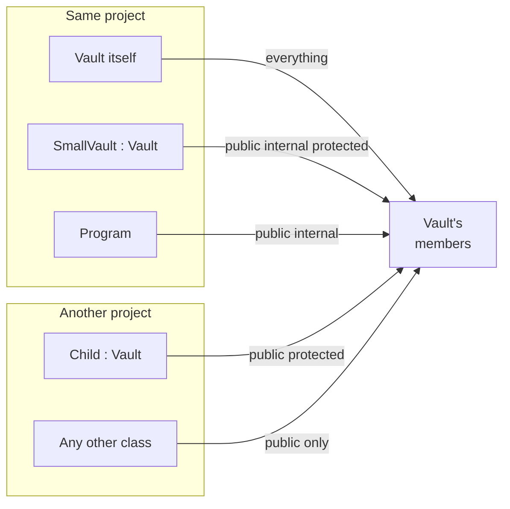

**Defaults, when you write nothing:** class **members** are `private`; a **class** itself is `internal`.

```csharp
var vault = new Vault();
vault._code = 0;   // error CS0122: 'Vault._code' is inaccessible due to its protection level
```

> **Rule of thumb:** fields should almost always be `private`. Expose data through **properties**, so you can add validation later without breaking the code that uses the class.

### 5.3 Auto-implemented properties

A **property** looks like a field from outside, but it has a **`get`** (read) and a **`set`** (write) accessor. With `{ get; set; }` the compiler creates the hidden field for you:

```csharp
public class Product
{
    public string Name { get; set; } = "";     // = "" avoids warning CS8618
    public decimal Price { get; set; }

    public int Stock { get; private set; }     // anyone can read; only Product can write

    public void Restock(int units)
    {
        Stock += units;
    }
}
```

What `{ get; set; }` really is: the compiler writes a hidden field and two small methods for you.

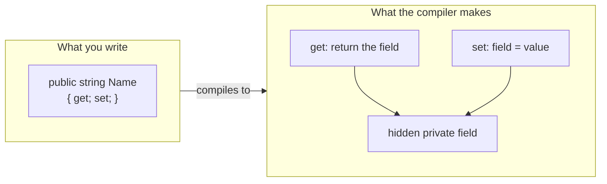

```csharp
laptop.Stock = 100;
// error CS0272: The property or indexer 'Product.Stock' cannot be used in this context because the set accessor is inaccessible
```

> ⚠️ **Correction:** like the fields in §3.2, the deck's `public string Name { get; set; }` gives **warning CS8618** in a .NET 10 project. Add `= ""`, set it in a constructor, or mark it `required`.

> 🆕 **`init` (C# 9):** settable **only while the object is being created** (in the initializer or constructor), then read-only:
>
> ```csharp
> public string Sku { get; init; } = "";
>
> var p = new Product { Sku = "LP-01" };   // OK
> p.Sku = "XX";   // error CS8852: Init-only property or indexer 'Product.Sku' can only be assigned in an object initializer, ...
> ```

### 5.4 Full properties with a backing field

When you need **validation** or other logic, write the `get` and `set` yourself and keep the value in a **private backing field**:

```csharp
public class Product
{
    private decimal _price;

    public decimal Price
    {
        get => _price;
        set
        {
            if (value < 0)
                throw new ArgumentException("Price cannot be negative.", nameof(value));
            _price = value;
        }
    }
}

laptop.Price = -10;   // ArgumentException: Price cannot be negative. (Parameter 'value')
```

- `value` is the value being assigned (the right side of `=`).
- If the `set` throws, the old value stays: the object is never in an invalid state.

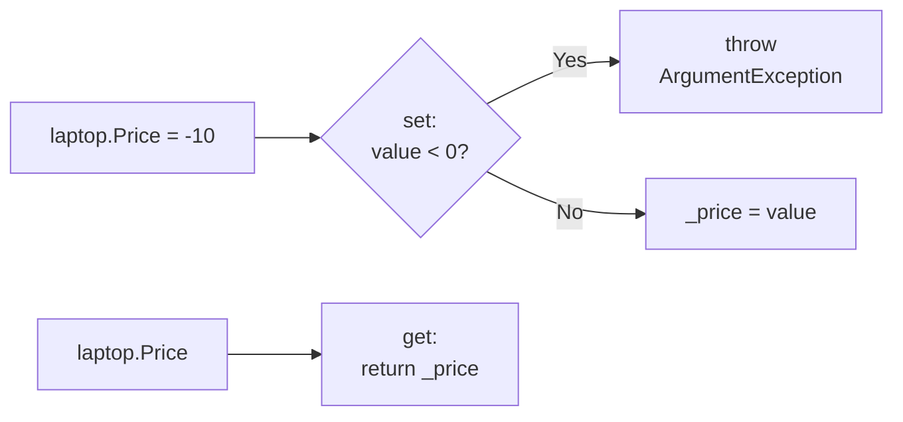

> 🆕 **C# 14: the `field` keyword.** Inside an accessor, `field` is the compiler-made backing field, so you don't have to declare `_price` yourself:
>
> ```csharp
> public decimal Percent
> {
>     get;
>     set
>     {
>         ArgumentOutOfRangeException.ThrowIfNegative(value);
>         ArgumentOutOfRangeException.ThrowIfGreaterThan(value, 100);
>         field = value;
>     }
> }
> ```

### 5.5 Computed (read-only) properties

A property with only a `get`, often written with `=>`, **computes its value every time** it's read. No field is stored, so it can **never get out of date**:

```csharp
public class Rectangle
{
    public double Width { get; set; }
    public double Height { get; set; }

    public double Area => Width * Height;
    public double Perimeter => 2 * (Width + Height);
}

var r = new Rectangle { Width = 4, Height = 6 };
Console.WriteLine(r.Area);        // 24
Console.WriteLine(r.Perimeter);   // 20
r.Width = 10;
Console.WriteLine(r.Area);        // 60  ← updated automatically
```

**Which kind of property?**

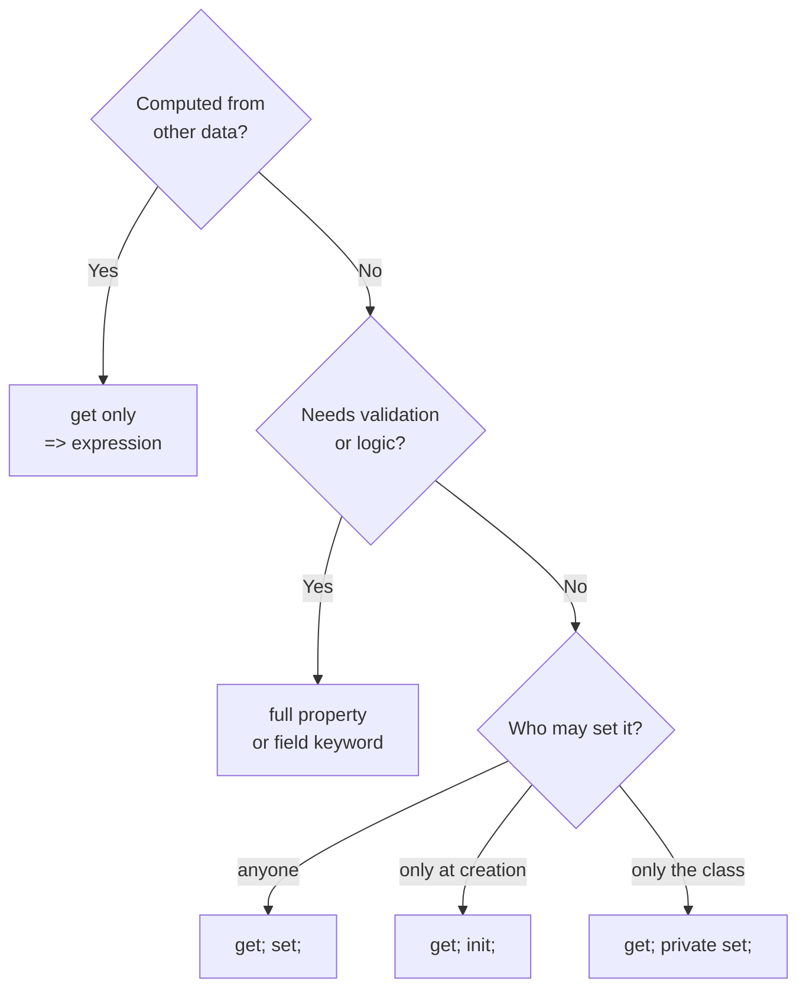

| | Field | Property |
|---|---|---|
| What it is | A variable inside the object | A pair of methods (`get`/`set`) that **looks** like a variable |
| Validation | No | Yes, in `set` |
| Can be read-only from outside | Only `readonly` (set once in the constructor) | Yes: `private set`, `init`, or `get` only |
| Naming | `private`: `_camelCase` | `PascalCase` |
| Use for | Private storage | Everything other classes see |

---

## 6. Static Members

> ▶ **Run it:** `Session05.StaticMembers` in [`Demo`](Demo/Session05.StaticMembers/Program.cs) — `dotnet run --project Session05.StaticMembers`

### 6.1 Static vs instance

An **instance** member belongs to **each object** (each `User` has its own `Name`). A **static** member belongs to the **class itself**: there is **one shared copy** for the whole program, and you use it through the **class name**.

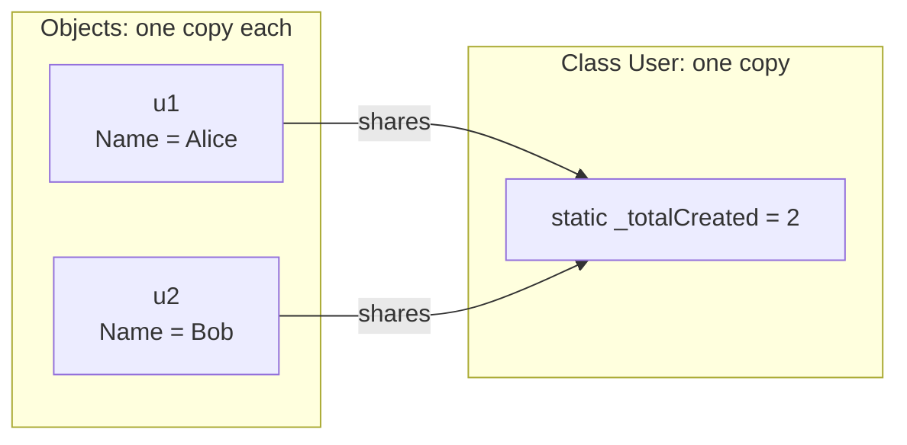

| | Instance member | Static member |
|---|---|---|
| Belongs to | Each object | The class |
| How many copies | One per object | One in total |
| Used through | An object: `u1.Name` | The class name: `User.TotalCreated` |
| Has `this` | Yes | **No**, so it can't use instance members |

### 6.2 Utility methods and static classes

Static methods are perfect for **helpers that need no object**. You already use them: `Console.WriteLine`, `Math.Sqrt`, `string.Join`, `int.TryParse`.

```csharp
public static class MathHelper
{
    public const double Pi = 3.14159;

    public static int Square(int n) => n * n;
    public static double CircleArea(double r) => Pi * r * r;
}

double pi = MathHelper.Pi;
int sq = MathHelper.Square(5);          // 25
double a = MathHelper.CircleArea(3);    // 28.27...
```

- A **`static class`** can only contain static members, and **can't be instantiated**: `new MathHelper()` → `error CS0712: Cannot create an instance of the static class 'MathHelper'`.
- A static method has **no `this`**, so it can't use instance members:

```text
public static string Bad() => Name;
error CS0120: An object reference is required for the non-static field, method, or property 'User.Name'
```

> ⚠️ **Correction:** the deck writes `public static double Pi = 3.14159;`. A **public static field can be changed by any code**: one line `MathHelper.Pi = 3;` silently breaks every calculation in the program. For a fixed value use **`const`** (or just `Math.PI`), which makes `MathHelper.Pi = 3;` a compile error (CS0131). The deck's `MathHelper` is also a normal class; marking it `static` stops anyone from creating pointless `MathHelper` objects.

### 6.3 Shared state

A **static field** is one memory location shared by every object. Here it counts how many users were created:

```csharp
public class User
{
    private static int _totalCreated = 0;   // one copy — shared by all instances

    public string Name { get; set; }

    public User(string name)
    {
        Name = name;
        _totalCreated++;                    // every constructor call increments it
    }

    public static int TotalCreated => _totalCreated;
}

var u1 = new User("Alice");
var u2 = new User("Bob");
Console.WriteLine(User.TotalCreated);   // 2
```

The static field exists **before any object** and keeps counting as objects are created:

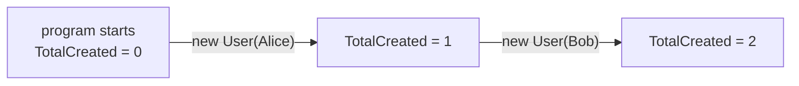

Static members are used through the **class**, not an object: `u1.TotalCreated` → `error CS0176: Member 'User.TotalCreated' cannot be accessed with an instance reference; qualify it with a type name instead`.

### 6.4 Static or instance?

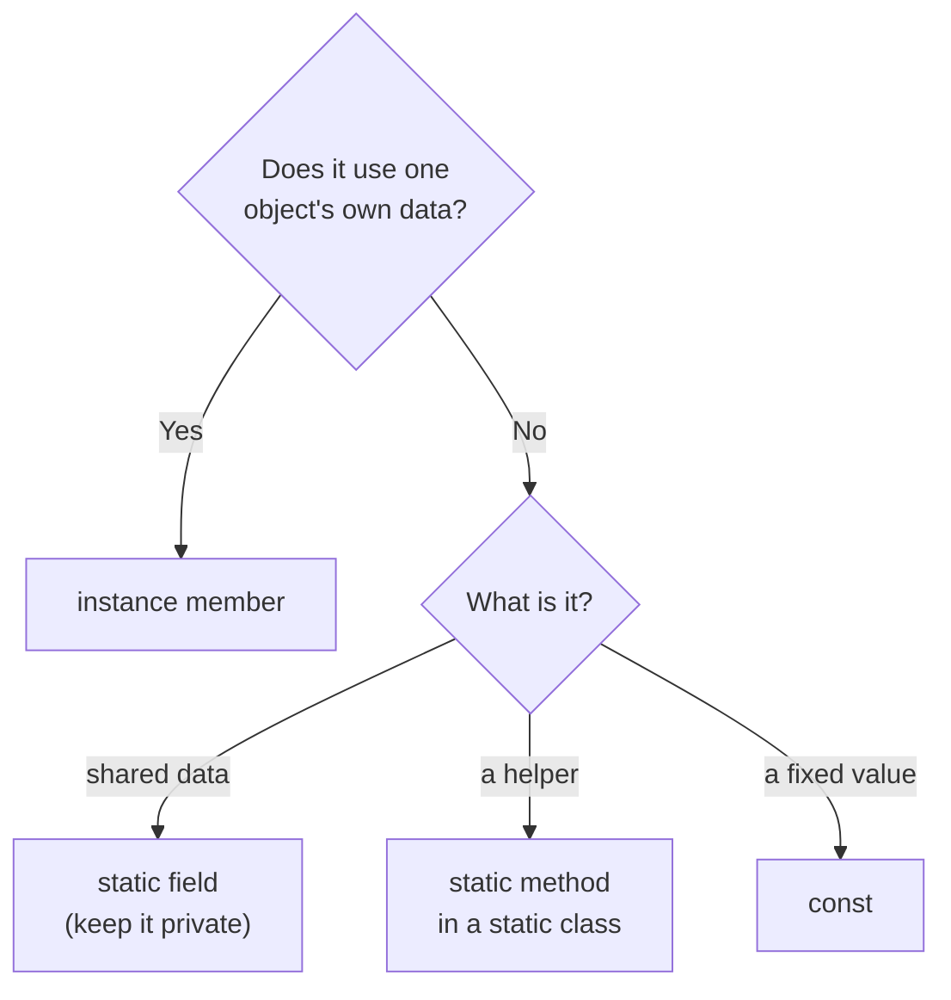

> In the API you'll use **few** static members: shared mutable state causes bugs when many requests run at once. Most logic lives in **instance** classes (services) that ASP.NET Core creates for you.

---

## 7. Inheritance & the `base` Keyword

> ▶ **Run it:** `Session05.Inheritance` in [`Demo`](Demo/Session05.Inheritance/Program.cs) — `dotnet run --project Session05.Inheritance`

### 7.1 The IS-A relationship

**Inheritance** lets a new class (**derived** class, or child) **reuse and extend** an existing one (**base** class, or parent). Use it when the new class **IS-A** kind of the base: a `Dog` IS-A `Animal`.

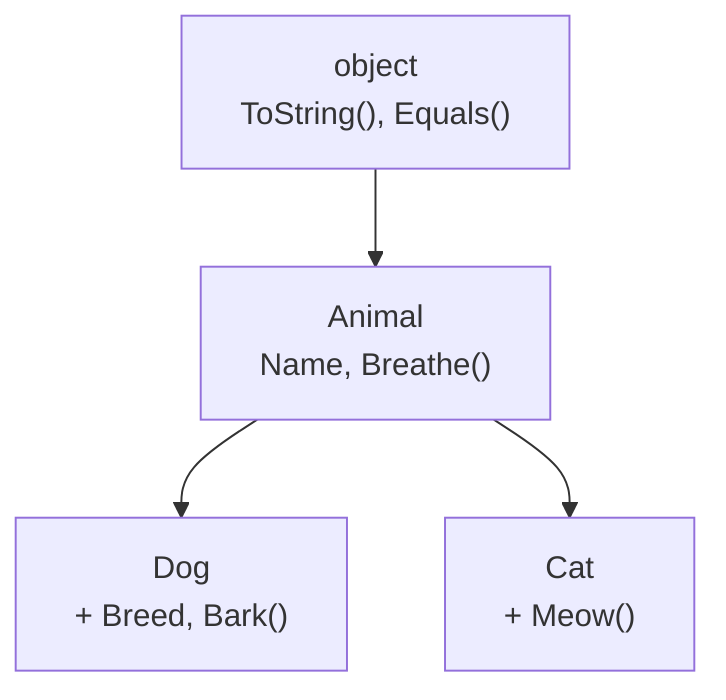

| Term | Meaning | In the example |
|---|---|---|
| **Base class** (parent, superclass) | The class being inherited from | `Animal` |
| **Derived class** (child, subclass) | The class that inherits | `Dog`, `Cat` |
| **Inherit** | Get the base class's members automatically | `Dog` gets `Name` and `Breathe()` |
| **IS-A** | The test for inheritance: "a Dog is an Animal" | ✅ Dog : Animal, ❌ Car : Engine |
| **Hierarchy** | The tree of classes | `object` → `Animal` → `Dog` |

**IS-A or HAS-A?** Use inheritance only when the IS-A sentence is true. When one thing **has** another, give it a **property** of that type instead (this is called **composition**):

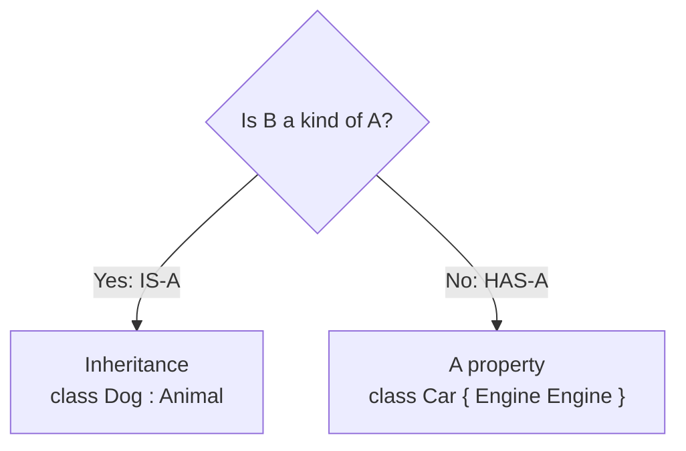

> A `Car` is not an `Engine`, so `class Car : Engine` is wrong even though it would compile. A car **has** an engine.

```csharp
public class Animal
{
    public string Name { get; set; }

    public Animal(string name)
    {
        Name = name;
    }

    public void Breathe()
    {
        Console.WriteLine($"{Name} is breathing.");
    }
}
```

### 7.2 Derived classes and base constructors

`: Animal` after the class name makes `Dog` derive from `Animal`. **`: base(...)`** after a constructor calls the **parent's constructor**:

```csharp
public class Dog : Animal
{
    public string Breed { get; set; }

    public Dog(string name, string breed)
        : base(name)   // calls Animal(string name)
    {
        Breed = breed;
    }

    public void Bark() => Console.WriteLine($"{Name} says: Woof!");
}

Dog d = new Dog("Rex", "Labrador");
d.Breathe();   // inherited — "Rex is breathing."
d.Bark();      // "Rex says: Woof!"
```

The **parent's constructor always runs first**, so the `Animal` part is ready before `Dog` adds to it:


Why the parent goes first: a `Dog` object is built in **layers**. The `Animal` part is the foundation the `Dog` part sits on, just as a house's ground floor is built before the first floor:

```mermaid
flowchart LR
    D["Dog d = ref"] --> OBJ
    subgraph OBJ["Dog object: heap"]
        direction TB
        L1["object part<br/>GetType(), ToString()"] --> L2["Animal part<br/>Name"]
        L2 --> L3["Dog part<br/>Breed"]
    end
```

It's **one** object, not three: `Name` and `Breed` sit side by side in the same object.

If the base class has **no parameterless constructor**, every derived constructor **must** call `base(...)`:

```text
public Dog() { }
error CS7036: There is no argument given that corresponds to the required parameter 'name' of 'Animal.Animal(string)'
```

`base.MethodName()` calls the parent's version of a method; it's most useful together with `override` ([§8.3](#83-calling-the-base-version)).

### 7.3 What a derived class gets

```csharp
Animal pet = d;   // ✅ a Dog IS-A Animal, so an Animal variable can hold it
pet.Breathe();    // ✅ Animal's members are available
pet.Bark();       // ❌ error CS1061: 'Animal' does not contain a definition for 'Bark' ...
```

> ⚠️ **Correction / clarification:** the deck says "all non-private members of the base class are inherited automatically". Two details matter:
>
> - **Constructors are never inherited.** That's why `Dog` needs its own constructor that calls `base(name)`.
> - **Private** members *are* part of a `Dog` object, but the `Dog` code **can't touch them**. Use `protected` for members the derived class needs ([§5.2](#52-access-modifiers)).

- C# allows **one base class only**: `class C : A, B` → `error CS1721: Class 'C' cannot have multiple base classes: 'A' and 'B'`. Session 06's **interfaces** solve this.
- Every class ultimately derives from **`object`**, which is where `ToString()`, `Equals()` and `GetType()` come from. Without an override, `d.ToString()` prints the type name: `Session05.Inheritance.Models.Dog`.

---

## 8. `virtual` & `override`

> ▶ **Run it:** `Session05.Polymorphism` in [`Demo`](Demo/Session05.Polymorphism/Program.cs) — `dotnet run --project Session05.Polymorphism`

### 8.1 Replacing a method in a derived class

Methods are **not** replaceable by default. The base class marks a method **`virtual`** to say "derived classes **may** supply their own version", and the derived class writes **`override`** to supply it:

```csharp
public class Shape
{
    public virtual double Area() => 0;
}

public class Circle : Shape
{
    public double Radius { get; set; }
    public Circle(double r) => Radius = r;
    public override double Area() => Math.PI * Radius * Radius;
}

public class Rectangle : Shape
{
    public double Width { get; set; }
    public double Height { get; set; }
    public Rectangle(double w, double h) { Width = w; Height = h; }
    public override double Area() => Width * Height;
}
```

```mermaid
flowchart TD
    SH["Shape<br/>virtual Area()"] --> CI["Circle<br/>override Area()"]
    SH --> RE["Rectangle<br/>override Area()"]
    RE --> SQ["sealed Square<br/>override Describe()"]
```

`override` on a method that isn't `virtual` is an error: `error CS0506: ... cannot override inherited member ... because it is not marked virtual, abstract, or override`.

### 8.2 Polymorphism in action

**Polymorphism** ("many forms"): the **same call** behaves differently depending on the **real type of the object**, even when the variable's type is the base class:

```csharp
Shape[] shapes =
{
    new Circle(5),
    new Rectangle(4, 6)
};

foreach (Shape s in shapes)
{
    Console.WriteLine($"Area: {s.Area():F2}");
}
// Area: 78.54   (Circle)
// Area: 24.00   (Rectangle)
```

```mermaid
flowchart LR
    CALL["s.Area()<br/>s is a Shape variable"] --> Q{"Real object?"}
    Q -->|"Circle"| C["Circle.Area()<br/>78.54"]
    Q -->|"Rectangle"| R["Rectangle.Area()<br/>24.00"]
    Q -->|"Shape"| S["Shape.Area()<br/>0.00"]
```

Every variable that holds an object has **two types**:

| | Declared type (compile time) | Actual type (run time) |
|---|---|---|
| What it is | The type written on the **left**: `Shape s` | The type of the object it points to: `new Circle(5)` |
| Decided by | The compiler, before the program runs | The program while it runs |
| Controls | **Which members you may call** (`s.Radius` doesn't compile) | **Which `override` runs** for a `virtual` method |

```mermaid
flowchart LR
    CODE["Shape s = new Circle(5)<br/>s.Area()"] --> CT{"Compile time:<br/>does Shape have Area()?"}
    CT -->|"No"| ERR["compile error<br/>CS1061"]
    CT -->|"Yes"| RT{"Run time:<br/>what is the object?"}
    RT -->|"a Circle"| RUN["Circle.Area() runs"]
```

This is **runtime polymorphism**: the decision is made **while the program runs**, by looking at the object. The loop doesn't need an `if` for every shape type, and adding a new shape doesn't change the loop.

### 8.3 Calling the base version

Inside an override, `base.Method()` runs the **parent's** implementation, so you can **add to it** instead of rewriting it:

```csharp
public class Shape
{
    public virtual double Area() => 0;
    public virtual string Describe() => $"{GetType().Name} with area {Area():F2}";
}

public sealed class Square : Rectangle
{
    public Square(double side) : base(side, side) { }

    public override string Describe() => base.Describe() + " (all sides equal)";
}

new Square(3).Describe();   // "Square with area 9.00 (all sides equal)"
```

**Which version runs?** The runtime starts at the object's **own** class and walks **up** the hierarchy until it finds an override. `Square` doesn't override `Area()`, so `Rectangle`'s version runs:

```mermaid
flowchart LR
    CALL["new Square(3).Area()"] --> SQ{"Square<br/>overrides Area?"}
    SQ -->|"No"| RE{"Rectangle<br/>overrides Area?"}
    RE -->|"Yes"| RUN["Rectangle.Area()<br/>runs: 9 ✅"]
    SQ -.->|"if Yes"| SQR["Square.Area()"]
```

### 8.4 `override` vs hiding with `new`

> ⚠️ **Correction:** the deck says the compiler "requires the `override` keyword explicitly, preventing accidental hiding". It doesn't stop you: if a derived class declares a method with the **same signature** but **without** `override`, the code **compiles** with only a **warning**, and the new method **hides** the old one:
>
> ```text
> warning CS0108: 'B.Area()' hides inherited member 'A.Area()'. Use the new keyword if hiding was intended.
> ```
>
> A hidden method is **not** polymorphic: through a base-class variable, the **base** version runs.

```csharp
public class Speaker
{
    public virtual string Speak() => "Speaker: hello";
    public string Greet() => "Speaker: hi";            // not virtual
}

public class Robot : Speaker
{
    public override string Speak() => "Robot: beep";   // replaces
    public new string Greet() => "Robot: hi";          // hides (no warning with 'new')
}

Speaker s = new Robot();
s.Speak();   // "Robot: beep"   ← override: the OBJECT decides
s.Greet();   // "Speaker: hi"   ← new: the VARIABLE type decides
```

```mermaid
flowchart LR
    subgraph OV["override"]
        direction TB
        O1["Speaker s = new Robot()"] --> O2["s.Speak()"] --> O3["Robot: beep<br/>object decides"]
    end
    subgraph NW["new (hiding)"]
        direction TB
        N1["Speaker s = new Robot()"] --> N2["s.Greet()"] --> N3["Speaker: hi<br/>variable decides"]
    end
    OV ~~~ NW
```

> Treat warning **CS0108** as a bug: you almost always meant `virtual` + `override`.

### 8.5 `sealed` and `ToString()`

`sealed` on a **class** stops anyone from inheriting it. `sealed override` on a **method** stops further overriding below that class.

```csharp
public sealed class ImmutablePoint
{
    public int X { get; }
    public int Y { get; }

    public ImmutablePoint(int x, int y)
    {
        X = x;
        Y = y;
    }
}

public class Special : ImmutablePoint { }
// error CS0509: 'Special': cannot derive from sealed type 'ImmutablePoint'
```

```text
public sealed override void M() { }   in B, then   public override void M() { }   in C : B
error CS0239: 'C.M()': cannot override inherited member 'B.M()' because it is sealed
```

- Use `sealed` when a class isn't designed to be extended. `string` is sealed.
- The deck also lists `DateTime`: it's a **struct**, and structs can never be inherited from at all.

**Override `ToString()`** (a `virtual` method from `object`) to give your objects a readable text form. It's used by `Console.WriteLine(obj)`, string interpolation and the debugger:

```csharp
public override string ToString() => $"Square({Width})";

Console.WriteLine(new Square(3));   // Square(3)
Console.WriteLine(new Circle(1));   // Session05.Polymorphism.Models.Circle  (no override)
```

---

## 9. Debugging Objects

Objects hold many values, so the debugger is the fastest way to see what's inside them.

| Action | Visual Studio 2026 | VS Code |
|---|---|---|
| Look inside an object | Hover over the variable → expand **▶** in the DataTip; or the **Locals** window | Hover; or the **Variables** panel → expand |
| See private fields from outside the class | Expand **Non-Public members** | Expand **Non-Public members** |
| Nicer one-line display | Override `ToString()` ([§8.5](#85-sealed-and-tostring)): it's shown in the **Value** column | Same: shown in the Variables panel |
| Same object or a copy? | Right-click → **Make Object ID** (`$1`), then check other variables | **Watch**: `object.ReferenceEquals(car1, sameCar)` |
| Follow a constructor chain | **F11** on `new Dog(...)` stops on `: base(name)`; **F11** again enters `Animal(...)`, which finishes before `Dog`'s body | **F11**, same |
| Which override runs? | **F11** on `s.Area()` lands in the real object's method | **F11**, same |

> **Try it:** in `Session05.Polymorphism`, set a breakpoint on `Console.WriteLine($"Area: ...` inside the loop, press **F5**, then **F11** on each round: you land in `Circle.Area()`, then `Rectangle.Area()`, then `Rectangle.Area()` again for the `Square` (it inherits it), and finally `Shape.Area()`.

Docs: [View data in DataTips](https://learn.microsoft.com/visualstudio/debugger/view-data-values-in-data-tips-in-the-code-editor) · [Debugging C# in VS Code](https://code.visualstudio.com/docs/csharp/debugging)

---

## 10. Common Mistakes

> ▶ **Run it:** `Session05.CommonMistakes` in [`Demo`](Demo/Session05.CommonMistakes/Program.cs) — `dotnet run --project Session05.CommonMistakes`

| Mistake | What goes wrong | Do this instead |
|---|---|---|
| Public fields with no checks | Any code can set `Price = -50` | `private` field + property with validation |
| `public string Name;` with no value | Warning CS8618; `null` at runtime | `= ""`, a constructor, `required`, or `string?` |
| `b = a` to "copy" an object | Both variables point to the **same** object | Create a new object (`new`) |
| `new Person()` after writing `Person(string name)` | CS7036 / CS1729: the free constructor is gone | Pass the arguments, or add a parameterless constructor |
| Storing a value that can be computed | It goes stale when other properties change | A computed property: `public double Area => Width * Height;` |
| `public static` field for a setting | Anyone can change it for the whole program | `const`, or a private static field with a get-only property |
| Using `Name` inside a `static` method | CS0120 | Make it an instance method, or pass the object in |
| `u1.TotalCreated` | CS0176 | `User.TotalCreated` |
| Derived constructor without `base(...)` | CS7036 when the base needs arguments | `public Dog(string name) : base(name)` |
| Same method in the child without `override` | Warning CS0108; the base version runs through a base variable | `virtual` in the base, `override` in the child |
| `override` on a non-virtual method | CS0506 | Mark the base method `virtual` |
| `class C : A, B` | CS1721: only one base class | One base class; interfaces (Session 06) for more |

---

## 11. Summary

- A **class** is a blueprint; each **object** made with `new` has its own data and lives on the heap.
- **Constructors** run on `new` and make the object valid from the start. Writing one removes the free parameterless one.
- `: this(...)` chains constructors; **`this`** is the current object.
- **Encapsulation:** `private` fields, `public` **properties** and methods.
- `{ get; set; }`, `{ get; private set; }`, `{ get; init; }`, full properties with validation, and computed `=>` properties each have their job. 🆕 C# 14's `field` keyword removes the manual backing field.
- **Static** members belong to the class: one shared copy, used through the class name, no `this`.
- **Inheritance** (`: Base`) models IS-A. The parent constructor runs first; call it with `: base(...)`. Constructors aren't inherited.
- **`virtual` + `override`** = polymorphism: the real object decides which method runs. Without `override` you get **hiding** (warning CS0108).
- **`sealed`** stops inheritance; override **`ToString()`** for readable objects.

---

## 12. Lab: WorkItem Hierarchy

> ▶ **Starter code:** [`Lab/Session05.Lab`](Lab/Session05.Lab/Program.cs) — empty `WorkItem`, `TaskItem` and `BugReport` classes in `Models/` with TODOs. Run it with `dotnet run --project Session05.Lab` from the `Lab` folder.

This is the **in-session lab** (10 minutes on the agenda). It's the first model of the Task Manager's data.

**Acceptance criteria:**

- [ ] Create a base class `WorkItem` with properties `Id` (`int`), `Title` (`string`), `CreatedAt` (`DateTime`), and a `virtual string Summarize()` method.
- [ ] Derive `TaskItem : WorkItem` — add `IsCompleted` (`bool`) and `DueDate` (`DateTime?`). Override `Summarize()` to include the completion status.
- [ ] Derive `BugReport : WorkItem` — add `Severity` (`string`). Override `Summarize()` to include the severity level.
- [ ] Instantiate both types, store them in a `WorkItem[]`, and loop over the array printing each summary.

```mermaid
flowchart TD
    W["WorkItem<br/>Id, Title, CreatedAt<br/>virtual Summarize()"] --> T["TaskItem<br/>+ IsCompleted, DueDate<br/>override Summarize()"]
    W --> B["BugReport<br/>+ Severity<br/>override Summarize()"]
```

### Hints

| Requirement | Hint |
|---|---|
| `Title` warning CS8618 | Give it `= ""`, or set it in a constructor ([§3.2](#32-class-anatomy)). |
| Base `Summarize()` | Return the shared part, e.g. Id, Title and `CreatedAt:yyyy-MM-dd`. |
| Overrides | Start from `base.Summarize()` and add the extra detail ([§8.3](#83-calling-the-base-version)). |
| `DueDate` may be missing | It's a `DateTime?`: use `?.` and `??` from [Session 04 §5](../Session04/dotnet-backend-session-04-notes.md#5-null--nullable-types). |
| The loop | `foreach (WorkItem item in items)`: each object's own override runs ([§8.2](#82-polymorphism-in-action)). |

> **Keep it:** next session refactors `WorkItem` into an **abstract class**.

---

## 13. Assignment: BankAccount Hierarchy

> ▶ **Starter code:** [`Lab/Session05.Assignment`](Lab/Session05.Assignment/Program.cs) — empty `BankAccount` and `SavingsAccount` classes in `Models/` with TODOs. Run it with `dotnet run --project Session05.Assignment` from the `Lab` folder.

Build a `BankAccount` class hierarchy that exercises encapsulation, properties, inheritance, and method overriding.

**Acceptance criteria:**

- [ ] Create `BankAccount` with a `private decimal _balance` field, a **read-only** `Balance` property, an `Owner` string, and `Deposit` / `Withdraw` methods that **validate their arguments**.
- [ ] Add a `virtual string GetAccountType()` method that returns `"Standard"`.
- [ ] Derive `SavingsAccount : BankAccount` — add `InterestRate` (`decimal`) and `ApplyInterest()`; override `GetAccountType()` to return `"Savings"`.
- [ ] Store a `BankAccount` and a `SavingsAccount` in a `BankAccount[]` and print `GetAccountType()` and `Balance` for each.
- [ ] Attempting to set `Balance` directly from outside the class should **not compile** — demonstrate this in a comment.

**Bonus:** derive `PremiumSavingsAccount : SavingsAccount` that **doubles the interest rate** on each `ApplyInterest()` call and overrides `GetAccountType()` to return `"Premium Savings"`.

> ℹ️ The bonus can be read two ways: "apply **twice** the interest rate each time" or "the rate itself **doubles** after every call (5%, 10%, 20%...)". Check with the instructor which one is meant.

```mermaid
flowchart TD
    BA["BankAccount<br/>private _balance, Balance, Owner<br/>Deposit(), Withdraw()<br/>virtual GetAccountType()"] --> SA["SavingsAccount<br/>+ InterestRate, ApplyInterest()<br/>override GetAccountType()"]
    SA -.->|"bonus"| PS["PremiumSavingsAccount<br/>doubles the rate<br/>override GetAccountType()"]
```

```mermaid
flowchart LR
    C["Create accounts<br/>Deposit, ApplyInterest"] --> A["BankAccount[]"]
    A --> L["foreach account"]
    L --> P["print GetAccountType()<br/>and Balance"]
```

### Hints

| Requirement | Hint |
|---|---|
| Read-only `Balance` | `public decimal Balance => _balance;` — a get-only property over the private field. |
| "Should not compile" | Write the line `account.Balance = 1_000_000m;`, build, copy the real error (it's `CS0200`) into a comment, then comment the line out. |
| Validation | `amount` must be greater than 0: `ArgumentOutOfRangeException.ThrowIfNegativeOrZero(amount)`. Withdrawing more than the balance: throw `InvalidOperationException`, or reuse the custom exception idea from [Session 04 §6.6](../Session04/dotnet-backend-session-04-notes.md#66-custom-exception-types). |
| `ApplyInterest()` | `_balance` is `private` to `BankAccount`, so `SavingsAccount` can't write it. Call `Deposit(Balance * InterestRate)`, or add a `protected` method in the base class. |
| Owner warning CS8618 | Take the owner in a constructor; then `SavingsAccount` needs `: base(owner)` ([§7.2](#72-derived-classes-and-base-constructors)). |
| Bonus | `ApplyInterest()` must be `virtual` in `SavingsAccount` so `PremiumSavingsAccount` can `override` it. |

### Starter skeleton

```csharp
// Models/BankAccount.cs
public class BankAccount
{
    private decimal _balance;

    // TODO: read-only Balance, Owner, constructor
    // TODO: Deposit / Withdraw with validation
    // TODO: public virtual string GetAccountType() => "Standard";
}

// Models/SavingsAccount.cs
public class SavingsAccount : BankAccount
{
    // TODO: InterestRate, ApplyInterest(), override GetAccountType()
}

// Program.cs
// TODO: BankAccount[] accounts = { ... };
// TODO: foreach → print GetAccountType() and Balance
// account.Balance = 1_000_000m;   // error CS0200: ...
```

**How to run it:**

- **Visual Studio 2026:** open `Lab\Session05.Lab.slnx`, right-click `Session05.Assignment` → **Set as Startup Project** → `Ctrl+F5`.
- **VS Code:** `dotnet run --project Session05.Assignment` from the `Lab` folder.
- **Single file:** `dotnet run bank.cs` works too; put the classes **after** the top-level code.

---

## 14. Before Next Session

**Next: Session 06, OOP II: Polymorphism, Abstraction & Interfaces**

- Abstract classes and abstract methods.
- Interfaces and implementing several interfaces.
- Casting with `is` and `as`.
- Polymorphism patterns used throughout the .NET standard library.

**To do:**

- [ ] Finish the WorkItem lab ([§12](#12-lab-workitem-hierarchy)): it will be refactored into an abstract class next session.
- [ ] Do the BankAccount assignment ([§13](#13-assignment-bankaccount-hierarchy)): it's good preparation.
- [ ] Step through `Session05.Polymorphism` with **F11** ([§9](#9-debugging-objects)).

**Think about:**

1. What does this print?
   ```csharp
   Car a = new Car { Brand = "A" };
   Car b = a;
   b.Brand = "B";
   Console.WriteLine(a.Brand);
   ```
2. `Person` has only `public Person(string name)`. Why doesn't `new Person()` compile?
3. What's the difference between `{ get; private set; }` and `{ get; init; }`?
4. `Shape s = new Circle(5);` Which `Area()` runs for `s.Area()`? What if `Circle` declared `Area()` **without** `override`?
5. Why can't a `static` method read an instance property like `Name`?

<details>
<summary>Answers</summary>

1. `B`. `b = a` copies the **reference**, so both variables point to the same `Car`.
2. C# only adds the free parameterless constructor when the class has **no** constructor. With `Person(string name)` written, you must pass a name (error CS7036).
3. `private set`: the class can change it **any time**. `init`: **anyone** can set it, but **only while creating** the object; after that, nobody can.
4. `Circle.Area()` (78.54): `override` + a virtual base method means the object decides. Without `override`, `Circle.Area()` only **hides** the base method (warning CS0108) and `s.Area()` runs `Shape.Area()` → `0`.
5. A static method belongs to the class, not to an object, so there's no `this` and no "current" object whose `Name` it could read (error CS0120).

</details>

---

## 15. Links

**Classes and objects**

| Topic | Link |
|---|---|
| Classes | <https://learn.microsoft.com/dotnet/csharp/fundamentals/types/classes> |
| Objects (instances) | <https://learn.microsoft.com/dotnet/csharp/fundamentals/object-oriented/objects> |
| Constructors | <https://learn.microsoft.com/dotnet/csharp/programming-guide/classes-and-structs/constructors> |
| Primary constructors | <https://learn.microsoft.com/dotnet/csharp/whats-new/tutorials/primary-constructors> |
| `this` keyword | <https://learn.microsoft.com/dotnet/csharp/language-reference/keywords/this> |
| Object initializers | <https://learn.microsoft.com/dotnet/csharp/programming-guide/classes-and-structs/object-and-collection-initializers> |
| `required` modifier | <https://learn.microsoft.com/dotnet/csharp/language-reference/keywords/required> |

**Encapsulation**

| Topic | Link |
|---|---|
| Access modifiers | <https://learn.microsoft.com/dotnet/csharp/programming-guide/classes-and-structs/access-modifiers> |
| Accessibility levels (who can see what) | <https://learn.microsoft.com/dotnet/csharp/language-reference/keywords/accessibility-levels> |
| Properties | <https://learn.microsoft.com/dotnet/csharp/programming-guide/classes-and-structs/properties> |
| `init` accessor | <https://learn.microsoft.com/dotnet/csharp/language-reference/keywords/init> |
| `field` keyword (C# 14) | <https://learn.microsoft.com/dotnet/csharp/language-reference/keywords/field> |
| Static classes and members | <https://learn.microsoft.com/dotnet/csharp/programming-guide/classes-and-structs/static-classes-and-static-class-members> |
| `const` | <https://learn.microsoft.com/dotnet/csharp/language-reference/keywords/const> |

**Inheritance and polymorphism**

| Topic | Link |
|---|---|
| Inheritance | <https://learn.microsoft.com/dotnet/csharp/fundamentals/object-oriented/inheritance> |
| `base` keyword | <https://learn.microsoft.com/dotnet/csharp/language-reference/keywords/base> |
| Polymorphism | <https://learn.microsoft.com/dotnet/csharp/fundamentals/object-oriented/polymorphism> |
| `virtual` | <https://learn.microsoft.com/dotnet/csharp/language-reference/keywords/virtual> |
| `override` | <https://learn.microsoft.com/dotnet/csharp/language-reference/keywords/override> |
| `new` modifier (hiding) | <https://learn.microsoft.com/dotnet/csharp/language-reference/keywords/new-modifier> |
| When to use `override` and `new` | <https://learn.microsoft.com/dotnet/csharp/programming-guide/classes-and-structs/knowing-when-to-use-override-and-new-keywords> |
| `sealed` | <https://learn.microsoft.com/dotnet/csharp/language-reference/keywords/sealed> |

**Debugging**

| Topic | Link |
|---|---|
| View data in DataTips (VS) | <https://learn.microsoft.com/visualstudio/debugger/view-data-values-in-data-tips-in-the-code-editor> |
| Watch and QuickWatch, Object IDs (VS) | <https://learn.microsoft.com/visualstudio/debugger/watch-and-quickwatch-windows> |
| Debugging C# in VS Code | <https://code.visualstudio.com/docs/csharp/debugging> |
